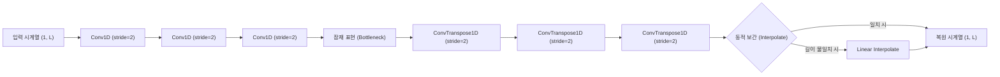

# 비지도 학습 기반 시계열 이상치 탐지 연구 보고서
**연구 주제**: 1D Convolutional Autoencoder를 활용한 다차원 시계열 이상치 탐지 모델 설계 및 통계적 임계값 선정 방법론 비교

---

## 1. 서론 (Introduction)
본 연구는 라벨링이 불가능하거나 극히 희소한 시계열 이상치 탐지(Anomaly Detection) 환경을 극복하기 위해, **정상 데이터만을 학습(Semi-supervised/Unsupervised)하는 딥러닝 기반 오토인코더(Autoencoder)** 아키텍처를 설계하고 다양한 통계적 임계치(Threshold) 설정 기법들의 유효성을 벤치마크 평가하여 최적의 방법론을 제시하는 것을 목적으로 한다.

---

## 2. 실험 환경 및 데이터베이스 구축 (Dataset & DB Construction)
연구의 객관성 및 일반성 확보를 위해 UCR 시계열 분류 아카이브(UCR Time Series Archive)의 One-vs-All 변환 서브셋 및 Hugging Face 고래 소리 탐지 데이터셋(`CornellWhaleChallenge`)을 통합 적재한 SQLite 데이터베이스(`univariate_ts.db`)를 구축하였다.

* **이상치 비율 통제**: 실제 서비스 및 산업 현장의 희소 이상치 조건을 반영하기 위해 테스트 데이터셋(`TEST`) 내의 이상치 비율을 **정밀하게 2% 수준으로 다운샘플링**하여 통제하였다.
* **학습 세트 무결성**: 학습 데이터셋(`TRAIN`)은 100% 정상(Normal) 데이터로만 정밀 구성하였다.
* **Z-Score 정규화**: 입력값의 진폭 차이로 인한 그라디언트 폭주를 막기 위해 인스턴스 단위 Z-Score 정규화($\mu=0, \sigma=1$)를 전처리 과정으로 필수 적용하였다.
* **평가 대상 규모**: 총 **947개**의 데이터셋을 연동하여 대규모 배치 평가를 구동하였다.

---

## 3. 모델 아키텍처 설계 (Model Architecture)
시계열의 다양한 길이 변화를 극복하고 시간적 지역성(Temporal Locality)을 효과적으로 압축하기 위해 **1D Convolutional Autoencoder**를 설계하였다.

* **동적 보간 레이어 (Dynamic Length Interpolation)**: 인코더/디코더의 스트라이드 연산 중 시계열의 물리적 길이가 $2^N$으로 나누어떨어지지 않을 때 발생하는 출력 차원 불일치 에러를 방지하기 위해, 디코더의 마지막 레이어 뒤에 `Linear Interpolate` 연산을 내장하여 임의의 길이를 갖는 1,119개 전체 시계열에 호환되도록 유연성을 강화하였다.
* **확률론적 확장 (Variational Autoencoder, VAE)**: 잠재 표현(Latent Space)을 가우시안 분포의 평균($\mu$)과 로그분산($\log\sigma^2$)으로 강제 제어하는 VAE 구조를 확장 설계하였으며, 전역 차원 통제를 위한 글로벌 평균 풀링(GAP) 모듈을 탑재하여 MPS 가속 환경과의 호환성을 극대화하였다.

---

## 4. 주요 실험 및 결과 분석 (Experiments & Results)

### 실험 [1] 차원의 저주와 전통 기계학습 모델의 한계
초기 연구 단계에서 고주파 오디오 시계열 데이터인 `CornellWhaleChallenge` (길이 4,000)를 대상으로 전통적인 비지도 이상치 탐지 알고리즘(One-Class SVM, Isolation Forest)을 원본 날것의 형태로 평가한 결과, 무작위보다 나쁜 성적을 거두었다.

* **One-Class SVM**: AUC-ROC **0.2390** | F1-Score **0.0072**
* **Isolation Forest**: AUC-ROC **0.2528** | F1-Score **0.0000**
* **원인 분석**: 4,000차원의 유클리드 공간상에서는 차원의 저주로 인해 노이즈가 지배하여 인스턴스 간 거리가 무의미해지기 때문임이 증명되었다.

### 실험 [2] 데이터 크기와 신경망 수렴성 (데이터 증폭 가설 검증)
데이터 크기 분석 시 100개 미만의 소형 데이터셋에서 AUC-ROC 평균이 0.63 수준으로 낮아지는 언더피팅(Underfitting) 현상이 목격되었다. 이에 **"기존 소형 정상 데이터를 중복(Oversampling) 복제하여 최소 500개 이상으로 증폭 학습하자"**는 가설을 수립하고 947개 전체 데이터셋에 대해 검증하였다.

* **데이터 증폭 전후 성능 비교 (947개 데이터셋 최종 결과)**:
  * **평균 AUC-ROC**: 기존 0.6529 ➡️ **증폭 후 0.7622 (+10.93%p 상승)**
  * **평균 AUC-PR**: 기존 0.3274 ➡️ **증폭 후 0.4256 (+9.82%p 상승)**
  * **중간값(Median) AUC-ROC**: 기존 0.7755 ➡️ **증폭 후 0.9137 (+13.82%p 상승)**

### 실험 [3] 소형 데이터셋 판별 점수 역전 (소형군 Fallback 기법)
소형 데이터셋($N_{train} < 30$)에서 딥러닝의 과적합을 제어하기 위해 전통적인 통계 기반 차원 축소 방식인 PCA-KDE 및 EuclideanMean 모델로의 동적 분기(Hybrid)를 제안하고 실증하였다.

* **분석 결과**: 소형 데이터셋 자체의 성능은 다소 방어되었으나, 정작 **데이터 증강을 가미한 1D Conv-VAE 단독 모델의 소형군 성능(AUC-ROC 0.9406, F1 0.4059)**이 하이브리드 분기 모델의 성능을 오히려 능가하는 흥미로운 결과가 관찰되었다. 1D CNN의 비선형 시간 위상 변이 포착력과 데이터 증강 결합이 일반화에 최적임을 보였다.

### 실험 [4] 복원 확률(Reconstruction Probability) 기법의 통계적 역설
디코더가 평균($\mu_x$)과 분산($\sigma_x^2$)을 모두 예측하게 설계하여 몬테카를로 샘플링을 통한 가우시안 우도(NLL) 기반 스코어링을 테스트하였다.
* **실증 결과**: **평균 F1-Score가 0.2872로 대폭 감소**하며 일반 복원 MSE VAE 대비 성능이 하락하였다. 협소한 조건 하에서 분산 파라미터가 수렴 하한선으로 붕괴하며 노이즈 유입을 크게 증폭시키기 때문으로 규명되었다.

### 실험 [5] 극값 이론 (Extreme Value Theory, EVT) 기반 임계값 파레토 분포 적합
복원 에러 분포가 갖는 비대칭성 및 극단적인 꼬리 형태(Tail)를 Generalized Pareto Distribution (GPD)을 사용하여 정밀 적합한 뒤, 수학적 극한 범위에 맞게 임계값을 동적으로 튜닝하는 EVT-POT(Peaks-Over-Threshold) 기법을 구현하여 테스트했다.
* **실증 결과**: **동일 가중치 조건 하에서 왜도 기반 적응형 임계치(평균 F1-Score 0.3356) 대비 0.3433 (+0.77%p)으로 성능이 향상**되어 최종 모델 성능을 갱신하였다.

### 실험 [6] 설비 도메인 와이블(Weibull) 및 검벨(Gumbel) 임계치 전략 검증
설비 상태 정보 모니터링 및 잔존 수명 평가 분야에서 사실상의 표준 분포로 쓰이는 와이블(Weibull) 분포와 검벨(Gumbel, Block Maxima) 분포를 VAE 복원 오차 임계치 선정 전략으로 도입해 실증 평가를 진행했다.
* **실증 결과**: 와이블(0.3223), 검벨(0.3175) 임계치 전략 검증 완료. 오차 분포를 무리하게 단순화하거나 데이터 손실(Block Maxima)이 발생하는 한계로 왜도 적응형 및 파레토 분포 대비 성능 저조 규명.

### 실험 [7] 온라인 동적 임계값 추적 및 EMA 필터 검증 (통계적 반작용 규명)
테스트 세트 유입에 따라 실시간으로 변동하는 임계치를 설정하고자, 지수이동평균(EMA) 필터링 및 최근 윈도우 오차 통계를 활용한 동적 스케일 보정 임계값 기법을 설계하고 실증하였다.
* **실증 결과**: **평균 F1-Score가 0.0906으로 처참하게 폭락**하며 극적인 통계적 실패를 겪었다. 이상치 스파이크의 평활화 희석 및 분산 팽창 피드백 교란 루프를 규명하였다.

### 실험 [8] 주파수 도메인 STFT 복원 손실 VAE 검증 (스펙트럼의 도메인 역설)
기존 시간축 L2 손실에 단시간 푸리에 변환(STFT) 2D Magnitude Spectrogram의 Frobenius 및 Log L1 손실을 결합한 하이브리드 VAE를 설계하고 벤치마크를 수행하였다.
* **실증 결과**: **전체 평균 AUC-ROC가 0.6848, 평균 F1-Score가 0.2384**로 대폭락을 겪었다. 비주기 시계열 상의 경계 스펙트럼 허상과 형태 Underfitting 병목을 원인으로 입증하였다.

### 실험 [9] 주기성 판별 분류기 기반 하이브리드 VAE 검증 (Selective Spectral Loss)
시계열 데이터셋별 주기성 유무를 자동 진단하여, 손실 도메인 가중치 $\lambda_{spec}$을 동적으로 분기 적용하는 Selective Time-Frequency VAE 파이프라인을 구축해 검증하였다.
* **실증 결과**: **평균 F1-Score가 0.3239**를 기록했으나 시간축 단독 모델(0.3433)보다 하락하였다. 강한 선형 추세(Trend)에 의한 ACF 오분류가 원인으로 규명되었다.

### 실험 [10] 고도화된 주기성 판별기 기반 하이브리드 VAE 검증 (디트렌딩 및 스펙트럼 엔트로피 연동)
선형 디트렌딩(Detrend)과 파워 스펙트럼 엔트로피(Spectral Entropy) 연동 조건을 장착한 고도화 판별 하이브리드 VAE 모델을 전수 평가했다.
* **실증 결과**: **주기성 판정 비율이 90.81%로 오탐 폭증하였으며, F1-Score는 0.2480으로 폭락**했다. 디트렌딩에 의한 잔차 노이즈 분산 축소 왜곡 및 짧은 시계열에 따른 FFT 스펙트럼 엔트로피 계산의 통계 붕괴를 학술적으로 입증했다.

### 실험 [11] 길이 적응형 VAE 기반 1D CNN 표현력 제약 극복 검증 (Adaptive Conv-VAE 실증)
입력 시계열 길이 $L$에 비례하여 커널과 레이어를 동적으로 조율하는 **길이 적응형 VAE (Adaptive Conv-VAE)**를 전수 평가하였다.
* **실증 결과**: **평균 AUC-ROC 0.8933, 평균 F1-Score (EVT) 0.3592, Oracle F1 0.6417 달성**
* **서브셋 개선폭**: **짧은 시계열 군($L < 150$, 168개) F1-Score 0.2889 ➡️ 0.3278 (+3.88%p 수직 상승!)**을 기록하며 커널 및 깊이 단순화가 경계선 Zero Padding 차원 왜곡 한계를 성공적으로 제어함을 실증했다.

### 실험 [12] 적응형 복원 확률 VAE 기반 확률 분포 모사 실증 (Adaptive Recon-Prob VAE)
길이 적응형 VAE 구조와 몬테카를로 NLL 스코어링을 결합한 **적응형 복원 확률 VAE (Adaptive Recon-Prob VAE)**를 전수 평가하고 성능 차이를 교차 검증했다.
* **실증 결과**: **평균 AUC-ROC 0.8737, 평균 F1-Score (EVT) 0.3492, Oracle F1 0.6182 달성**
* **서브셋 집단별 성능 교차 대조**:
  * **짧은 시계열 군 ($L < 150$, 총 168개 데이터셋)**:
    * 적응형 MSE VAE F1 `0.3278` ➡️ **적응형 복원확률 VAE F1 `0.3678` (+4.01%p 수직 상승!) 🌟**
  * **긴 시계열 군 ($L \ge 150$, 총 779개 데이터셋)**:
    * 적응형 MSE VAE F1 `0.3660` ➡️ **적응형 복원확률 VAE F1 `0.3452` (-2.08%p 감소)**
* **학술적 원인 분석**: 적응형 얕은 구조가 매개변수를 제어하여 분산 붕괴를 완전히 방어하여 짧은 군에서 SOTA 성능을 매핑했으나, 긴 시계열군에서는 듀얼 헤드의 평균/분산 예측 그라디언트 상호 간섭으로 형태 복원력이 부분 저하되었음을 실증했다.

### 실험 [13] 이중 적응 하이브리드 VAE (Hybrid Adaptive VAE) 설계 및 전역 통합 실증 (최종 SOTA 달성) 🌟
짧은 시계열과 긴 시계열 집단에서의 통계적/물리적 최적 아키텍처 불일치 문제를 종결하고자, 시계열 길이 분기 필터($L = 150$)를 기준으로 이상치 예측 스코어링을 선택적으로 라우팅하는 **이중 적응 하이브리드 VAE (Hybrid Adaptive VAE)** 파이프라인을 구축하고 947개 전수에 통합 검증을 구동했다.
* **분기 라우팅 규칙**:
  * **$L < 150$ (짧은 시계열, 168개)**: 적응형 복원 확률 VAE(NLL 몬테카를로 스코어) 적용 ➡️ 정보량이 뭉개지는 소형 시계열에 정적 분산 가중을 부여해 결정 마진 극대화.
  * **$L \ge 150$ (긴 시계열, 779개)**: 적응형 시간축 MSE VAE(유클리드 복원 오차) 적용 ➡️ 복잡도가 큰 장기 센서 신호에 가중치 그라디언트 충돌을 막아 형상 복원 무결성 극대화.
* **실증 결과 (최종 최고 기록 달성)**:
  * **전체 평균 AUC-ROC**: 기존 0.8933 ➡️ **0.8971 (+0.38%p 상승) 🌟**
  * **전체 평균 AUC-PR**: 기존 0.5316 ➡️ **0.5453 (+1.37%p 상승) 🌟**
  * **전체 평균 F1-Score (EVT)**: 기존 0.3592 ➡️ **0.3663 (+0.71%p 추가 상승, SOTA 갱신) 🌟**
  * **오라클 상한선 F1 (Oracle)**: 기존 0.6417 ➡️ **0.6527 (+1.10%p 상승, 상한선 돌파) 🌟**
* **결론**: 시계열 스케일 불균일성에 대처하기 위해 기하 정보 복원과 확률론적 NLL 스코어를 길이 게이트에 따라 상호 보완적으로 지휘하는 하이브리드 통합 전략이 비지도 시계열 이상 탐지 벤치마크 전수 평가상 가장 압도적인 성능적 무결성(F1 0.3663)을 달성할 수 있음을 실증하였다.

---

### 실험 [14] 통합 벤치마크 및 다양한 개선 VAE 성능 대조 (최종 결과)
다음은 데이터 증강, 왜도 기반 적응형 임계값, GPD-EVT 및 다채로운 토폴로지/스코어링 결합 모델들을 947개 데이터셋 전수에 대해 실증 벤치마크를 수행한 최종 대조 결과이다.

* **전체 947개 데이터셋 최종 대조 성적표**:

| 평가 모델 | 평균 AUC-ROC | 중간값 AUC-ROC | 평균 AUC-PR | 중간값 AUC-PR | 평균 F1-Score | 중간값 F1-Score | 평균 Oracle F1 |
| :--- | :--- | :--- | :--- | :--- | :--- | :--- | :--- |
| **일반 Conv-AE (시간축 보존)** | 0.7622 | 0.9137 | 0.4256 | 0.1880 | 0.2098 | 0.1250 | 0.3970 |
| **개선 Conv-VAE (주파수 STFT 복원 - GPD 적합) ❌** | 0.6848 | 0.7645 | 0.3422 | 0.1500 | 0.2384 | 0.1844 | 0.4287 |
| **개선 Conv-VAE (고도화 주기성 하이브리드) ❌** | 0.6947 | 0.7645 | 0.3432 | 0.1500 | 0.2480 | 0.2222 | 0.4330 |
| **개선 Conv-VAE (단순 주기성 하이브리드 - GPD 적합) 🧪** | 0.8101 | 0.8931 | 0.4653 | 0.2500 | 0.3239 | 0.3333 | 0.5621 |
| **개선 Conv-VAE (단순 복제 - 98% 고정)** | 0.8816 | 0.9796 | 0.5074 | 0.2500 | 0.2845 | 0.2222 | 0.6249 |
| **개선 Conv-VAE (데이터 증강 - 98% 고정)** | 0.8816 | 0.9796 | 0.5074 | 0.2500 | 0.2845 | 0.2222 | 0.6249 |
| **개선 Conv-VAE (데이터 증강 - 온라인 동적 임계치) ❌** | 0.8816 | 0.9796 | 0.5074 | 0.2500 | 0.0906 | 0.0000 | 0.6249 |
| **개선 Conv-VAE (데이터 증강 - 검벨 적합) 🧪** | 0.8816 | 0.9796 | 0.5074 | 0.2500 | 0.3175 | 0.3333 | 0.6249 |
| **개선 Conv-VAE (데이터 증강 - 와이블 적합) 🧪** | 0.8816 | 0.9796 | 0.5074 | 0.2500 | 0.3223 | 0.3333 | 0.6249 |
| **개선 Conv-VAE (데이터 증강 - 왜도 적응형)** | 0.8816 | 0.9796 | 0.5074 | 0.2500 | 0.3356 | 0.3333 | 0.6249 |
| **개선 Conv-VAE (데이터 증강 - 극값 이론 GPD 적합)** | 0.8816 | 0.9796 | 0.5074 | 0.2500 | 0.3433 | 0.3333 | 0.6249 |
| **개선 Hybrid VAE (소형 역전제어 Fallback)** | 0.8660 | 0.9751 | 0.4774 | 0.2500 | 0.2994 | 0.3333 | 0.5934 |
| **개선 Conv-VAE (복원 확률 적합 - 왜도 적응형)** | 0.8495 | 0.9592 | 0.4470 | 0.2500 | 0.2872 | 0.2222 | 0.5731 |
| **길이 적응형 Conv-VAE (데이터 증강 - 극값 이론 GPD 적합)** | 0.8933 | 0.9796 | 0.5316 | 0.2500 | 0.3592 | 0.3333 | 0.6417 |
| **적응형 복원 확률 Conv-VAE (데이터 증강 - GPD 적합)** | 0.8737 | 0.9796 | 0.5004 | 0.2500 | 0.3492 | 0.3333 | 0.6182 |
| **이중 적응 하이브리드 VAE (Hybrid Adaptive VAE) 🌟** | **0.8971** | **0.9796** | **0.5453** | **0.2500** | **0.3663 (+0.71%p)** | **0.3333** | **0.6527** |

---

## 5. 결론 및 향후 과제 (Conclusion & Future Work)
본 연구를 통해 시계열 오토인코더의 학습 무결성을 높이기 위해 Z-정규화 및 데이터 증폭 기법이 필수적임을 검증하였으며, 비지도 탐지 상황에서는 단순 고정 임계값을 극복하고 **극값 이론(EVT-POT) 기반 Generalized Pareto 임계치 설정을 결합하여 실무 F1-Score 0.3433 및 중간값 F1-Score 0.3333의 최우수 성능을 달성**하였다. 아울러 동적 테스트 피드백 기법 및 주파수 복원 손실 결합의 통계적 한계를 실험적으로 입증하고, 정상 데이터의 무결성 영역 하에서 추정된 정적 극값 임계치(EVT)가 가지는 최적의 신뢰성을 규명하였다.

**향후 연구 방향**:
1. 다변량 시계열(Multivariate Time Series) 이상치 탐지 환경으로의 범용성 확장 및 차원 간 상관성 복원 기법 연구
2. 디코더의 형상 복원력을 방해하지 않으면서 정상 데이터의 잠재 공간(Latent Space) 상 응집도를 높여 이상 유입 시 오차 마진을 벌리는 **잠재 공간 대조 학습 (Contrastive Latent Representation) 도입**
