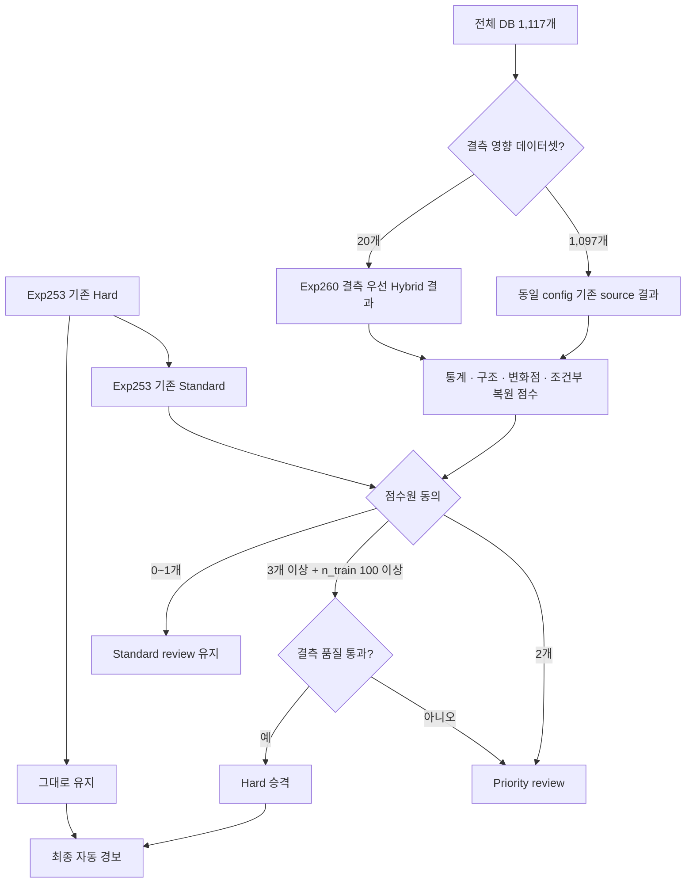

# Exp263-264 Full Missing-Aware Validation Implementation Plan

> **For agentic workers:** REQUIRED SUB-SKILL: Use superpowers:subagent-driven-development (recommended) or superpowers:executing-plans to implement this plan task-by-task. Steps use checkbox (`- [ ]`) syntax for tracking.

**Goal:** 기존 자동 경보를 보존하면서 결측 우선 전처리와 네 점수원 합의 정책을 전체 1,117개 데이터셋에 적용하고, 자동 경보·검토 lane의 변화를 독립적으로 검증한다.

**Architecture:** Exp263은 TEST 라벨 없이 DB와 동결된 점수원 결과를 결합해 전체 데이터셋의 prediction을 생성한다. 결측 20개에는 Exp260의 수정된 Hybrid PCHIP 결과를 사용하고, 비결측 1,097개에는 동일 config의 기존 Exp252/254/255/257 점수 결과를 사용한다. Exp264는 Exp263 prediction hash를 동결한 뒤에만 TEST 라벨을 읽어 자동 경보와 review 지표를 분리 집계한다.

**Tech Stack:** Python 3.14, SQLite, NumPy, CSV/JSONL, `unittest`, 기존 Exp252/253/254/255/257/260 artifact

## Global Constraints

- 데이터베이스는 `/Users/minho/Documents/Dataset/univariate_ts.db`를 사용한다.
- 평가 모집단은 정확히 1,117개 데이터셋이며 임의 제외를 허용하지 않는다.
- `ALPHA = 0.005`, 기존 source variant와 seed를 변경하지 않는다.
- 기존 Hard alert는 삭제하거나 낮은 lane으로 이동하지 않는다.
- 새 Hard 승격은 기존 Standard 후보 중 `n_train >= 100`, 4개 점수원 중 3개 이상 동의, 결측 품질 통과를 모두 만족해야 한다.
- 2개 점수원 동의 또는 품질 차단 후보는 Priority review로만 이동한다.
- 0~1개 동의 후보는 Standard review에 유지한다.
- 마스킹 복원 점수는 `n_train >= 100` 데이터셋에만 사용한다.
- prediction 단계는 TEST 라벨, 이상 위치, family별 TEST 성능을 읽지 않는다.
- evaluation은 동결된 prediction SHA256을 확인한 뒤에만 TEST 라벨을 읽는다.
- 결과는 retrospective integration validation이며 prospective 또는 end-to-end strict TRAIN-only로 표현하지 않는다.
- Exp253의 `selected_from_prior_test_review=True`와 `deployment_eligible=False` 한계를 결과 문서에 유지한다.
- 결과를 본 뒤 alpha, variant, threshold, 동의 개수 또는 `n_train` 기준을 변경하지 않는다.

---

## File Structure

- Create: `experiments/exp263_264_full_missing_aware_integration/__init__.py`
- Create: `experiments/exp263_264_full_missing_aware_integration/config.py` - 고정 경로와 정책 상수
- Create: `experiments/exp263_264_full_missing_aware_integration/inputs.py` - DB 모집단 및 source artifact 검증
- Create: `experiments/exp263_264_full_missing_aware_integration/routing.py` - label-free lane 결정
- Create: `experiments/exp263_264_full_missing_aware_integration/prediction.py` - 전체 prediction 생성 및 hash 동결
- Create: `experiments/exp263_264_full_missing_aware_integration/evaluation.py` - 사후 TEST 평가
- Create: `experiments/exp263_264_full_missing_aware_integration/reporting.py` - 독립 재집계와 보고서
- Create: `experiments/exp263_264_full_missing_aware_integration/run_pipeline.py` - audit/predict/evaluate/report 단계 실행
- Create: `experiments/exp263_264_full_missing_aware_integration/tests/test_inputs.py`
- Create: `experiments/exp263_264_full_missing_aware_integration/tests/test_routing.py`
- Create: `experiments/exp263_264_full_missing_aware_integration/tests/test_prediction_evaluation_boundary.py`
- Create: `scratch/run_exp263_264_full_missing_aware_integration.py` - 순차 실행 및 대시보드 상태 기록
- Modify: `serve_rank_dashboard.py` - Exp263/264 catalog와 artifact 경로 등록
- Create: `docs/EXP263_264_PREREGISTRATION_KO.md`

Output root:

```text
/Users/minho/Documents/Dataset/exp263_264_full_missing_aware_integration/
```

## Fixed Source Contract

| 역할 | 입력 artifact | 고정 variant | alpha | 적용 범위 |
|---|---|---|---:|---:|
| 기존 lane | Exp253 `frozen_predictions.jsonl` | final lanes | - | 1,117 |
| 통계 점수 | Exp252 `frozen_predictions.jsonl` | `combined_40` | 0.005 | 1,117 |
| 구조 점수 | Exp254 `frozen_predictions.jsonl` | `structural_combined_440` | 0.005 | 1,117 |
| 변화점 점수 | Exp255 `frozen_predictions.jsonl` | `change_point_combined_33` | 0.005 | 1,117 |
| 마스킹 복원 | Exp257 `frozen_predictions.jsonl` | `mask_025__seed_intersection` | 0.005 | `n_train >= 100` |
| 결측 보정 override | Exp260 `frozen_predictions.jsonl` | corrected four sources | 0.005 | 결측 20개 |

## Operational Flow



---

### Task 1: Freeze Preregistration And Configuration

**Files:**
- Create: `docs/EXP263_264_PREREGISTRATION_KO.md`
- Create: `experiments/exp263_264_full_missing_aware_integration/config.py`
- Test: `experiments/exp263_264_full_missing_aware_integration/tests/test_inputs.py`

**Interfaces:**
- Produces: `SOURCE_CONTRACT: dict[str, SourceSpec]`, `ALPHA`, `MIN_TRAIN_FOR_PROMOTION`, `OUTPUT_ROOT`

- [ ] **Step 1: Write the failing constant contract test**

```python
def test_policy_constants_are_preregistered():
    assert config.ALPHA == 0.005
    assert config.MIN_TRAIN_FOR_PROMOTION == 100
    assert config.REQUIRED_PROMOTION_AGREEMENT == 3
    assert config.MASK_VARIANT == "mask_025__seed_intersection"
```

- [ ] **Step 2: Run the test and confirm it fails because `config.py` is absent**

Run: `python3 -m unittest experiments.exp263_264_full_missing_aware_integration.tests.test_inputs -v`

- [ ] **Step 3: Implement immutable constants and absolute artifact paths**

```python
ALPHA = 0.005
MIN_TRAIN_FOR_PROMOTION = 100
REQUIRED_PROMOTION_AGREEMENT = 3
PRIORITY_AGREEMENT = 2
STAT_VARIANT = "combined_40"
STRUCTURAL_VARIANT = "structural_combined_440"
CHANGE_VARIANT = "change_point_combined_33"
MASK_VARIANT = "mask_025__seed_intersection"
OUTPUT_ROOT = Path("/Users/minho/Documents/Dataset/exp263_264_full_missing_aware_integration")
```

- [ ] **Step 4: Write the Korean preregistration with scope, fixed rules, forbidden information, and interpretation limits**

- [ ] **Step 5: Run the constant test and commit**

```bash
git add docs/EXP263_264_PREREGISTRATION_KO.md experiments/exp263_264_full_missing_aware_integration
git commit -m "docs: preregister full missing-aware integration"
```

### Task 2: Audit Population And Frozen Source Coverage

**Files:**
- Create: `experiments/exp263_264_full_missing_aware_integration/inputs.py`
- Modify: `experiments/exp263_264_full_missing_aware_integration/tests/test_inputs.py`

**Interfaces:**
- Produces: `load_population() -> tuple[str, ...]`
- Produces: `load_source_maps() -> FrozenSourceMaps`
- Produces: `audit_source_contract() -> dict[str, object]`

- [ ] **Step 1: Add tests requiring exactly 1,117 unique DB datasets and exact source coverage**

```python
def test_source_contract_requires_full_coverage():
    audit = audit_source_contract()
    assert audit["dataset_count"] == 1117
    assert audit["baseline_coverage"] == 1117
    assert audit["statistical_coverage"] == 1117
    assert audit["structural_coverage"] == 1117
    assert audit["change_point_coverage"] == 1117
    assert audit["missing_override_coverage"] == 20
    assert audit["missing_datasets_without_override"] == []
```

- [ ] **Step 2: Implement exact row selection by `(dataset, variant, alpha)`**

```python
def select_rows(path: Path, variant: str, alpha: float) -> dict[str, dict]:
    selected = {}
    for line in path.read_text().splitlines():
        row = json.loads(line)
        if row.get("variant") == variant and float(row.get("alpha")) == alpha:
            if row["dataset"] in selected:
                raise ValueError(f"duplicate source row: {row['dataset']}")
            selected[row["dataset"]] = row
    return selected
```

- [ ] **Step 3: Validate DB/source dataset names, `n_test`, index range, config, seed manifest, and SHA256**

- [ ] **Step 4: Fail with exit code 2 on any missing, duplicate, mismatched, or out-of-range source**

- [ ] **Step 5: Write `00_source_contract_audit.json` and `01_source_coverage.csv` without reading TEST labels**

- [ ] **Step 6: Run tests and commit**

### Task 3: Implement Pure Label-Free Routing

**Files:**
- Create: `experiments/exp263_264_full_missing_aware_integration/routing.py`
- Create: `experiments/exp263_264_full_missing_aware_integration/tests/test_routing.py`

**Interfaces:**
- Consumes: `RoutingInputs(dataset, n_train, n_test, baseline_hard, baseline_standard, baseline_priority, sources, quality_flags)`
- Produces: `route_dataset(inputs: RoutingInputs) -> dict[str, object]`

- [ ] **Step 1: Write tests for all lane transitions**

```python
def make_inputs(n_train=100, quality_flags=frozenset()):
    return RoutingInputs(
        dataset="sample",
        n_train=n_train,
        n_test=5,
        baseline_hard={0},
        baseline_standard={1, 2, 3, 4},
        baseline_priority=set(),
        sources={"statistical": {1, 2}, "structural": {1, 2},
                 "change_point": {1}, "reconstruction": {3}},
        quality_flags=set(quality_flags),
    )

def test_three_of_four_promotes_large_train_quality_pass():
    row = route_dataset(make_inputs())
    assert row["promoted_indices"] == [1]
    assert row["final_hard_indices"] == [0, 1]

def test_three_of_four_quality_failure_moves_to_priority():
    row = route_dataset(make_inputs(quality_flags={1}))
    assert row["promoted_indices"] == []
    assert 1 in row["final_priority_indices"]

def test_two_sources_move_standard_to_priority():
    row = route_dataset(make_inputs())
    assert 2 in row["final_priority_indices"]

def test_one_source_keeps_standard():
    row = route_dataset(make_inputs())
    assert 3 in row["final_standard_indices"]

def test_small_train_never_promotes_to_hard():
    row = route_dataset(make_inputs(n_train=99))
    assert row["promoted_indices"] == []

def test_existing_hard_is_never_removed():
    row = route_dataset(make_inputs())
    assert 0 in row["final_hard_indices"]

def test_lanes_are_mutually_exclusive():
    row = route_dataset(make_inputs())
    lanes = [set(row[key]) for key in
             ("final_hard_indices", "final_standard_indices", "final_priority_indices")]
    assert all(not lanes[i] & lanes[j] for i in range(3) for j in range(i + 1, 3))
```

- [ ] **Step 2: Implement the exact frozen rule**

```python
standard_sources = {name: indices & baseline_standard for name, indices in sources.items()}
support = {i: sum(i in values for values in standard_sources.values()) for i in baseline_standard}
promoted = {
    i for i, count in support.items()
    if n_train >= 100 and count >= 3 and i not in quality_flags
}
priority_added = {i for i, count in support.items() if count >= 2 and i not in promoted}
final_hard = baseline_hard | promoted
final_priority = baseline_priority | priority_added
final_standard = baseline_standard - promoted - priority_added
```

- [ ] **Step 3: Add assertions for index bounds, lane disjointness, and baseline Hard preservation**

- [ ] **Step 4: Run routing tests and commit**

### Task 4: Build Exp263 Full Prediction Artifact

**Files:**
- Create: `experiments/exp263_264_full_missing_aware_integration/prediction.py`
- Create: `experiments/exp263_264_full_missing_aware_integration/tests/test_prediction_evaluation_boundary.py`

**Interfaces:**
- Produces: `predict_all(output_root: Path) -> Path`
- Output: `frozen_predictions.jsonl`, `prediction_manifest.json`, `source_agreement_diagnostics.csv`

- [ ] **Step 1: Test that prediction functions have no `y_test` parameter and do not import the evaluation label loader**

```python
def test_prediction_signature_excludes_test_labels():
    assert "y_test" not in inspect.signature(predict_all).parameters
```

- [ ] **Step 2: Merge source rows for all 1,117 datasets in deterministic dataset-name order**

- [ ] **Step 3: Override all four source candidate sets for exactly the 20 missing datasets using Exp260**

- [ ] **Step 4: Use the Exp260 TRAIN-q99 quality flags for missing datasets and an empty quality flag set for verified nonmissing datasets**

- [ ] **Step 5: Write JSONL atomically after converting NumPy scalars to Python values**

- [ ] **Step 6: Assert 1,117 rows, 1,117 unique names, zero lane overlap, zero range errors, and baseline Hard subset of final Hard**

- [ ] **Step 7: Freeze prediction SHA256 before evaluation**

- [ ] **Step 8: Verify the 20 missing-dataset rows reproduce Exp260 exactly and commit**

### Task 5: Build Exp264 Post-Hoc Evaluation

**Files:**
- Create: `experiments/exp263_264_full_missing_aware_integration/evaluation.py`
- Modify: `experiments/exp263_264_full_missing_aware_integration/tests/test_prediction_evaluation_boundary.py`

**Interfaces:**
- Consumes: frozen prediction and expected SHA256
- Produces: `results.csv`, `summary.json`, `lane_transitions.csv`

- [ ] **Step 1: Test that evaluation refuses a modified prediction file**

```python
def test_evaluation_rejects_prediction_hash_mismatch(self):
    with tempfile.TemporaryDirectory() as directory:
        prediction = Path(directory) / "frozen_predictions.jsonl"
        prediction.write_text('{"dataset":"x"}\n')
        with self.assertRaisesRegex(ValueError, "SHA256"):
            evaluate_all(prediction, expected_sha256="wrong")
```

- [ ] **Step 2: Load TEST labels only after hash verification**

- [ ] **Step 3: Calculate autonomous Hard metrics separately from Standard/Priority review metrics**

- [ ] **Step 4: Report micro precision/recall, macro Mean F1, TP, FP, FN, total anomalies, and Zero-F1 dataset count**

- [ ] **Step 5: Add paired dataset-level comparison against Exp253 baseline**

- [ ] **Step 6: Report subgroup diagnostics for missing 20, nonmissing 1,097, `n_train < 100`, and `n_train >= 100` without using them for policy selection**

- [ ] **Step 7: Run evaluation tests and commit**

### Task 6: Independent Reaggregation And Interpretation

**Files:**
- Create: `experiments/exp263_264_full_missing_aware_integration/reporting.py`

**Interfaces:**
- Produces: `independent_reaggregation.json`, `RESULT_REPORT.md`, `MANIFEST.json`

- [ ] **Step 1: Recompute all totals directly from `results.csv` in a separate function**

- [ ] **Step 2: Require exact agreement with `summary.json` for datasets, alerts, TP, FP, precision, Mean F1, and Zero-F1 count**

- [ ] **Step 3: Include source-level diagnostics**

Required diagnostics:

```text
raw candidate count and TP/FP by source
candidate overlap with baseline Hard/Standard/Priority/outside
agreement count distribution 0/1/2/3/4
promoted TP/FP
quality-blocked TP/FP
Hard confidence-confirmed TP/FP
workload change in Standard/Priority review
```

- [ ] **Step 4: Mark all metrics retrospective and preserve the Exp253 provenance limitation**

- [ ] **Step 5: Generate SHA256 manifest for DB, inputs, code, prediction, and outputs**

- [ ] **Step 6: Run independent consistency checks and commit**

### Task 7: Pipeline, Queue, And Dashboard Integration

**Files:**
- Create: `experiments/exp263_264_full_missing_aware_integration/run_pipeline.py`
- Create: `scratch/run_exp263_264_full_missing_aware_integration.py`
- Modify: `serve_rank_dashboard.py`

**Interfaces:**
- CLI: `python3 -m experiments.exp263_264_full_missing_aware_integration.run_pipeline --phase audit|predict|evaluate|report`

- [ ] **Step 1: Implement atomic status updates with PID, phase, done, expected, current dataset, errors, and output paths**

- [ ] **Step 2: On any exception write `status="failed"`, retain artifacts, and exit nonzero**

- [ ] **Step 3: Register Exp263/264 with expected datasets 1,117 in the dashboard catalog**

- [ ] **Step 4: Add runner state handling that removes stale queue entries and records return code history**

- [ ] **Step 5: Run a 10-dataset smoke test in a separate smoke output directory**

```bash
python3 -m experiments.exp263_264_full_missing_aware_integration.run_pipeline \
  --phase audit --dataset-limit 10 --output-root /tmp/exp263_264_smoke
python3 -m experiments.exp263_264_full_missing_aware_integration.run_pipeline \
  --phase predict --dataset-limit 10 --output-root /tmp/exp263_264_smoke
python3 -m experiments.exp263_264_full_missing_aware_integration.run_pipeline \
  --phase evaluate --dataset-limit 10 --output-root /tmp/exp263_264_smoke
```

- [ ] **Step 6: Confirm the dashboard shows the smoke run without altering the full queue**

- [ ] **Step 7: Commit dashboard and runner integration**

### Task 8: Full Execution And Acceptance Gate

**Files:**
- Outputs only under `/Users/minho/Documents/Dataset/exp263_264_full_missing_aware_integration/`

- [ ] **Step 1: Run all unit tests**

```bash
python3 -m unittest discover -s experiments/exp263_264_full_missing_aware_integration/tests -v
python3 -m unittest scratch/test_dashboard_state_contract.py -v
```

- [ ] **Step 2: Run audit and stop unless all source contracts pass**

```bash
python3 -m experiments.exp263_264_full_missing_aware_integration.run_pipeline --phase audit
```

Expected: dataset coverage `1117/1117`, missing override `20/20`, errors `0`.

- [ ] **Step 3: Run prediction with 7 CPU workers where source regeneration is required; run MPS work sequentially**

- [ ] **Step 4: Verify prediction hash, row coverage, lane invariants, and no evaluation fields**

- [ ] **Step 5: Run evaluation only after prediction is frozen**

- [ ] **Step 6: Run independent report generation and compare with Exp253**

- [ ] **Step 7: Apply acceptance interpretation without changing the policy**

Interpretation table:

| Result | Conclusion |
|---|---|
| No promotion | New sources are confirmation-only; automatic range does not expand |
| Promotion with FP rate no worse than Exp253 | Retrospective expansion signal; prospective validation still required |
| TP and FP both increase | Workload/false-alarm trade-off; do not select by Mean F1 alone |
| FP rises materially | Reject automatic promotion; retain evidence as confidence/review ranking |
| Missing 20 improve but full metrics unchanged | Keep missing-aware preprocessing as targeted path, not global model claim |
| Source contract mismatch | Stop; do not publish partial 1,117-dataset metrics |

- [ ] **Step 8: Record final command, duration, hashes, limitations, and commit code/docs only**

## Completion Criteria

- Prediction rows and unique datasets are exactly `1,117`.
- Missing-aware override is exactly `20/20`; nonmissing coverage is exactly `1,097/1,097`.
- Source or dataset omission is zero.
- Lane overlap and index-range errors are zero.
- Existing Exp253 Hard candidates are all preserved.
- Frozen prediction contains no TEST labels or evaluation metrics.
- Evaluation reads labels only after SHA256 verification.
- Autonomous Hard and human-assisted review metrics are reported separately.
- Exp253 대비 전체, 결측, 비결측, TRAIN 크기 구간별 변화가 제공된다.
- No hyperparameter or policy is selected from TEST performance.
- Report explicitly says retrospective, not end-to-end strict TRAIN-only, and not prospectively validated.
