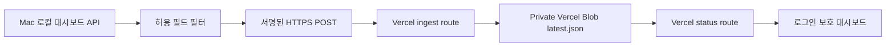

# Vercel Dashboard Mirror Design

## 목적

현재 Mac에서 실행되는 실험과 로컬 대시보드를 변경하지 않고, 외부에서 고정 주소로
확인할 수 있는 Vercel 미러 대시보드를 만든다. 원본 DB와 시계열은 Mac에 남기고
허용된 운영 상태 요약만 Vercel로 전송한다.

## 범위

첫 버전이 제공하는 기능은 다음과 같다.

- 현재 실험, 진행률, 처리 데이터셋 수, ETA
- 순차 실험 큐
- CPU/GPU와 프로세스 요약
- warning/error 요약
- 마지막 동기화 시각과 stale 표시
- 모바일과 데스크톱 화면
- 비로그인 접근 차단

첫 버전은 원본 로그 전체, DB 파일, 시계열 원본, TEST label, 자격 증명, 로컬 절대
경로를 Vercel에 전송하지 않는다.

## 구조

## 구성 요소

### Vercel 앱

경로는 `vercel-dashboard/`이며 Next.js 16 App Router와 TypeScript를 사용한다.

- `POST /api/ingest`: Mac 전송기만 사용하는 수집 API
- `GET /api/status`: private Blob의 최신 상태를 읽는 화면용 API
- `proxy.ts`: 화면과 조회 API에 HTTP Basic Auth 적용
- `/`: 10초 polling 운영 대시보드

수집 API는 `DASHBOARD_INGEST_TOKEN` Bearer token만 허용한다. 화면은
`DASHBOARD_VIEW_USER`와 `DASHBOARD_VIEW_PASSWORD`를 사용한다. 두 인증 체계는
서로 독립이다.

### Snapshot 저장

Production은 `@vercel/blob` private storage의
`dashboard/latest.json`을 `allowOverwrite: true`로 갱신한다. Vercel Functions의
로컬 파일시스템은 지속 저장소로 사용하지 않는다.

Local test에서는 명시적인 `DASHBOARD_LOCAL_STORE_PATH`가 있을 때만 로컬 JSON을
사용한다. Production에서 Blob token이 없으면 조용히 빈 화면을 만들지 않고 503을
반환한다.

### Mac 전송기

`scratch/push_vercel_dashboard_snapshot.py`가 로컬 `/api/overview`를 읽고 허용 목록만
새 JSON으로 만든다. 전송기는 다음을 보장한다.

- DB와 결과 CSV를 직접 읽지 않는다.
- 원본 `log_tail`, 로컬 파일 경로, 환경 변수는 전송하지 않는다.
- snapshot에 schema version, 생성 시각, source instance id를 포함한다.
- 성공/실패를 로컬 로그와 heartbeat에 기록한다.
- 한 번 전송 모드와 10초 반복 모드를 제공한다.

## 데이터 계약

허용되는 최상위 필드는 다음으로 고정한다.

- `schema_version`
- `generated_at`
- `source_instance_id`
- `active_experiment`, `active_label`, `running`
- `datasets_done`, `expected_datasets`, `progress_percent`
- `elapsed_seconds`, `eta_seconds`, `current_dataset`
- `queue_items`
- `coverage`, `throughput`, `runtime_health`
- `system`, `warning_summary`, `error_summary`
- `last_completed_experiment`, `last_completed_label`

수집 route는 JSON 크기를 256 KiB로 제한하고, 허용되지 않은 최상위 필드를 거부한다.
클라이언트가 보낸 HTML은 렌더링하지 않는다.

## UI

운영 도구답게 어두운 단색 카드 나열이 아니라 밝고 조용한 작업 화면으로 만든다.

- 상단: 현재 실험명, 연결 상태, 마지막 동기화
- 핵심 지표 band: 진행률, 처리량, ETA, 오류
- 본문: 실행 중 상세와 순차 큐를 좌우 배치
- 하단: 자원 사용량과 warning/error 요약
- 30초 이상 갱신되지 않으면 `업데이트 지연` 상태 표시
- 중첩 카드와 설명용 대형 hero는 사용하지 않는다.

## 보안

- View password와 ingest token은 Vercel 환경 변수에만 저장한다.
- 저장 snapshot에는 credential, TEST label, 원본 로그, 환경 변수를 넣지 않는다.
- 수집 token 비교는 timing-safe 비교를 사용한다.
- 응답에는 `Cache-Control: no-store`를 사용한다.
- Blob은 private access로 생성한다.

## 검증

- Python sanitizer 단위 테스트: 허용 필드만 남는지 확인
- route 단위 테스트: token 누락/오류 401, 잘못된 schema 400, 크기 초과 413
- UI 테스트: loading, fresh, stale, unavailable 상태
- `npm test`, `npm run build`
- 로컬 전송기 one-shot smoke
- Vercel 배포 후 비로그인 401, 로그인 200, ingest 200 검증

## 배포 게이트

1. 로컬 테스트와 production build가 통과한다.
2. Vercel 계정 연결을 확인한다.
3. Private Blob store를 연결한다.
4. 세 환경 변수와 Blob token을 설정한다.
5. 배포 후 인증과 상태 갱신을 검증한다.

계정 인증이나 Blob provisioning이 사용자 상호작용을 요구하면 코드는 완료하되 배포
단계에서 정확한 blocker로 보고한다. Cloudflare 터널은 Vercel 검증이 끝날 때까지
유지한다.
