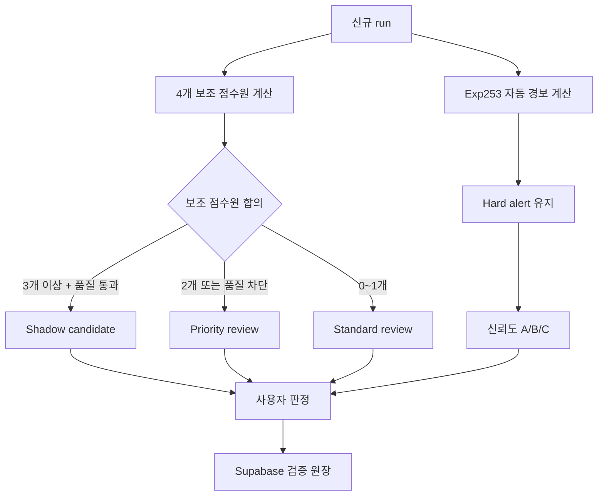

# Exp265 Shadow Validation Ledger Design

## 1. 목적

Exp265는 Exp253 자동 경보 정책을 변경하지 않은 채 Exp264에서 확인한 다중 점수원 합의 신호를 신규 데이터에서 검증하는 shadow 운영 체계다.

핵심 목적은 다음과 같다.

- 기존 자동 경보의 신뢰도를 A/B/C 등급으로 표시한다.
- 자동 경보로 승격하지 않은 Exp264 후보를 Shadow, 우선 검토, 일반 검토로 구분한다.
- 신규 dataset/run 100개의 사용자 판정을 Supabase에 누적한다.
- 후보 정밀도, 오탐, 검토 업무량과 결측 데이터 결과를 후향 TEST 결과와 분리해 보고한다.
- 신규 검증 결과가 좋아도 자동으로 운영 정책을 변경하지 않는다.

Exp265는 실제 설비 배포 정책이 아니라 prospective shadow validation을 지원하는 기록·검토 시스템이다.

## 2. 고정 원칙

1. Exp253 Hard alert는 그대로 유지한다.
2. Exp264에서 추가된 2개 TP는 과거 TEST 결과이므로 운영 자동 경보로 즉시 승격하지 않는다.
3. TEST 라벨, 실제 이상 위치, family별 과거 TEST 성능을 prediction이나 routing에 사용하지 않는다.
4. 네 점수원의 feature, threshold, alpha와 합의 규칙은 shadow 시작 전에 고정한다.
5. 신규 100개 run을 관찰하는 동안 결과를 보고 규칙을 수정하지 않는다.
6. Priority review는 자동 경보가 아니다.
7. 결측 데이터는 별도 집계하지만 결측 여부로 자동 경보 기준을 완화하지 않는다.
8. 100개 run 완료 후에도 자동 승격하지 않고 검증 보고서만 생성한다.

## 3. 용어와 운영 단위

- `run`: 신규 데이터 입력 한 건. 고유한 `run_id`로 식별한다.
- `candidate`: 한 run 안에서 모델이 사용자 확인 대상으로 제시한 index 또는 event.
- `Hard alert`: 기존 Exp253가 생성한 자동 경보. Exp265에서 추가하거나 제거하지 않는다.
- `Shadow candidate`: 기존 Standard 후보 중 보조 점수원 3개 이상이 동의하고 데이터 품질 검사를 통과한 후보.
- `Priority review`: 보조 점수원 2개가 동의하거나, 3개 이상 동의했지만 데이터 품질 검사를 통과하지 못한 후보.
- `Standard review`: 보조 점수원 동의가 0~1개인 기존 검토 후보.
- `No alert`: 자동 경보 또는 검토 후보가 없는 상태.

신규 100건은 후보 수가 아니라 고유한 run 수로 계산한다. 후보가 없는 run도 검증 모집단에 포함한다.

## 4. 신뢰도 등급

기존 Exp253 Hard alert에만 다음 신뢰도 등급을 부여한다.

| 등급 | 정의 | 사용자 의미 |
|---|---|---|
| A | 보조 점수원 3개 이상이 재확인 | 자동 경보 중 근거가 가장 강함 |
| B | 보조 점수원 1~2개가 재확인 | 자동 경보이며 추가 근거가 있음 |
| C | 보조 점수원 추가 확인 없음 | 기존 Exp253 근거로 유지된 자동 경보 |

`Shadow`는 신뢰도 등급이 아니라 별도 lane이다. 화면에서 A/B/C와 혼동되지 않게 표시한다.

## 5. 고정 점수원과 routing

Exp264에서 감사한 다음 점수원을 그대로 사용한다.

- 통계 특징 점수
- 시계열 구조 점수
- 변화점 점수
- 마스킹 복원 점수

신규 run의 routing은 다음 순서로 수행한다.

모든 lane은 상호 배타적이어야 한다. 후보 인덱스는 원본 run 범위 안에 있어야 하며, 동일 후보를 여러 lane에 중복 저장하지 않는다.

## 6. 시스템 구조

### 6.1 로컬 prediction/export

로컬 실행기는 다음을 수행한다.

1. 신규 run을 읽고 TRAIN-normal 기준으로 feature, score, threshold와 후보를 계산한다.
2. TEST 또는 사용자 라벨 없이 lane과 신뢰도 등급을 결정한다.
3. prediction payload와 설정 hash를 로컬 append-only spool에 먼저 기록한다.
4. Vercel ingest API로 전송한다.
5. 성공 응답을 받으면 해당 spool 항목을 전송 완료로 표시한다.

네트워크 실패 시 prediction 결과를 삭제하지 않는다. 같은 `run_id`와 `candidate_id`의 재전송은 중복 생성 없이 동일한 결과를 반환해야 한다.

### 6.2 Vercel API

기존 실험 상태 snapshot API와 shadow 검증 API를 분리한다.

- 상태 snapshot: 실험 진행 상황과 시스템 상태
- shadow ingest: run, 후보, 점수원 근거, 고정 config hash
- feedback API: 사용자 후보 판정과 run 단위 놓침 판정
- report API: 신규 run 누적 수와 검증 지표 조회

Machine ingest는 기존 bearer token과 writer session을 사용한다. 사용자 feedback은 Supabase 로그인 사용자만 기록할 수 있다.

### 6.3 Supabase 검증 원장

다음 논리 테이블을 추가한다.

#### `shadow_validation_runs`

- `run_id`: 고유 식별자
- `source_id`: 데이터를 보낸 설비 또는 로컬 인스턴스
- `observed_at`: 신규 데이터 발생 시각
- `dataset_key`: 데이터 조회 키. 정책 분기에는 사용하지 않는다.
- `equipment_id`, `recipe_id`, `sensor_id`, `step_id`: 존재할 때만 저장
- `has_missing`, `missing_quality_status`
- `policy_version`, `config_sha256`, `prediction_sha256`
- `candidate_count`, `hard_count`, `shadow_count`, `priority_count`, `standard_count`
- `ingested_at`

#### `shadow_validation_candidates`

- `candidate_id`: `run_id + candidate index/event`로 만든 안정적인 고유 키
- `run_id`, `candidate_index`, 선택적 event 범위
- `final_lane`: Hard, Shadow, Priority, Standard
- `confidence_grade`: Hard일 때 A/B/C, 그 외 null
- 네 점수원의 동의 여부와 score/threshold
- 데이터 품질 상태와 차단 이유
- prediction 당시의 고정 payload

#### `shadow_feedback_events`

사용자 판정을 덮어쓰지 않는 append-only 이력으로 저장한다.

- `candidate_id`
- `verdict`: `true_anomaly`, `false_alarm`, `deferred`
- `reviewer_id`
- `note`
- `created_at`
- 정정 대상 event ID

현재 판정은 가장 최근의 유효 event로 계산하되 과거 판정을 삭제하지 않는다.

#### `shadow_run_feedback_events`

후보 밖의 놓친 이상을 파악하기 위한 선택적 run 단위 판정이다.

- `run_id`
- `missed_anomaly_state`: `none`, `exists`, `unknown`
- 선택적 위치 또는 설명
- `reviewer_id`, `created_at`

## 7. 대시보드 사용자 경험

### 7.1 진행 요약

- 신규 run 진행률: `완료 run / 100`
- 판정 완료 후보 수
- 판단 보류 후보 수
- Hard, Shadow, Priority, Standard별 후보 수
- 결측 run 수

### 7.2 후보 목록

기본 정렬은 다음 순서다.

1. Shadow candidate
2. Priority review
3. Hard alert A
4. Hard alert B/C
5. Standard review

사용자는 lane, 신뢰도, 결측 여부, 판정 상태로 필터링할 수 있다.

### 7.3 후보 상세

- 시계열 파형과 후보 위치
- 자동 경보/검토 lane
- 신뢰도 A/B/C 또는 Shadow 표시
- 동의한 점수원과 score/threshold
- 데이터 품질 상태
- `실제 이상`, `정상 오탐`, `판단 보류` 버튼
- 판정 이력과 메모

### 7.4 run 단위 판정

사용자는 선택적으로 다음을 기록할 수 있다.

- 모델이 놓친 다른 이상 없음
- 모델이 놓친 다른 이상 있음
- 확인할 수 없음

이 정보가 없는 run은 Recall 계산에서 완전 라벨 run으로 취급하지 않는다.

## 8. 지표와 해석

### 8.1 항상 계산 가능한 지표

- lane별 사용자 판정 수
- TP/FP와 candidate precision
- run당 후보 수와 p50/p90/p95 workload
- 판단 보류 비율
- 결측/비결측 후보 precision
- A/B/C 신뢰도별 precision
- Shadow와 Priority의 precision

### 8.2 완전 run 판정이 있을 때만 계산하는 지표

- Recall
- F1
- FN
- 놓친 이상이 있는 run 비율

후보만 판정된 상태에서 Recall 또는 F1을 전체 운영 성능으로 표시하지 않는다.

### 8.3 100개 run 완료 보고서

100개 신규 run이 수집되면 정책을 자동 변경하지 않고 다음을 출력한다.

- autonomous Hard와 shadow/review 결과 분리
- lane 및 신뢰도별 precision과 workload
- 결측/비결측 분리 결과
- 완전 판정 run의 수와 coverage
- Recall/F1 계산 가능 여부
- 미판정·판단 보류 데이터 수
- config와 prediction hash
- prospective shadow 결과라는 명시

## 9. 보안과 데이터 무결성

- 비로그인 사용자는 shadow 후보와 feedback에 접근할 수 없다.
- Supabase RLS는 등록된 dashboard member만 읽을 수 있게 한다.
- `can_write=true` 사용자만 feedback을 추가한다.
- Machine ingest token은 브라우저에 노출하지 않는다.
- 동일 run/candidate의 중복 전송은 unique constraint로 차단한다.
- prediction payload는 feedback과 분리해 사용자가 판정을 바꿔도 원본 예측이 변하지 않게 한다.
- feedback 정정은 기존 기록을 삭제하지 않고 새 event로 추가한다.
- 모든 시간은 UTC로 저장하고 화면에서 사용자 시간대로 표시한다.

## 10. 오류 처리

- prediction 실패 run은 검증 모집단에 성공 처리하지 않는다.
- 일부 점수원 계산 실패 시 원인을 저장하고 임의로 합의 수를 낮춰 정상 처리하지 않는다.
- Supabase 전송 실패는 로컬 spool에서 재시도한다.
- config hash 불일치 시 ingest를 거부한다.
- feedback 대상 candidate가 없거나 run 범위를 벗어나면 요청을 거부한다.
- 100개 집계는 prediction과 ingest가 모두 완료된 고유 run만 포함한다.

## 11. 시험 전략

### 단위 테스트

- A/B/C 등급 계산
- Shadow/Priority/Standard routing
- 기존 Hard 후보 불변성
- lane 상호 배타성과 범위 검사
- 100개 run 중복 방지
- feedback event 현재값 계산

### API·DB 테스트

- 비로그인 접근 차단
- 읽기/쓰기 권한 분리
- machine ingest token 검증
- idempotent 재전송
- config hash 불일치 차단
- feedback append-only 정정 이력

### 통합 테스트

- 신규 run prediction부터 대시보드 표시까지
- 오프라인 spool 재전송
- 모바일 화면에서 판정 버튼과 이력 확인
- 후보 없는 run도 100개 모집단에 포함
- 후보 판정만 있을 때 Recall/F1 비표시

### 회귀 테스트

- Exp253 Hard index가 Exp265로 인해 추가·삭제되지 않음
- 기존 실험 상태 대시보드와 ingest가 유지됨
- Exp263/264 결과 파일을 덮어쓰지 않음

## 12. 범위 제외

- Exp264의 2개 과거 TP를 운영 자동 경보로 즉시 승격하지 않는다.
- 신규 100개 결과로 자동 threshold 튜닝을 하지 않는다.
- family별 과거 TEST 성능으로 정책을 변경하지 않는다.
- 결측 보정 모델 자체를 이번 작업에서 재학습하지 않는다.
- 신규 100개만으로 실제 설비 전체 성능 또는 deployment readiness를 주장하지 않는다.

## 13. 완료 조건

- Exp253 Hard alert가 완전히 보존된다.
- 신규 run과 후보가 중복 없이 Supabase에 기록된다.
- 대시보드에서 A/B/C, Shadow, Priority, Standard를 구분해 확인할 수 있다.
- 사용자 판정과 정정 이력이 append-only로 남는다.
- 신규 run 진행률이 100건 기준으로 표시된다.
- 후보 판정만 있는 경우 Recall/F1을 표시하지 않는다.
- 결측/비결측 결과가 분리된다.
- 기존 실험 진행 대시보드 기능이 회귀하지 않는다.
