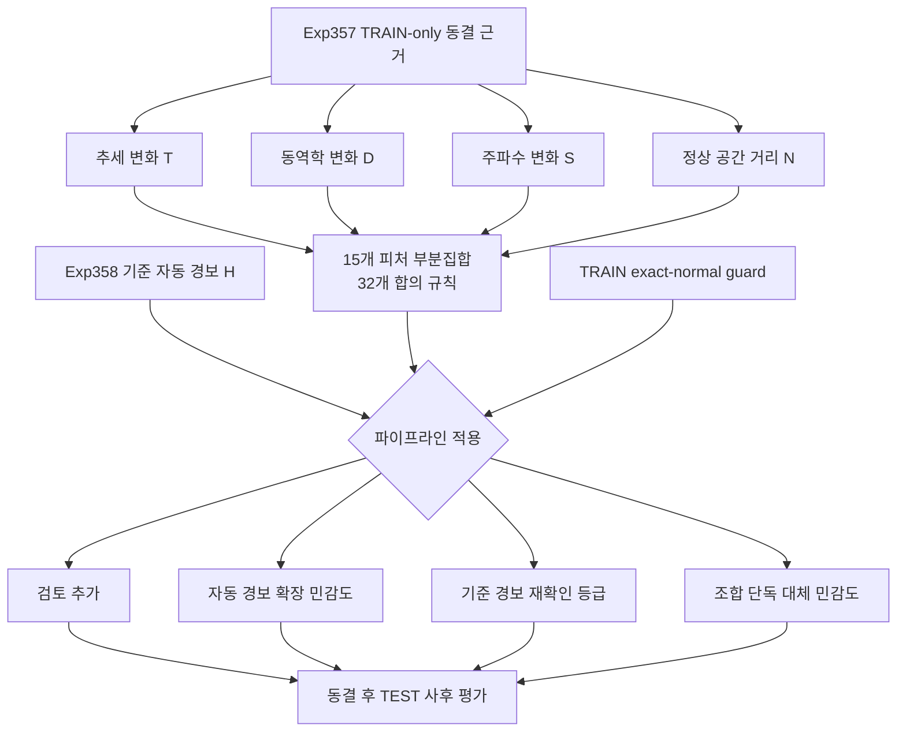

# Exp377-380 피처 조합 격자 및 파이프라인 구조 검증 설계

## 1. 목적

Exp373-376에서 검증한 기준 자동 경보와 네 독립 근거군을 사용해 다음을
체계적으로 확인한다.

1. 새 피처의 단독 효과
2. 기존 독립 피처와 만들 수 있는 모든 조합의 효과
3. 같은 조합을 파이프라인의 서로 다른 위치에 배치했을 때의 효과
4. 자동 경보 범위, 오탐, 검토 업무량 사이의 관계

이번 검증은 retrospective counterfactual experiment다. TEST 결과를 보고
조합, 합의 수 또는 운영 정책을 선택하지 않는다.

## 2. 고정 입력

- 기준 자동 경보: Exp358 frozen baseline
- 독립 근거: Exp357 frozen TRAIN-only evidence
- 데이터셋: 1,117개
- 근거 alpha: 기존 manifest에 기록된 고정값
- seed: 기존 manifest에 기록된 고정값
- 정확히 정상 TRAIN과 동일한 TEST index: 자동 정상 guard 유지

입력 파일과 manifest의 SHA256을 실행 전에 검증한다. 기존 Exp373-376
결과와 파일은 수정하지 않는다.

## 3. 독립 피처 명칭

| 기호 | 회사 발표용 명칭 | 구현 근거 |
|---|---|---|
| T | 추세 변화 | EWMA 잔차 |
| D | 동역학 변화 | 원본·1차·2차 차분 중 2개 이상 동의 |
| S | 주파수 변화 | 주파수 영역 근거 |
| N | 정상 공간 거리 | TRAIN 정상 공간 거리 |

상관성이 높은 차분 세 종류는 세 표로 세지 않고 `D` 한 근거군으로
축약한다.

## 4. 모든 조합 규칙

네 독립 피처의 비어 있지 않은 부분집합 15개를 생성한다. 각 부분집합의
크기가 `m`이면 `k=1..m`의 모든 합의 규칙을 생성한다.

| 부분집합 크기 | 부분집합 수 | 부분집합별 규칙 수 | 전체 규칙 수 |
|---:|---:|---:|---:|
| 1 | 4 | 1 | 4 |
| 2 | 6 | 2 | 12 |
| 3 | 4 | 3 | 12 |
| 4 | 1 | 4 | 4 |
| 합계 | 15 | - | 32 |

예를 들어 `{T,S,N}`에서는 `1-of-3`, `2-of-3`, `3-of-3`을 모두
계산한다. 규칙명은 피처 정렬 순서와 합의 수를 포함해 결정적으로 만든다.

새 독립 피처가 추가되면 같은 생성기가 새 피처 단독 규칙과 기존
독립 피처를 포함한 모든 부분집합 및 합의 규칙을 자동으로 생성한다.

## 5. 파이프라인 적용 구조

각 조합 규칙 `R`과 기준 자동 경보 `H`를 네 구조로 비교한다.

### 5.1 검토 추가

- 자동 경보: `H`
- 신규 검토: `R - H - exact_normal`
- 목적: 자동 경보 성능을 바꾸지 않고 놓친 이상 후보를 사람에게 제시

### 5.2 자동 경보 확장 민감도

- 자동 경보: `H ∪ (R - exact_normal)`
- 목적: 탐지 범위를 늘렸을 때 TP와 FP가 함께 얼마나 증가하는지 측정
- 제한: 결과가 좋아도 운영 자동 경보로 즉시 승격하지 않는다.

### 5.3 기준 경보 재확인 등급

- 추가 확인된 기준 경보: `H ∩ R`
- 단독 기준 경보: `H - R`
- 목적: 기준 경보를 제거하지 않고 추가 근거 유무로 신뢰도와 검토
  우선순위를 표시

피처가 특정 데이터셋에서 생성되지 않았다는 사실은 반대 근거가 아니다.
따라서 추가 근거가 없는 기준 경보를 자동 정상으로 내리지 않는다.

### 5.4 조합 단독 대체 민감도

- 자동 경보 연구 후보: `R - exact_normal`
- 목적: 기준 구조 없이 조합만 사용했을 때의 성능 상한과 손실 확인
- 제한: 운영 후보가 아니라 구조 비교용 연구 지표로만 보고

## 6. 실험 분할

### Exp377: 전체 조합 격자

- 32개 규칙의 prediction index를 생성한다.
- 모든 조합의 단독 후보 수와 TEST 사후 평가 지표를 보고한다.
- prediction 파일에는 TEST label과 평가 지표를 저장하지 않는다.

### Exp378: 검토 및 중복 구조

- 각 규칙의 기준 경보 밖 신규 후보를 계산한다.
- 기존 일반 검토 및 우선 검토와의 중복을 계산한다.
- 신규 검토 후보의 TP, FP, precision, workload를 별도 보고한다.

### Exp379: 기준 경보 결합 구조

- 검토 추가
- 자동 경보 확장 민감도
- 기준 경보 재확인 등급
- 조합 단독 대체 민감도

네 구조를 32개 규칙에 동일하게 적용한다.

### Exp380: Pareto 및 안정성 감사

새 prediction을 만들지 않고 Exp377-379 동결 결과를 재집계한다.

- Hard TP 증가와 Hard FP 증가
- 자동 경보 precision과 recall
- 데이터셋별 mean F1
- 신규 검토 workload
- zero-F1 데이터셋 변화
- 후보가 특정 데이터셋에 집중되는 정도
- 기준과 후보 index의 exact 및 tolerance 일치

Pareto frontier는 보고만 하며 배포 정책을 선택하지 않는다.

## 7. 데이터 흐름

## 8. Prediction과 평가 분리

Prediction 단계는 다음 정보만 사용한다.

- 동결된 TRAIN-only 근거 index
- 기준 자동 경보 index
- exact-normal guard index
- 사전등록된 피처 목록과 조합 규칙

Prediction 단계는 다음을 읽지 않는다.

- TEST label
- 실제 이상 위치
- TP, FP, F1 또는 과거 TEST 성능
- family별 과거 성능
- dataset 이름 기반 정책

Prediction JSONL을 SHA256으로 동결한 뒤 evaluation 단계에서만 TEST
label을 읽는다.

## 9. 평가 지표

각 규칙과 구조에서 다음을 모두 계산한다.

- 데이터셋 수
- 후보 또는 자동 경보 수
- TP, FP, FN
- micro precision, micro recall
- dataset macro mean F1
- zero-F1 데이터셋 수
- 후보 0개 데이터셋 수
- 데이터셋별 후보 수 mean, median, p90, p95, max
- 기준 대비 추가·제거·유지 후보
- exact-index Jaccard
- tolerance ±1, ±3, ±5 일치

자동 경보 지표와 human-assisted review 지표를 합치지 않는다.

## 10. 결과 선택 방지

- 32개 규칙과 네 구조를 실행 전에 모두 동결한다.
- 결과가 나쁜 규칙도 삭제하지 않는다.
- TEST 결과를 보고 피처, 합의 수, threshold 또는 alpha를 변경하지 않는다.
- `best`, `optimal`, `deployment-ready`라는 표현을 사용하지 않는다.
- 성능이 좋아 보이는 규칙은 후속 사전등록과 prospective validation
  대상으로만 제안한다.

## 11. 오류 및 중단 조건

다음 조건에서는 전체 평가를 성공 처리하지 않는다.

- Exp357 또는 Exp358 입력 hash 불일치
- 1,117개 데이터셋 coverage 불일치
- 중복 dataset row
- index 범위 오류
- exact-normal index가 신규 후보에 포함
- prediction 파일에 TEST label 또는 평가 필드 포함
- 조합 규칙 수가 32개가 아님
- prediction hash 동결 전 TEST label 접근

## 12. 테스트

단위 테스트는 다음을 검증한다.

1. 부분집합 15개와 규칙 32개 생성
2. 규칙명과 순서 결정성
3. `k-of-m` index 계산
4. exact-normal guard
5. 검토·확장·재확인·대체 집합 연산
6. 피처 부재를 반대 근거로 사용하지 않음
7. prediction 금지 필드
8. hash tamper 감지
9. 동일 입력과 seed의 출력 hash 재현

10개 데이터셋 smoke test가 통과한 뒤에만 1,117개 전체 실험을 순차
큐에 등록한다.

## 13. 완료 기준

- 모든 32개 조합 규칙이 누락 없이 생성됨
- 네 파이프라인 구조가 동일한 규칙 집합에 적용됨
- 단위 테스트 및 smoke test 통과
- 전체 1,117개 coverage, 오류 0
- prediction/evaluation 분리와 hash 검증 완료
- Exp377-380 결과 및 manifest 생성
- 대시보드에서 실험 진행률과 완료 결과 확인 가능
- 운영 정책을 TEST 결과로 선택하지 않았음을 문서화
