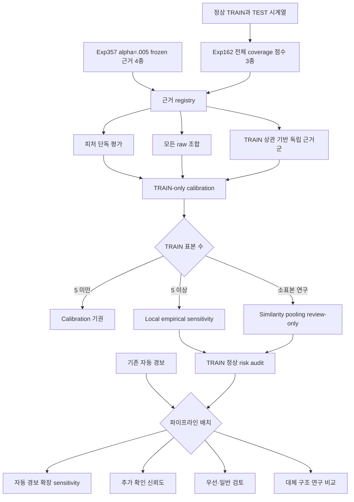

# Exp381-385 Coverage-First Feature Lattice 설계

## 1. 목적

Exp377-380은 네 독립 근거의 모든 조합을 검증했지만 실제 근거는
1,117개 중 177개 데이터셋에서만 생성됐다. 다음 단계는 기존 자동 경보를
유지하면서 TRAIN-only 근거 coverage를 넓히고, 새 근거의 단독 효과와
가능한 모든 조합 및 파이프라인 배치를 검증하는 것이다.

모든 결과는 retrospective counterfactual이다. TEST 결과를 보고 피처,
alpha, 조합, threshold 또는 운영 정책을 선택하지 않는다.

## 2. 확인된 사실

- 기존 기준 자동 경보: 2,218건, TP 1,915, FP 303, precision 86.339%
- Exp377 네 근거 모두 사용 가능: 177개
- Exp377 네 근거 모두 사용 불가: 940개
- TRAIN 200개 이상 데이터셋: 179개
- Exp357 frozen evidence는 alpha 0.005의 최종 index만 보존
- Exp357 원본 점수 벡터와 생성 코드는 현재 저장소에서 확인되지 않음
- Exp162 대안 점수 cache는 1,117개 전체 coverage, 오류 0

Exp357의 기존 네 근거를 다른 alpha로 재생성하지 않는다. 생성 코드와
점수 provenance가 복구되기 전에는 alpha 0.005 frozen evidence로만
사용한다.

## 3. TRAIN 크기 계약

| TRAIN 수 | 데이터셋 | 정책 |
|---:|---:|---|
| 1-4 | 162 | calibration 기권, 자동·검토 후보 생성 금지 |
| 5-19 | 316 | TRAIN 경험적 꼬리 및 pooling을 review-only sensitivity로 평가 |
| 20-49 | 138 | TRAIN 경험적 꼬리와 pooling을 분리 평가 |
| 50-99 | 250 | local empirical alpha grid 평가 |
| 100-199 | 74 | local empirical alpha grid 평가 |
| 200 이상 | 179 | 기존 local conformal 및 대안 점수 비교 가능 |

`n_train < 5` 기권은 유지한다. 빈 후보를 정상 판정으로 해석하지 않고
`calibration_abstained`로 표시한다.

## 4. 점수원

### 4.1 Frozen 기존 근거

- `trend_change`: EWMA 추세 변화
- `dynamics_change`: 다중 차분 합의
- `frequency_change`: 주파수 변화
- `normal_space_distance`: TRAIN 정상 공간 거리

이 네 근거는 Exp357 alpha 0.005 frozen index만 사용한다.

### 4.2 Full-coverage 대안 점수

Exp162 cache에서 다음 TRAIN/TEST score를 읽는다.

- `spectral_derivative`: 원본·차분·FFT 통합 편차
- `shapelet_normal_prototype`: TRAIN 정상 shapelet prototype 거리
- `interval_quantile`: 구간·분위수·기울기 편차

각 점수는 단독 평가한다. 세 점수의 7개 비어 있지 않은 부분집합과
부분집합별 모든 `k-of-m`, 총 12개 규칙을 평가한다.

## 5. 상관성 처리

`spectral_derivative`는 기존 dynamics/frequency 근거와 중복될 수 있다.
따라서 다음 두 결과를 분리한다.

1. `raw_source_lattice`: 모든 개별 점수원을 그대로 사용한 연구용 조합
2. `independent_family_lattice`: TRAIN OOF/정상 점수 상관성이 높은
   점수원을 하나의 근거군으로 축약한 운영 해석용 조합

상관성 판정에는 TRAIN 점수만 사용한다. TEST score, label 또는 성능은
사용하지 않는다. 상관 임계값은 실행 전 고정하며 sensitivity로 여러 값을
보고할 경우 하나를 TEST 성능으로 선택하지 않는다.

## 6. Calibration

### 6.1 Local empirical tail

Exp162 TRAIN 정상 점수의 경험적 상위 분위수를 사용한다.

- alpha: 0.005, 0.01, 0.02, 0.05
- strict `test_score > train_quantile`
- 동점은 후보로 만들지 않음
- 이를 exact conformal p-value라고 부르지 않음
- threshold 고유 개수와 해상도 제한을 기록

### 6.2 Score-similarity pooling

기존 Exp158-160 계약을 재사용한다.

- target dataset은 reference에서 제외
- 이웃 선택은 TRAIN score descriptor만 사용
- 최소 pooled reference 200
- family 또는 dataset 이름 사용 금지
- `n_train < 5` 기권
- review-only sensitivity

Pooling과 local empirical 결과를 TEST 성능으로 비교해 하나를 선택하지
않는다.

## 7. 실험 구성

### Exp381: Coverage 및 provenance 감사

- TRAIN 크기 분포와 alpha별 이론적 해상도
- Exp357 177/940 분기 원인
- TRAIN 200 이상인데 unavailable인 2개 데이터셋 원인
- Exp357 원본 score/code provenance
- Exp162 1,117개 cache hash, config, 배열, finite 값, TRAIN/TEST 길이
- 후속 실험 실행 가능 여부

Exp162 coverage 또는 hash가 맞지 않으면 Exp382 이후를 중단한다.

### Exp382: Full-coverage 대안 점수 calibration

- 세 점수 × 네 alpha의 label-free 후보 동결
- 단독 후보와 12개 전체 조합 생성
- local empirical과 similarity pooling을 별도 variant로 생성
- `n_train < 5` 기권

### Exp383: Source dependence 및 독립 근거군

- TRAIN 점수 Spearman 상관
- source availability
- raw source와 독립 family의 차이
- 기존 네 frozen 근거와 새 세 근거 사이의 가용 조합
- 상관된 근거의 중복 투표 방지

### Exp384: Exhaustive combined lattice 및 TRAIN risk

기존 네 frozen 근거와 새 세 근거를 결합한다.

- raw 7-source lattice: 비어 있지 않은 127개 부분집합, 448개 규칙
- independent-family lattice: Exp383에서 사전 정의된 family 기준
- 모든 규칙의 full-population/common-support 결과
- TRAIN pseudo-normal false alert risk
- 정상 100 run당 0.5, 1, 2건 목표를 모두 sensitivity로 보고

TEST 결과로 규칙이나 risk target을 선택하지 않는다.

### Exp385: 파이프라인 구조 비교

- 기존 Hard 유지 + 신규 review
- 기존 Hard + TRAIN risk 통과 후보의 hard-expansion sensitivity
- 기존 Hard의 추가 확인 신뢰도 등급
- 새 조합 단독 replacement research sensitivity

Priority/review 후보를 TEST 결과 확인 후 자동 경보로 승격하지 않는다.

## 8. 데이터 흐름

## 9. Prediction과 평가 분리

Prediction은 TEST label, 실제 이상 위치, TP, FP, F1을 입력받지 않는다.
dataset 이름은 조회 key로만 사용하고 정책 분기에 사용하지 않는다.
Prediction JSONL과 config를 SHA256으로 동결한 후에만 TEST label로
retrospective evaluation을 수행한다.

## 10. 평가 지표

- coverage 및 abstention
- candidate 수와 dataset별 workload 분포
- Hard TP, FP, precision, recall, mean F1
- zero-F1 데이터셋 수
- Standard/Priority review TP, FP, precision
- 기준 대비 candidate index 변화
- exact 및 tolerance 일치
- TRAIN pseudo-normal false alert rate와 Wilson upper bound
- TRAIN 크기 구간별 성능과 안정성

자동 경보와 human-assisted 지표를 합치지 않는다.

## 11. 중단 조건

- Exp162 cache coverage가 1,117개가 아님
- cache hash 또는 source config 불일치
- TRAIN/TEST score 배열 누락 또는 길이 불일치
- finite score가 아닌 값 존재
- prediction 단계 TEST label 접근
- `n_train < 5`에서 후보 생성
- 일부 실패 데이터셋을 빈 후보로 성공 처리
- TEST 결과를 보고 alpha, 상관 임계값, 조합 또는 risk target 변경

## 12. 완료 기준

- Exp381 provenance 및 coverage 감사 완료
- Exp382 세 신규 점수 단독 및 12개 조합 완료
- Exp383 TRAIN-only source dependence 감사 완료
- Exp384 raw/independent 전체 조합과 risk audit 완료
- Exp385 네 파이프라인 구조 비교 완료
- 전체 1,117개 coverage 또는 명시적 abstention
- prediction/evaluation 분리 및 hash 검증
- 독립 재집계 일치
- 모든 결과가 retrospective이며 정책 선택이 아님을 명시
