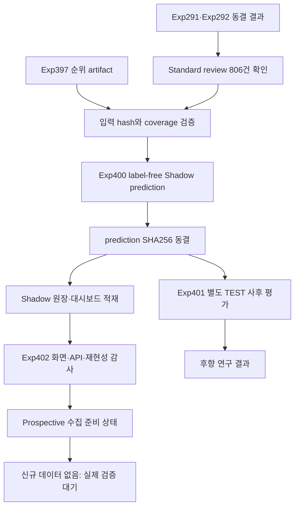

# Exp400-402 Exp397 Review Ranking Shadow Validation Design

## 1. 목적

Exp400-402는 Exp397의 검토 후보 순위가 기존 Exp292 순위보다 사용자 검토
업무에 도움이 되는지를 검증한다. 자동 경보 정책과 기존 lane은 변경하지
않는다.

현재 신규 설비 데이터가 없으므로 이번 검증은 두 범위로 한정한다.

1. 기존 1,117개 데이터셋을 이용한 `retrospective shadow replay`
2. 향후 신규 데이터가 들어왔을 때 사용할 `prospective shadow` 기록 경계의
   준비 상태 감사

이번 결과를 실제 설비 prospective 검증 또는 배포 검증으로 표현하지 않는다.

## 2. 고정 원칙

1. Exp291 자동 경보 2,218건은 변경하지 않는다.
2. Exp292 Standard review 806건의 후보 집합은 변경하지 않는다.
3. 기존 Priority review 31건은 변경하지 않으며 순위 대상에도 포함하지 않는다.
4. Exp265의 기존 정책, 데이터, Supabase 행과 대시보드 표시는 덮어쓰지 않는다.
5. Shadow prediction에는 TEST 라벨, TP, FP, F1 또는 실제 이상 위치를 넣지 않는다.
6. TEST 결과로 alpha, variant, K 또는 자동 승격 규칙을 선택하지 않는다.
7. `ALPHAS=(0.005, 0.01, 0.02, 0.05)`를 모두 병렬 기록한다.
8. 운영 비교 대상은 Exp292 기본 순위와 Exp397
   `tier_preserving_grammar` 순위다.
9. `additive_grammar_family`와 `grammar_only_control`은 연구 대조군으로만
   결과 파일에 보존하며 운영 Shadow 기본 화면에서는 숨긴다.
10. Priority review를 자동 경보로 승격하지 않는다.
11. tail replacement를 사용하지 않는다.
12. 동일 과거 TEST 데이터의 반복 분석이라는 한계를 모든 결과 문서에 표시한다.

## 3. 접근 방식

### 선택한 방식: 기존 Exp265 원장 확장

Exp265가 이미 지원하는 `prospective_shadow`와 `retrospective_replay` 분리를
재사용한다. Exp397 전용 정책 버전과 순위 필드를 추가하되 기존 Exp265
payload와 행은 그대로 유지한다.

장점:

- label-free prediction과 사후 evaluation 경계가 이미 존재한다.
- 인증, append-only feedback, hash 검증과 재전송 안전성을 재사용한다.
- `/shadow`에서 과거 재생과 신규 검증을 명확하게 분리할 수 있다.

주의점:

- 기존 Exp265의 네 점수원 lane과 Exp397의 검토 순위는 목적이 다르다.
- 따라서 Exp397 순위를 Exp265 `final_lane`으로 변환하지 않고 별도 ranking
  evidence로 저장한다.

### 제외한 방식

- CSV 전용 재생: 저렴하지만 원장, API와 화면 연결을 검증하지 못한다.
- 즉시 prospective 수집: 신규 upstream 데이터가 없어 현재 수행할 수 없다.

## 4. 실험 구성

### Exp400: Frozen review ranking shadow prediction

입력:

- Exp291 자동 경보 및 기존 lane
- Exp292 Standard review tier
- Exp397 동결 순위 artifact
- Exp397 prediction manifest와 SHA256

출력:

- 데이터셋별 label-free shadow run
- Standard 후보별 Exp292 기본 순위
- alpha별 Exp397 tier-preserving 순위
- grammar support count와 p-value 근거
- policy/config/input/prediction SHA256

Exp400은 다음 필드를 포함하지 않는다.

- `y_test`
- 실제 이상 위치
- TP, FP, FN, precision, recall, F1
- TEST 성능에서 파생된 추천 alpha 또는 추천 K

한 후보는 기존 Standard review 후보라는 사실만 보존한다. Exp400은 후보의
lane을 바꾸거나 자동 경보를 생성하지 않는다.

### Exp401: Frozen shadow replay evaluation

Exp400 prediction 파일의 SHA256을 먼저 검증하고 고정한 뒤 별도 단계에서 TEST
라벨을 읽는다.

평가 대상:

- Exp292 기본 순위
- alpha 4개의 tier-preserving grammar 순위
- 연구 대조군 2종

사전 고정 workload:

- 전역 K = 25, 50, 100, 200
- 데이터셋별 top-1

보고 지표:

- Precision@K
- TP@K, FP@K
- 후보가 있는 데이터셋의 top-1 precision
- 후보 순위 exact Jaccard와 rank correlation
- Exp292 대비 순위 상승/하락 후보 수
- dataset별 workload

평가 결과로 alpha나 workload를 운영값으로 선택하지 않는다. 결과는
`retrospective research diagnostic`이다.

### Exp402: Shadow dashboard and readiness audit

Exp402는 두 가지를 검증한다.

1. 과거 재생 데이터를 `/shadow`의 Exp397 전용 보기에서 읽을 수 있는가
2. 미래 신규 run에서 같은 label-free schema를 기록할 준비가 되었는가

화면의 기본 표시:

- `개발용 재생` 배지
- `실제 운영 검증 아님` 안내
- 현재 운영 순위: Exp292
- Shadow 비교 순위: Exp397 tier-preserving, alpha 4개
- 후보별 기존 순위, Shadow 순위, 순위 변화
- grammar 근거 수와 p-value
- 사후 사용자 판정 상태

연구 대조군은 기본 화면에서 숨기고 필요할 때만 펼쳐 본다.

## 5. 데이터 모델

기존 Exp265 테이블은 수정하지 않는다. Exp397 ranking evidence는 별도 테이블
또는 기존 candidate의 독립 JSON evidence 필드로 추가할 수 있다. 구현
계획에서는 migration blast radius를 비교한 뒤 별도 테이블을 우선한다.

논리 schema:

### `shadow_ranking_runs`

- `run_id`
- `collection_mode`
- `policy_version`
- `dataset_key`
- `observed_at`
- `baseline_policy_version`
- `ranking_policy_version`
- `input_sha256`
- `prediction_sha256`
- `retrospective`
- `prospective`

### `shadow_ranking_candidates`

- `candidate_id`
- `run_id`
- `candidate_index`
- `exp292_tier`
- `exp292_rank`
- alpha별 `tier_preserving_rank`
- alpha별 `grammar_support_count`
- alpha별 primitive/composite p-value
- `contains_test_labels=false`
- `contains_evaluation_metrics=false`

한 dataset에 Standard 후보가 없더라도 run 행은 기록한다. 검증 모집단은 후보가
있는 데이터셋이 아니라 전체 1,117개 데이터셋이다.

## 6. 처리 흐름

## 7. 무결성 조건

Exp400은 다음 조건을 모두 만족해야 성공이다.

- dataset coverage: 1,117/1,117
- Standard candidate coverage: 806/806
- 후보 중복: 0
- 후보 범위 오류: 0
- 자동 경보 변경: 0
- Priority review 변경: 0
- Standard 후보 집합 변경: 0
- prediction의 TEST label/evaluation field: 0
- 동일 입력과 seed의 정렬 출력 SHA256 일치
- alpha별 후보 집합 exact match

Exp401은 다음을 확인한다.

- prediction SHA256 불일치 시 평가 중단
- 독립 재집계와 공식 결과 exact match
- lane overlap 0
- 후보 합계 불일치 0
- TP+FP가 평가 후보 수와 일치

Exp402는 다음을 확인한다.

- 비로그인 API 접근 거부
- retrospective/prospective 자료 혼합 0
- Exp265 기존 자료 변경 0
- 같은 run ID와 같은 hash의 재전송은 idempotent
- 같은 run ID와 다른 hash는 충돌 처리
- 라벨 없는 상태에서 precision/recall/F1을 운영 지표로 표시하지 않음

## 8. 오류 처리

- 입력 SHA256이 다르면 생성과 적재를 중단한다.
- 1,117개 dataset 또는 806개 후보 coverage가 맞지 않으면 부분 성공으로
  처리하지 않는다.
- 한 후보라도 범위를 벗어나거나 중복되면 해당 실행 전체를 실패 처리한다.
- Supabase 전송 실패는 로컬 append-only spool에 남기고 재시도한다.
- 기존 run ID와 다른 prediction hash가 발견되면 자동 재시도하지 않고
  blocker로 기록한다.
- 신규 데이터가 없으면 prospective 진행률은 0으로 유지한다.

## 9. 테스트

### Python

- prediction 함수가 TEST label을 입력받지 않는 구조 테스트
- forbidden evaluation field 테스트
- 1,117 dataset 및 806 candidate coverage 테스트
- alpha별 후보 집합 불변 테스트
- 자동 경보/Priority/Standard 집합 불변 테스트
- deterministic output hash 테스트
- prediction hash tamper detection
- independent reaggregation

### Dashboard/API

- Exp397 replay schema validation
- 기존 Exp265 schema backward compatibility
- retrospective/prospective query 분리
- 인증과 append-only feedback
- ranking 정렬과 순위 변화 계산
- label이 없을 때 metric 숨김
- 1,117개 run pagination

## 10. 성공 기준과 해석

소프트웨어 검증 성공:

- Exp400-402 무결성 조건과 테스트가 모두 통과한다.
- 대시보드가 Exp397 과거 재생 결과를 기존 Exp265와 분리해 표시한다.
- prospective 입력을 받을 schema, hash와 spool 경계가 준비된다.

순위 연구 신호:

- Exp397이 특정 사전 고정 workload에서 Exp292보다 높은 precision을 보이는지
  그대로 보고한다.
- 좋아진 workload와 나빠진 workload를 모두 공개한다.
- TEST 결과로 운영 alpha 또는 K를 선택하지 않는다.

이번 작업으로 말할 수 없는 것:

- Exp397이 실제 설비에서 검증됐다.
- 특정 alpha가 운영 최적값이다.
- Exp397 순위가 자동 경보를 개선했다.
- 전체 파이프라인이 prospective 또는 deployment validated다.

## 11. 향후 prospective 단계

신규 데이터가 확보되면 다음을 별도 사전등록한다.

1. 운영 전에 alpha와 검토 workload 선택 규칙을 동결한다.
2. 실제 고유 run ID와 발생 시각을 기록한다.
3. prediction 완료 후에만 사용자 판정을 연결한다.
4. 후보가 없는 run도 모집단에 포함한다.
5. 완전 run 판정이 없는 경우 precision과 workload만 보고한다.
6. Recall/F1은 놓친 이상까지 확인된 run에서만 계산한다.
7. 결과가 좋아도 자동 경보 승격은 새 실험과 별도 승인으로 진행한다.

