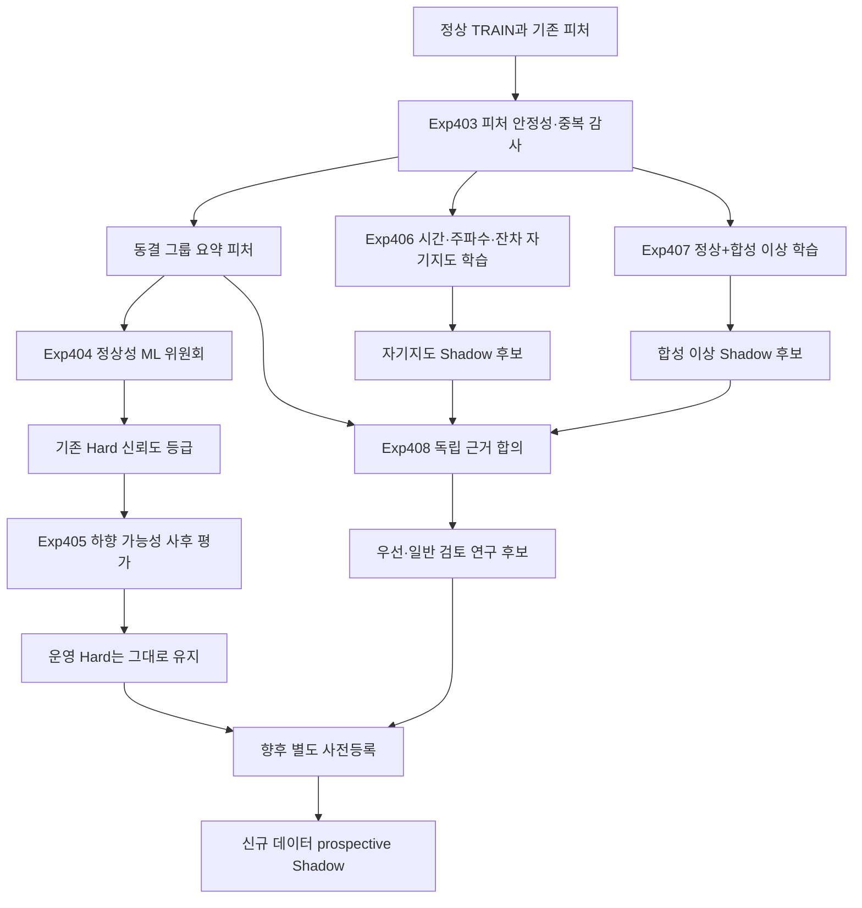

# Exp403-408 기존 피처 개선 및 TRAIN-only 머신러닝 검증 설계

## 1. 목적

Exp403-408은 두 문제를 순서대로 분리해 검증한다.

1. 기존 자동 경보의 오탐 가능성을 정상 TRAIN 기반 머신러닝으로 재확인한다.
2. 기존 자동 경보가 놓친 이상을 자기지도 표현과 합성 이상 학습으로 찾아
   Shadow 또는 검토 후보로 제시한다.

첫 번째 문제에서 머신러닝은 기존 자동 경보를 즉시 취소하지 않는다. 먼저
`신뢰도 높음`, `신뢰도 보통`, `재확인 필요` 등급만 기록한다. 하향 가능성은
별도의 retrospective counterfactual 실험으로만 평가한다.

두 번째 문제의 신규 후보는 자동 경보로 승격하지 않는다. 기존 자동 경보와
Priority/Standard review를 보존한 상태에서 review-only Shadow로 시작한다.

## 2. 기준 결과와 해석 경계

- 평가 데이터셋: 1,117개
- 기준 자동 경보: 2,218건
- 기준 TP / FP / FN: 1,915 / 303 / 2,003
- 기준 Zero-F1 데이터셋: 356개
- 기존 Standard review: 806건
- 기존 Priority review: 31건
- 기존 automatic Hard, Standard, Priority 인덱스는 Exp408까지 불변이다.
- 모든 prediction은 TEST 라벨과 실제 이상 위치를 읽지 않는다.
- TEST 결과로 피처, 모델, 임계값, alpha, 합성 이상 유형 또는 lane을 선택하지
  않는다.
- 모든 결과는 기존 TEST를 재사용하는 retrospective counterfactual이다.
- 신규 설비 데이터의 prospective 또는 deployment 검증으로 표현하지 않는다.

## 3. 현재 근거

최근 실험은 새로운 점수원을 자동 경보에 단독 추가하면 FP가 빠르게 증가한다는
점을 보여줬다.

- Exp391에서 큰 데이터셋은 전체 FN의 86.42%를 포함했지만, 사전 고정된 신규
  근거 합의의 정밀도는 21.85~33.33%였다.
- Exp392의 Alpha 0.005 단일 근거 중 EWMA는 61.54%, 정상 공간 거리는
  34.19%였지만 신호가 일부 데이터셋 또는 계보에 집중됐다.
- Exp393-396의 정상 공정 문법 피처는 FN을 회수했지만 검토 후보 추가 시
  정밀도가 낮아 workload가 크게 증가했다.
- ROCKET kernel 수만 늘리는 방식은 독립 근거를 만들지 못했고 단독 정밀도도
  개선하지 못했다.

따라서 이번 설계는 원시 후보 합집합을 확대하지 않고 다음 두 방향을 사용한다.

1. 기존 피처를 TRAIN OOF 안정성 기준으로 정리해 정상성 판단 품질을 높인다.
2. 수작업 피처가 놓치는 비선형 구조는 독립된 자기지도·합성 이상 모델로
   review-only 후보를 만든다.

## 4. 고정 원칙

1. 기존 자동 경보 2,218건을 prediction 결과에서 삭제하거나 이동하지 않는다.
2. Exp405는 하향 정책을 실제 lane에 적용하지 않는 사후 진단이다.
3. 하향 후보의 실제 오탐 비율 80% 이상, 기존 TP 99% 이상 보존, 정상 TRAIN
   교차검증 정상 판정 안정성 99% 이상을 모두 보고한다.
4. 위 기준을 만족하더라도 별도 사전등록과 신규 검증 전에는 운영 정책을
   변경하지 않는다.
5. 같은 피처를 사용하는 여러 모델은 하나의 `정상성 근거군`으로 취급한다.
6. TEST 길이 기반 top-N budget, family 이름, dataset 이름, 과거 family별 TEST
   성능을 정책 입력으로 사용하지 않는다.
7. tail replacement를 사용하지 않는다.
8. Priority review를 automatic Hard로 승격하지 않는다.
9. `ALPHAS=(0.005, 0.01, 0.02, 0.05)`를 모두 동결해 보고하며 TEST 결과로
   하나를 선택하지 않는다.
10. feature fitting, scaling, pruning, model fitting, threshold, eligibility,
    source independence는 정상 TRAIN만으로 결정한다.

## 5. 피처 체계 개선

### 5.1 피처 그룹

기존 피처를 물리적·방법론적 근거에 따라 다음 그룹으로 정리한다.

| 그룹 | 포함 근거 |
|---|---|
| 시간 랜덤 커널 | ROCKET, MiniROCKET, MultiROCKET |
| 정상 공간 거리 | KNN local-gap, shrinkage/diagonal Mahalanobis |
| 변화·차분 | EWMA, 1·2차 차분, change-point |
| 주파수·다중 스케일 | Spectrogram, Wavelet, spectral statistics |
| 형상·복잡도 | entropy, recurrence, topology, statistical shape |
| 공정 문법 | transition, dwell, recovery |

같은 그룹 내부 모델의 동의는 독립된 여러 표로 세지 않는다.

### 5.2 TRAIN OOF 안정성 정리

각 데이터셋과 fold에서 다음을 계산한다.

- 비유한 값 비율
- 상수 또는 근상수 피처
- robust scale
- fold별 정상 중심 이동
- bootstrap rank 안정성
- 피처 쌍의 TRAIN OOF Spearman 상관

다음 피처는 사용하지 않는다.

- 비유한 값이 존재하고 사전 고정 보정으로 복구되지 않는 피처
- TRAIN에서 분산이 사실상 0인 피처
- fold마다 방향이 크게 뒤집혀 정상 점수 순위가 재현되지 않는 피처

절대 Spearman 상관이 0.90 이상인 피처는 하나의 중복 component로 묶는다.
대표 피처는 TEST 성능이 아니라 TRAIN OOF 안정성, coverage, 비유한 값 비율
순서로 선택한다.

### 5.3 그룹 요약과 상호작용

원시 고차원 피처를 무조건 이어 붙이지 않는다. 각 그룹에서 다음 고정 요약을
만든다.

- empirical p-value 최소값과 중앙값
- `-log10(p)` robust mean과 maximum
- 그룹 내 threshold 초과 수
- 첫째와 둘째 근거의 score gap
- bootstrap sign/stability
- 그룹 간 독립 동의 수

상호작용은 TRAIN 기준으로 스케일된 그룹 요약의 차이와 최소값만 사용한다.
무제한 다항 조합이나 TEST 성능 기반 feature search는 하지 않는다.

## 6. Exp403: TRAIN-only Feature Stability Audit

### 목적

기존 피처를 머신러닝에 넣기 전에 안정성, 중복, coverage를 감사하고 고정된
feature contract를 생성한다.

### 출력

- 데이터셋별 사용 가능한 피처와 제외 이유
- TRAIN OOF 안정성 및 상관 component
- 그룹별 요약 벡터
- feature/config/input SHA256
- 학습 가능성 구분

### TRAIN 크기 구분

- `n_train < 5`: ML abstention, 기준 lane 유지
- `5 <= n_train < 20`: 고전적 robust distance만 허용
- `20 <= n_train < 50`: 고전적 정상성 위원회 허용
- `n_train >= 50`: 자기지도·합성 이상 모델까지 연구 eligibility 허용

위 경계는 실행 전에 동결하며 TEST 결과로 변경하지 않는다.

## 7. Exp404: Automatic Hard Confidence Committee

### 목적

Exp403 피처로 기존 자동 경보 각각에 정상성 신뢰도 등급을 부여한다. 경보
인덱스는 변경하지 않는다.

### 모델

1. Robust shrinkage Mahalanobis
2. Isolation Forest
3. One-Class SVM
4. Local Outlier Factor novelty mode

모델마다 fold-local fit과 scoring을 사용한다. LOF는 `novelty=True`로
학습하고 fit에 사용한 행을 그대로 novelty score로 평가하지 않는다.

### 점수 보정

- 각 모델 score를 TRAIN OOF empirical p-value로 변환한다.
- threshold는 동결 alpha 네 개를 모두 사용한다.
- 모델 수가 아니라 정상성 근거군의 calibration 안정성과 합의를 기록한다.
- contamination 또는 `nu`는 TEST anomaly rate에서 얻지 않는다.

### 신뢰도 등급

- `신뢰도 높음`: 기존 독립 이상 근거와 정상성 위원회가 모두 이상 방향
- `신뢰도 보통`: 기존 경보는 강하지만 정상성 위원회가 혼합
- `재확인 필요`: eligible 정상성 모델이 모두 정상 방향이며 TRAIN 안정성
  계약을 통과
- `판정 보류`: TRAIN 부족, 모델 불안정 또는 피처 coverage 부족

어떤 등급도 automatic Hard를 삭제하거나 review로 이동하지 않는다.

## 8. Exp405: Hard Demotion Counterfactual

### 목적

Exp404의 동결 prediction을 TEST 라벨로 사후 평가해 `재확인 필요` 경보를
검토로 내릴 가능성만 진단한다.

### 성공 기준

- 재확인 필요 집합의 실제 FP 비율 `>= 0.80`
- 기존 Hard TP 보존율 `>= 0.99`
- 정상 TRAIN OOF 정상 판정 안정성 `>= 0.99`
- 결과가 한 데이터셋 또는 한 계보에 과도하게 집중되지 않음
- prediction/evaluation 분리 및 불변성 테스트 통과

집중도는 데이터셋 수, 상위 1/5/10개 데이터셋 점유율, leave-one-lineage-out
결과로 보고한다. 성공 기준을 만족해도 기존 automatic Hard는 변경하지 않는다.

## 9. Exp406: Tri-view Self-supervised FN Shadow

### 목적

수작업 피처가 놓친 비선형 정상 구조를 시간·주파수·잔차 세 관점의 작은
자기지도 encoder로 학습한다.

### 입력 관점

- 시간: 정규화 원 파형과 다중 스케일 구간
- 주파수: log spectrum과 고정 wavelet band
- 잔차: 정상 prototype 또는 안정적 baseline 대비 잔차

### 학습 과제

- 사전 고정 비율의 구간 masking 복원
- 동일 정상 run의 약한 변형 간 표현 일치
- 시간·주파수·잔차 표현의 cross-view 일치
- 정상 prototype 또는 memory bank와의 compactness

모델은 `n_train >= 50`에서만 dataset-specific 연구 eligibility를 가진다.
MPS는 동일 seed 반복 hash와 CPU 대비 smoke 일치가 확인될 때만 사용한다.

### 출력

- 기존 Hard 밖 label-free 후보
- TRAIN OOF p-value와 alpha별 후보
- 기존 Standard/Priority/외부 후보와의 overlap
- 자동 경보가 아닌 `self_supervised_shadow`

## 10. Exp407: Synthetic-anomaly FN Shadow

### 목적

정상 TRAIN과 사전 고정된 합성 이상만 이용해 실제 이상 형태를 직접 가정하는
가벼운 분류기를 학습한다.

### 동결 합성 이상

- 짧은 spike
- 완만한 drift
- level shift
- flat-line
- 국소 amplitude scaling
- frequency warp
- phase 또는 구간 순서 perturbation

강도는 TEST를 보지 않고 TRAIN robust scale과 길이 분위수에서 생성한다.
각 유형과 통합 결과를 모두 sensitivity로 보고하며 TEST 성능으로 특정 유형을
선택하지 않는다.

### 모델

- Logistic Regression
- HistGradientBoosting
- 작은 MLP sensitivity

세 모델을 모두 보고하며 primary/optimal 모델을 TEST 결과로 고르지 않는다.
출력은 `synthetic_anomaly_shadow`이며 automatic Hard를 변경하지 않는다.

## 11. Exp408: Independent-source Consensus and Final Audit

### 목적

Exp406과 Exp407을 기존 근거와 독립적으로 비교하고, 합의가 실제로 FP를
억제하면서 FN을 회수하는지 평가한다.

### 독립성

- 같은 feature lineage 또는 같은 synthetic transformation 계보는 한 표
- TRAIN OOF 절대 Spearman `>= 0.90`인 source는 하나의 component
- 정렬된 TRAIN OOF 행이 20개 미만이면 독립성 확인 불가
- 독립성 확인 불가 source는 신규 독립 표로 세지 않음

### 동결 variants

1. Exp406 단독 Shadow
2. Exp407 단독 Shadow
3. Exp406과 Exp407 교집합
4. 두 신규 source 중 하나와 기존 독립 근거군 하나의 합의
5. 두 신규 source와 기존 독립 근거군의 3-way 합의

모든 variant를 보고하며 TEST 성능으로 하나를 선택하지 않는다.

### 보고

- 기존 Hard TP/FP/FN 불변
- 신규 후보 수, FN 회수, 추가 FP, 정밀도
- 기존 review overlap과 review 밖 신규 후보
- Zero-F1 변화 진단
- TRAIN 크기별 coverage
- dataset/lineage 집중도
- review workload
- paired bootstrap interval
- autonomous와 human-assisted 지표 분리

## 12. 전체 처리 흐름

## 13. Prediction과 Evaluation 분리

Prediction 함수는 다음 정보만 받는다.

- 정상 TRAIN values와 고정 metadata
- TEST values
- frozen config
- 데이터 조회용 key

Prediction 함수는 다음 정보를 받지 않는다.

- `y_test`
- 실제 이상 위치
- family 이름을 이용한 정책 분기
- dataset 이름을 이용한 정책 분기
- TEST 길이 기반 budget
- 과거 family별 TEST 성능

Prediction JSONL에는 TP, FP, FN, precision, recall, F1 또는 추천 variant를
넣지 않는다. Prediction hash를 고정한 뒤 별도 evaluation 단계에서만 TEST
라벨을 읽는다.

## 14. 오류 및 중단 조건

다음 조건이면 후속 stage를 실행하지 않는다.

- 기존 Hard/Standard/Priority 인덱스 불일치
- Exp403 feature contract 또는 input hash 불일치
- prediction에서 TEST label/evaluation field 발견
- TRAIN fold 자기 참조 또는 pseudo-test leakage
- 비유한 feature/score
- 일부 데이터셋 누락을 빈 후보로 대체
- 동일 seed 반복 hash 불일치
- source 독립성 계산에 TEST score 사용
- TEST 결과를 본 뒤 피처, 모델, threshold, alpha, 합성 이상 강도 변경

개별 데이터셋의 `n_train` 부족은 전체 실행 실패가 아니라 명시적 abstention으로
기록한다.

## 15. 검증

### 단위·구조 테스트

- 피처 그룹과 중복 component 결정성
- TRAIN OOF fold isolation
- LOF unseen-query 계약
- prediction 함수의 forbidden input 차단
- alpha coverage
- lane 불변성과 overlap 0
- non-finite rejection
- seed/행 순서 결정성
- prediction hash tamper detection

### Smoke

- TRAIN 크기 구간을 모두 포함하는 고정 데이터셋 집합
- 각 모델의 fit/abstain 이유 검증
- MPS와 CPU의 허용 오차 및 rank 일치
- prediction에 evaluation field 0

### Full

- 1,117개 dataset coverage
- 누락과 error 0 또는 명시적 abstention
- 독립 재집계 mismatch 0
- 기존 Hard 2,218, Standard 806, Priority 31 불변

## 16. 성능과 운영 해석

Exp404-405는 자동 경보의 품질을 평가하지만 운영 경보를 변경하지 않는다.
Exp406-408은 탐지 범위를 넓히지만 review-only다.

말할 수 있는 것:

- 정상 TRAIN 기반 ML이 기존 Hard에 신뢰도 등급을 부여했다.
- 동결된 재확인 필요 집합의 사후 FP 비율과 TP 보존율을 측정했다.
- 자기지도·합성 이상 source가 기존 후보 밖 FN을 찾을 가능성을 평가했다.

말할 수 없는 것:

- 기존 자동 경보를 실제로 취소해도 안전하다.
- TEST에서 가장 좋은 모델 또는 alpha가 운영 최적값이다.
- 전체 파이프라인이 prospective 검증됐다.
- 신규 모델이 실제 반도체 설비 성능을 개선했다.

## 17. 참고 근거

- scikit-learn novelty/outlier detection:
  https://scikit-learn.org/stable/modules/outlier_detection.html
- Temporal Hierarchical One-Class:
  https://proceedings.neurips.cc/paper/2020/hash/97e401a02082021fd24957f852e0e475-Abstract.html
- Bilinear Temporal-Spectral Fusion:
  https://proceedings.mlr.press/v162/yang22e.html
- Neural Transformation Learning:
  https://proceedings.mlr.press/v139/qiu21a.html
- Memory Mechanism for Unsupervised Anomaly Detection:
  https://proceedings.mlr.press/v216/li23a.html

