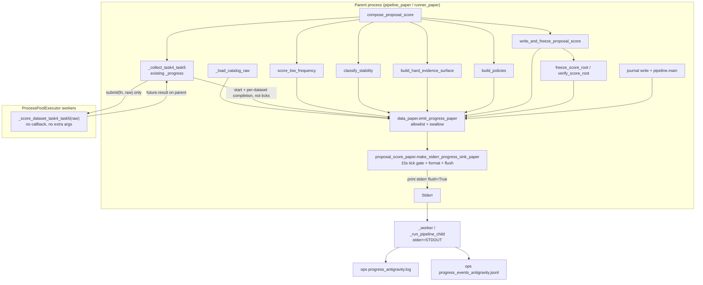
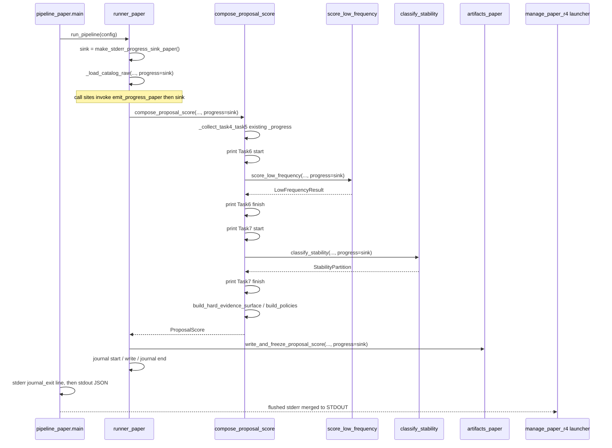

# Paper r4 Complete Progress Logging Design

| Field | Value |
| --- | --- |
| Title | Paper r4 Complete Progress Logging |
| Author | Grok (dedicated paper-r4 operational worktree) |
| Date | 2026-08-14 |
| Status | Approved |
| Eventual committed path | `docs/superpowers/specs/2026-08-14-paper-r4-complete-progress-logging-antigravity-design.md` |
| Workspace (read-only for this spec task) | `/Users/mac/Documents/Time Series/.worktrees/grok-paper-r4-operational-antigravity` |
| Decision | User-approved **callback-based progress logging** |

This is a design specification only. It does not implement code, does not edit production tests, and does not write Dataset or Codex-worktree roots.

## Overview

The live official paper r4 run at frozen commit `bc5ab54677b73e6f177a3afed9dfee816564b48f` is already past Task4+Task5 and is opaque for hours. Existing scientific progress is a parent-side Task4+Task5 completion printer plus four bare `Task6`/`Task7` start/finish lines. After those lines, RawPreload, Task6 dataset/group loops, Task7 candidate/view loops, hard-evidence and policy construction, shard writes, freeze verification, and journal/exit emit nothing the official launcher can capture.

This spec adds **optional, result-neutral progress callbacks** modeled on `data_paper.SqlObserver`. Default `progress=None` keeps today's bit-identical science and today's stderr contract. When a parent-side sink is installed, the same flushed-stderr transport already used by `scratch/manage_paper_r4_proposal_antigravity.py` records stage start/end/error immediately and intermediate ticks at most once per 15.0 seconds. Callback failures cannot change scores, candidates, shards, journal payloads, or exit codes.

The live `bc5ab546` process cannot gain these logs. Any edit to a file hashed by `paper/equipment_anomaly_detection/codemap_paper.lock` changes `runner_paper._closure()` / journal `code_closure`. Implementation therefore lands on a **new official scientific root and a new ops root**. Checkpoints are not migrated by assumption. Until the live run exits or is user-stopped, operators use a write-free monitor that tails the existing ops log and counts on-disk artifacts.

## Background & Motivation

### Live official facts (read-only, 2026-08-14)

| Item | Value |
| --- | --- |
| Scientific root | `/Users/mac/Documents/Dataset/paper_proposal_full_r4_antigravity_20260813` |
| Ops root | `/Users/mac/Documents/Dataset/paper_proposal_full_r4_v2_antigravity_20260814_ops_antigravity` |
| Reviewed commit | `bc5ab54677b73e6f177a3afed9dfee816564b48f` |
| Worker PID | 57778 (`state_antigravity.json` / `pid_antigravity.txt`) |
| Pipeline child PID | 57862, from official Codex worktree `/Users/mac/.codex/worktrees/e1be/Time Series` |
| Journal | `000000_context_paper.json` … `000003_acceleration_paper.json`; no `000004_proposal_score_paper.json` |
| Task4+Task5 success | 1117/1117 create-only records under `stage_artifacts_paper/proposal_work/task4_task5_success/` |
| Task4+Task5 attempts | 0 |
| Ops log | Task4+Task5 1117/1117, then `Task6 start` at `2026-08-14T01:01:45Z`, `Task6 finish` at `2026-08-14T02:00:51Z` (~59 minutes of silence), then `Task7 start` with **no further internal lines** |

### Current progress surfaces

`paper/equipment_anomaly_detection/proposal_score_paper.py` already has one parent-side printer:

```python
def _progress(stage: str, completed: int, total: int, started: float, dataset: str | None = None) -> None:
    ...
    print(f"{stage} {completed}/{total} {100.0 * completed / total:.1f}% elapsed={elapsed:.1f}s rate={rate:.2f}/s eta={eta:.1f}s{suffix}", file=sys.stderr, flush=True)
```

`_collect_task4_task5` emits `Task4+Task5 start 0/{total}` once, then one completion line per finished dataset. Workers stay `_score_dataset_task4_task5(raw)` with no extra arguments. That contract is correct and stays.

After Task4+Task5, `compose_proposal_score` emits only:

```python
print("Task6 start", file=sys.stderr, flush=True)
...
print("Task6 finish", file=sys.stderr, flush=True)
print("Task7 start", file=sys.stderr, flush=True)
...
print("Task7 finish", file=sys.stderr, flush=True)
```

There is no progress for:

1. **RawPreload.** `runner_paper._write_complete` (proposal_score), `_incomplete_status`, and `verify_journal` each build `{entry["dataset"]: load_dataset_values(...) for entry in catalog["datasets"]}`. Full mode is 1,117 descriptor-pinned SQLite loads. `inspect_status` in the launcher calls `verify_completed` → `verify_journal`, so an official `status` command itself reloads the population and is **not** a cheap live probe.
2. **Task6 internals.** `score_low_frequency` walks catalog-sorted datasets; `_score_one_dataset_paper` fits exact-length TRAIN groups via `fit_group_calibration_paper` (4–256 finite rows per group) then scores every TEST row. The live Task6 interval was ~59 minutes with zero inner lines.
3. **Task7 internals.** `classify_stability` walks `low.selected_candidates` (budget `GLOBAL_CANDIDATE_BUDGET_PAPER = 30`). `_candidate_views` refits up to `_MAXIMUM_VIEWS_PAPER = 16` omission views per candidate. The live run has been inside this loop since `Task7 start`.
4. **Hard evidence / policies.** `build_hard_evidence_surface` walks all datasets; `build_policies` builds four frozen routes (`hard_only`, `hard_plus_source`, `hard_plus_stable`, `hard_plus_unstable`) with per-dataset array work.
5. **Shard writes / freeze / verify.** `write_and_freeze_proposal_score` writes 1,117 typed shards; `freeze_score_root` and `verify_score_root` each re-read and hash those shards. `_write_complete` then calls `_proposal_artifact` / `_artifact_record`, which verify the freeze again.
6. **Journal / exit.** Journal write and `pipeline_paper.main` stdout JSON have no stderr phase line. After compose, `run_pipeline` recurses into `verify_journal`, which reloads all 1,117 datasets when `proposal_work` exists.

### Why the live process cannot be patched

`runner_paper._closure()` hashes every path in `codemap_paper.lock` and embeds the map as journal-context `code_closure`. The required executor set is at least:

`acceleration_paper.py`, `artifacts_paper.py`, `catalog_paper.py`, `data_paper.py`, `proposal_score_paper.py`, `runner_paper.py`, `pipeline_paper.py`, `contracts_paper.py`

plus every other lock-listed paper file that actually changes. Editing those files changes `context_payload` and makes the live root's `000000_context_paper.json` unrecomputable. Same-context resume of `/Users/mac/Documents/Dataset/paper_proposal_full_r4_antigravity_20260813` with new code is forbidden. Checkpoints are not migrated by assumption.

The official launcher already merges child stderr into stdout (`stderr=subprocess.STDOUT` in `_spawn_worker`, `_worker`, and `_run_pipeline_child`) and appends each line to `progress_antigravity.log` plus `progress_events_antigravity.jsonl` (`schema = paper-r4-progress-event-antigravity.v1`). There is no missing transport. There is a missing in-process emit contract.

## Goals & Non-Goals

### Goals

1. Optional `ProgressCallback | None = None` on the listed parent-side surfaces. Absent callback ⇒ bit-identical science and today's stderr contract.
2. Cover every approved surface: RawPreload, existing Task4+Task5 `_progress`, Task6 datasets/groups, Task7 candidates/views, hard evidence/policies, shard writes, freeze verification, journal/exit.
3. Keep `print(..., file=sys.stderr, flush=True)` and the existing launcher capture path. Do not invent a second log transport.
4. Rate-gate `tick` events at most once per 15.0 seconds per stage. Always emit `start`, `end`, and `error` immediately.
5. Label-free, score-free progress text.
6. Swallow every callback failure so science continues as if the callback were absent.
7. Leave the live `bc5ab546` process untouched.
8. Require a new scientific root and a new ops root after closure-lock changes.
9. Specify a cheap write-free monitor for the current run.
10. Name exact TDD tests, files, first-fail-then-implement order, and assertions.
11. Synchronize Exp448 and paper codemap triplets when boundaries or major data flows change.
12. Record the mandatory PyTorch / MLX / MPS assessment: logging is CPU control-plane only.

### Non-Goals

- Attaching to, monkeypatching, writing into, or resuming PID 57778 / 57862.
- Migrating live checkpoints into a new closure.
- Changing scores, candidates, indices, thresholds, routing, shards, journal payloads, or exit codes.
- Passing callbacks into `ProcessPoolExecutor` workers.
- Changing `load_dataset_values` from values-only, or adding a progress argument that would couple SQLite loading to logging.
- Dumping TEST labels, label SQL, p-values, scores, ranks, excess ratios, alert index sets, or score arrays.
- Introducing a heartbeat thread, side-channel file writer near the scientific root, or making py-spy the future in-process contract.
- Introducing PyTorch, MLX, or MPS for logging.
- Changing CPU worker policy `max(1, logical_cpus - 1)` or inner numerical threads `= 1`.
- Authorizing new official root names in this spec. Names remain user-authorized later.
- Implementing the optional live-monitor helper in this spec-only task.
- Editing `/Users/mac/.codex/worktrees/e1be/Time Series`, the live scientific root, or the live ops root.

## Proposed Design

### Architecture

Reuse the existing optional-observer pattern (`data_paper.SqlObserver` / `sql_observer`) rather than a parallel logging framework.



The installed callback **is** the sink. Every instrumented call site invokes `emit_progress_paper(progress, event)`, which allowlists the event and then calls `progress(filtered)`. That is a one-way path: call site → `emit_progress_paper` → sink → stderr. The sink never calls emit.

### Core types and emit wrapper

Do **not** add a new paper module. New test and scratch files use `antigravity` in the filename. Paper production modules keep the existing `*_paper.py` naming.

Home of the observer types and swallow wrapper is `paper/equipment_anomaly_detection/data_paper.py`, next to `SqlObserver`. `data_paper` today imports only `config_paper` and `contracts_paper`. That is cycle-free for every consumer that must emit:

| Consumer | Today imports `data_paper`? | Today imported by `proposal_score_paper`? |
| --- | --- | --- |
| `runner_paper.py` | yes (`load_dataset_values`) | no |
| `proposal_score_paper.py` | no | n/a (this module) |
| `sources_paper/low_frequency_paper.py` | no | yes (`score_low_frequency`) |
| `sources_paper/stability_paper.py` | no | yes (`classify_stability`) |
| `routing_paper.py` | no | yes (`build_hard_evidence_surface`, `build_policies`) |
| `artifacts_paper.py` | no | yes (`write_typed_proposal_shard`, `freeze_score_root`) |

A module-level `from ..proposal_score_paper import emit_progress_paper` (or `ProgressCallback`) from those source/routing/artifact modules is forbidden: `proposal_score_paper` already binds those functions at import time, so the reverse import is a circular import. Inner modules import only from `data_paper`:

```python
# sources_paper/*.py
from ..data_paper import ProgressCallback, emit_progress_paper

# routing_paper.py / artifacts_paper.py / runner_paper.py / proposal_score_paper.py
from .data_paper import ProgressCallback, emit_progress_paper
```

`proposal_score_paper` may import `data_paper`. That is a new edge and is cycle-free because `data_paper` must not import `proposal_score_paper`, `runner_paper`, any `sources_paper` module, `routing_paper`, or `artifacts_paper`.

Keep the existing Task4+Task5 line printer and the rate-gated sink next to it in `proposal_score_paper.py`. The sink factory imports `ProgressCallback` and `PROGRESS_TICK_INTERVAL_S` from `data_paper`. Inner modules never import `proposal_score_paper`.

```python
from collections.abc import Callable, Mapping
from typing import Any

PROGRESS_TICK_INTERVAL_S = 15.0
ALLOWED_PROGRESS_STAGES = frozenset({
    "raw_preload", "task4_task5", "task6", "task7",
    "hard_evidence", "policies", "shard_write", "freeze_verify", "journal_exit",
})
ALLOWED_PROGRESS_PHASES = frozenset({"start", "tick", "end", "error"})
ALLOWED_PROGRESS_KEYS = frozenset({
    "stage", "phase", "completed", "total", "dataset", "detail", "elapsed_s",
})
# Token firewall applies to formatted text and string field values.
# Stage tokens themselves (task4_task5, journal_exit) are allowlisted separately.
FORBIDDEN_PROGRESS_SUBSTRINGS = (
    "label=", "p-value", "pvalue=", "score=", "scores=", "rank=", "ranks=",
    "excess_ratio", "alert_index", "alerts=", "select i.label", "split='test' and i.label",
)

ProgressCallback = Callable[[Mapping[str, Any]], None]

def emit_progress_paper(callback: ProgressCallback | None, event: Mapping[str, Any]) -> None:
    """Best-effort, result-neutral emit. Never raises into science."""
```

`emit_progress_paper` contract:

1. If `callback is None`, return immediately.
2. Copy only `ALLOWED_PROGRESS_KEYS`. Extra keys, including `score`, `pvalue`, `label`, `alerts`, `sql`, and arrays, are dropped and never forwarded.
3. Require `stage ∈ ALLOWED_PROGRESS_STAGES` and `phase ∈ ALLOWED_PROGRESS_PHASES`. Invalid events are dropped.
4. Coerce `completed`/`total` to `int` when they are exact integers; otherwise drop the event.
5. Coerce `elapsed_s` to `float` when finite and `>= 0.0`; otherwise drop the event.
6. Accept `dataset` only as `str` or omit it. Accept `detail` only as a short `str` that passes the substring firewall; otherwise omit `detail`.
7. Invoke `callback(filtered)`. Catch `BaseException`, including `KeyboardInterrupt` **only from the callback**, and swallow it. Implementation must not catch `KeyboardInterrupt` raised by science around the emit call: the wrapper's `try` wraps only the callback invocation.
8. Never return a value that science inspects. Signature stays `-> None`.

`KeyboardInterrupt` / `SystemExit` that originate in scoring, I/O, or the runner continue to propagate. Only exceptions raised *inside* the callback are swallowed.

### Parent-side stderr sink and 15-second rate gate

```python
def make_stderr_progress_sink_paper(
    *,
    min_tick_interval_s: float = PROGRESS_TICK_INTERVAL_S,
    clock=monotonic,
    stream=None,
) -> ProgressCallback:
    """Format one flushed stderr line. Rate-gate ticks only."""
```

This factory lives in `proposal_score_paper.py` next to `_progress`. Default `stream` is `sys.stderr`. The sink is a closure or tiny class owned by the parent process that installed it. It is a `ProgressCallback`: official `run` / `status` / `verify` paths pass this object as `progress=` and every call site still goes through `emit_progress_paper` so allowlisting and swallow wrap the sink.

Rate gate:

| Phase | Gate |
| --- | --- |
| `start` | Always print immediately. Record stage start time from `clock()`. Reset that stage's last-tick stamp so a start line is never delayed. |
| `end` | Always print immediately. |
| `error` | Always print immediately. |
| `tick` | Print only if this stage has no prior tick, or `clock() - last_tick[stage] >= min_tick_interval_s`. Then update `last_tick[stage]`. |

The gate is **per stage**, not global, so a `task7` tick cannot suppress a `raw_preload` tick.

Line format, matching `_progress`:

```
{stage} {completed}/{total} {pct:.1f}% elapsed={elapsed:.1f}s rate={rate:.2f}/s eta={eta:.1f}s[ dataset={dataset}][ {detail}]
```

- `pct = 100.0 * completed / total` when `total > 0`, else `0.0`.
- `rate = completed / elapsed` when `elapsed > 0.0`, else `0.0`.
- `eta = (total - completed) / rate` when `rate > 0.0`, else `0.0`.
- `dataset` and `detail` suffixes are omitted when absent.
- Always `print(..., file=stream, flush=True)`.

Stage tokens in the sink line are the event `stage` values (`raw_preload`, `task6`, …). Task4+Task5 **does not** switch to this token for its existing completion lines. Those lines stay exactly `Task4+Task5 start …` and `Task4+Task5 {n}/{total} … dataset=…` via `_progress`.

If formatting or `print` raises (encoding, closed stream), the exception stays inside the sink. Because the official path invokes the sink only through `emit_progress_paper`, that failure is swallowed.

### Existing Task4+Task5 `_progress`

Keep `_progress` as the Task4+Task5 formatter. It continues to fire on wave start and on every completed dataset, including failures that still increment `completed`. Those lines are **completion events, not ticks**, and are **not** 15-second gated.

Thread an optional callback through `_collect_task4_task5(..., progress: ProgressCallback | None = None)`:

- On the existing start call, also `emit_progress_paper(progress, {stage: "task4_task5", phase: "start", completed: 0, total, elapsed_s: 0.0})`.
- After each dataset `_progress(...)`, also emit `{phase: "end"}` only when `completed == total` and there are no failures; emit `{phase: "error"}` when that dataset failed. Do **not** emit `tick` for Task4+Task5 completions. The existing per-dataset `_progress` line remains the human-visible completion record.
- If `queue` is empty (live-style exact coverage reuse), emit nothing new and keep today's early return with no Task4+Task5 lines.

`_progress` itself is not deleted and is not routed through the 15-second gate.

### Worker isolation

```python
def _score_dataset_task4_task5(raw: RawDataset) -> tuple[HardSourceBundle, HardRouteResult]:
    sources = score_hard_sources(raw)
    mini = score_minirocket_confirmations(raw)
    return sources, replay_hard_route(raw, sources, mini)
```

Both submit sites stay `executor.submit(_score_dataset_task4_task5, raw[dataset])`. No callback, no root, no authority, no sink crosses the process boundary. Progress for Task4+Task5 remains parent-side on `future.result()` / sequential completion, as today.

### Call-site threading

Default keyword on every new parameter is `progress: ProgressCallback | None = None`. Tests and helpers that omit it keep today's behavior, including the existing Task4+Task5 and Task6/Task7 start/finish lines.



#### 1. RawPreload — runner loop, not `load_dataset_values`

Do **not** add a progress argument to `load_dataset_values`. That function stays values-only with optional `sql_observer`. Progress is a sibling observer at the catalog loop.

Extract one helper in `runner_paper.py`:

```python
def _load_catalog_raw(catalog: dict[str, object], db_path: Path, *, progress: ProgressCallback | None = None) -> dict[str, RawDataset]:
    names = [entry["dataset"] for entry in catalog["datasets"]]
    started = monotonic()
    total = len(names)
    emit_progress_paper(progress, {"stage": "raw_preload", "phase": "start", "completed": 0, "total": total, "elapsed_s": 0.0})
    raw: dict[str, RawDataset] = {}
    try:
        for completed, name in enumerate(names, 1):
            raw[name] = load_dataset_values(db_path, name)
            emit_progress_paper(progress, {
                "stage": "raw_preload", "phase": "tick",
                "completed": completed, "total": total,
                "dataset": name, "elapsed_s": float(monotonic() - started),
            })
        emit_progress_paper(progress, {
            "stage": "raw_preload", "phase": "end",
            "completed": total, "total": total,
            "elapsed_s": float(monotonic() - started),
        })
    except Exception:
        emit_progress_paper(progress, {
            "stage": "raw_preload", "phase": "error",
            "completed": len(raw), "total": total,
            "elapsed_s": float(monotonic() - started),
        })
        raise
    return raw
```

Replace the three identical dict comprehensions in `_write_complete` (proposal_score), `_incomplete_status`, and `verify_journal` (the `proposal_work` namespace path). Official `run` installs the stderr sink. `status` / `verify` also install it so a 1,117-dataset journal re-load is no longer silent. That does **not** make official `status` cheap; the live-run monitor below still forbids invoking it against the live root.

`detail` for RawPreload is omitted. `dataset` is the catalog name only.

#### 2. Task4+Task5 — preserve `_progress`

`compose_proposal_score(..., progress=None)` forwards `progress` into `_collect_task4_task5`. Existing `_progress("Task4+Task5 start", 0, total, started)` and `_progress("Task4+Task5", completed, total, started, dataset)` stay byte-identical in format. `test_parallel_completion_progress_is_flush_visible_and_keeps_sorted_results` remains green without changing its assertions.

#### 3. Task6 — datasets and groups

`score_low_frequency(values, hard, *, progress: ProgressCallback | None = None)`:

Parent axis for **every** `task6` event, including group ticks: `total = len(datasets)` and `completed =` number of datasets whose `_score_one_dataset_paper` call has already returned. Nested group identity belongs only in `detail`.

- `start` before the `for dataset in sorted(datasets)` loop: `completed=0`, `total=len(datasets)`.
- While `_score_one_dataset_paper` is running for the current dataset, group ticks use `completed` equal to the last finished parent item (`0` before the first dataset finishes). That keeps ETA from jumping backward during inner work.
- `_score_one_dataset_paper(..., progress=None)` emits those group `tick`s while fitting groups (`for length, rows in finite_groups.items()`), with `detail="group_len={len(rows)}"` and `dataset=values.dataset`. Group ticks share stage `task6`, so the 15-second sink gate collapses a burst of short groups. Do **not** emit per TEST row (195,900 full-population rows). Do **not** put the group index into `completed`/`total`.
- After `_score_one_dataset_paper` returns: one parent `tick` with `completed` equal to the 1-based finished-dataset count, `dataset=<name>`, and no `group_len` detail.
- `end` after `select_source_candidates`: `completed=total`.
- `error` in a `try` around the dataset loop that re-raises the scientific exception; `completed` remains the last finished parent count.

Example, three catalog-sorted datasets, two groups in the first: start `0/3`; group ticks during the first dataset `0/3` with `group_len=…`; parent tick `1/3 dataset=<first>`; group ticks during the second dataset `1/3`; parent tick `2/3`; …; end `3/3`.

`compose_proposal_score` still prints exact `Task6 start` / `Task6 finish` lines regardless of `progress`. Those two lines are the frozen default stderr contract. Structured `task6 start/end` sink lines are **additional** and appear only when a callback is installed (official runner). Tests that do not pass `progress=` must still see exactly today's `Task6 start` / `Task6 finish` and must not require new `task6` lines.

#### 4. Task7 — candidates and views

`classify_stability(..., *, replay=None, progress: ProgressCallback | None = None)`:

Parent axis for **every** `task7` event, including view ticks: `total = len(selected)` (0–30) and `completed =` number of selected candidates whose `_candidate_views` call has already returned. Nested view identity belongs only in `detail`.

- `start`: `completed=0`, `total=len(selected)`.
- Per candidate, before `_candidate_views`: a `tick` with `completed` equal to the last finished candidate count (`0` before the first candidate finishes), `dataset=candidate.dataset`, and `detail="instance_index={candidate.instance_index}"`. Coordinate identity is the pair `(dataset, instance_index)` split across those two fields. Never put depths, excess ratios, ranks, or survival flags in `detail`.
- `_candidate_views(..., progress=None)` emits `tick` after each mask with the same parent `completed`/`total`, plus `detail="view_index={mask.view_index}"` (0–15). View ticks share stage `task7` and are rate-limited by the sink. Do **not** put `view_index+1` or `16` into `completed`/`total`.
- After `_candidate_views` returns: one parent `tick` with `completed` equal to the 1-based finished-candidate count and the same `(dataset, instance_index)` identity, without a `view_index` detail.
- `end` after the partition is built: `completed=total`.
- `error` on exception, then re-raise; `completed` remains the last finished parent count.

`compose_proposal_score` still prints exact `Task7 start` / `Task7 finish`.

Do not log `survived`, `agreeing_depths`, `missing_reason`, or any `LowFrequencyDepthEvidence` field.

#### 5. Hard evidence and policies

`build_hard_evidence_surface(..., *, progress=None)`:

- `stage="hard_evidence"`, `total = len(raw_by_dataset)`.
- `tick` after each catalog-sorted dataset. No p-values, no leaf scores, no `automatic_hard` index sets.

`build_policies(..., *, progress=None)`:

- `stage="policies"`, `total = 4` (frozen `POLICY_ORDER` / `POLICIES`).
- `tick` after each `_route(...)` with `detail` equal to the policy name (`hard_only`, `hard_plus_source`, `hard_plus_stable`, `hard_plus_unstable`). Those names are process-neutral route identifiers, not alert payloads.
- Do not serialize `alerts`, `strength`, or `scores` arrays.

#### 6. Shard writes and freeze verification

`write_and_freeze_proposal_score(..., *, progress=None)`:

- `stage="shard_write"`, `total = len(proposal.raw)`.
- `start` before the dataset loop, `tick` after each successful write, `end` after the last write.
- `tick` carries `dataset` and `detail` equal to the shard file name (`{dataset}_paper.json` only; no payload).
- It calls `write_typed_proposal_shard(...)` **without** `progress=`. The writer therefore emits nothing on this path. One tick per dataset comes only from `write_and_freeze_proposal_score`.

`write_typed_proposal_shard(..., *, progress=None)` emits a single `shard_write` `tick` only when its own `progress` is not `None` (direct or test invocation). The writer still returns the same `Path` and still calls `write_create_only` with identical bytes. Official composition never forwards the sink into this function.

`freeze_score_root(..., *, progress=None)` and `verify_score_root(..., *, progress=None)`:

- `stage="freeze_verify"`.
- `start` with `total = len(catalog["datasets"])`.
- `tick` after each shard validate/hash with `dataset=entry["dataset"]`.
- `end` after the manifest write (freeze) or after namespace checks (verify).
- Do not log shard hashes, score arrays, or alert lists.

`verify_score_root` is also called from `_proposal_artifact` during journal completion. Those calls pass the same sink so freeze re-verification is visible.

#### 7. Journal / exit

In `_write_complete`, after freeze and before the journal `write_create_only`:

- emit `journal_exit` / `start` with `detail="journal_stage={stage}"` (for proposal_score this is `proposal_score`; that token is a journal stage name, not a numeric score).
- write the journal record exactly as today.
- emit `journal_exit` / `end`.

`pipeline_paper.main` keeps the stdout JSON contract unchanged:

```python
print(json.dumps(value, sort_keys=True, separators=(",", ":")))
return exit_code_for_result_paper(value)
```

Immediately **before** that stdout print, emit one flushed stderr line:

```
journal_exit {status} exit={code}
```

where `status` is `value["status"]` when it is a `str`, else `unknown`, and `code` is the integer about to be returned. This line is process-neutral. It must not include the JSON payload. Existing CLI tests that redirect stderr and assert exact stdout bytes stay green.

`exit_code_for_result_paper` is unchanged: `completed → 0`, `proposal_score_incomplete → 2`, anything else → `1`.

### Official runner installation

`run_pipeline` / `_write_complete` / `verify_journal` / `_incomplete_status` construct **one** sink per invocation via `make_stderr_progress_sink_paper()` and pass that sink object as `progress=`. They do not wrap it a second time and do not install a process-global singleton. Every instrumented function still calls `emit_progress_paper(progress, event)`, so allowlisting and swallow sit at every inner tick even when a test passes a raw recording callback. Tests that never call those helpers never see extra lines.

Default `compose_proposal_score(...)` without `progress=` does **not** auto-install a sink. That would add `task6` / `task7` structured lines to tests that currently assert the four bare start/finish strings plus Task4+Task5 completions.

### What progress text may contain

Allowed: stage, completed/total, percent, elapsed, rate, ETA, dataset name, group length, candidate identity `(dataset, instance_index)`, `view_index`, shard file name, journal stage name, process-neutral counts (`total` datasets, selected-candidate count, view count, policy count).

Forbidden in events, formatted lines, and `detail`: TEST label values, SQL that selects labels (`TRAIN_VALUES_SQL` contains `i.label='0'` for the values-only TRAIN filter; that SQL string must never be copied into progress), p-values, scores, ranks, excess ratios, alert index sets, score arrays.

`data_paper.TEST_VALUES_SQL` is already label-free (`split='TEST'` with no label column). Progress still must not echo either SQL string.

### Result neutrality

Callbacks must not change:

- typed `ProposalScore` fields
- `LowFrequencyResult.selected_candidates` coordinates or order
- `StabilityPartition` coordinates / lanes
- policy alert sets or score arrays
- shard bytes (`canonical_json_bytes` payload)
- freeze manifest bytes
- journal record bytes except the existing `finished_at` timestamp field, which is already non-deterministic
- `pipeline_paper` stdout JSON (aside from that same pre-existing timestamp inside artifacts if a test reaches a real clock)
- exit codes

`finished_at` is produced by `runner_paper._now()` and is not a scientific value. Tests that compare journal bytes must continue to treat it as they do today.

## API / Interface Changes

All new parameters are keyword-only and default to `None`.

| Function | Change |
| --- | --- |
| `data_paper.ProgressCallback` | New alias, next to `SqlObserver`. |
| `data_paper.PROGRESS_TICK_INTERVAL_S` / `ALLOWED_*` / `FORBIDDEN_*` | New constants. |
| `data_paper.emit_progress_paper` | New swallow/allowlist wrapper. Inner modules import this, never `proposal_score_paper`. |
| `data_paper.load_dataset_values` | **No progress argument.** `sql_observer` unchanged. |
| `proposal_score_paper.make_stderr_progress_sink_paper` | New rate-gated stderr formatter next to `_progress`. Imports types/interval from `data_paper`. |
| `proposal_score_paper._progress` | Unchanged formatter. |
| `proposal_score_paper._collect_task4_task5` | Add `progress=None`. |
| `proposal_score_paper.compose_proposal_score` | Add `progress=None`; forward; keep Task6/Task7 start/finish prints. May import `data_paper`. |
| `proposal_score_paper.write_and_freeze_proposal_score` | Add `progress=None`. Emits `shard_write` start/tick/end. Does **not** forward `progress` into `write_typed_proposal_shard`. |
| `proposal_score_paper._score_dataset_task4_task5` | **No change.** |
| `runner_paper._load_catalog_raw` | New helper wrapping the 1,117-dataset loop. |
| `runner_paper._write_complete` / `_incomplete_status` / `verify_journal` | Use helper; install sink on official paths. |
| `pipeline_paper.main` | One stderr status line before stdout JSON. stdout JSON and exit codes unchanged. |
| `low_frequency_paper.score_low_frequency` | Add `progress=None`. Calls `emit_progress_paper` from `data_paper`. Parent-axis `completed`/`total`. |
| `low_frequency_paper._score_one_dataset_paper` | Add `progress=None` for group ticks. Same parent-axis counters; `group_len` only in `detail`. |
| `stability_paper.classify_stability` | Add `progress=None` after existing `replay`. Parent-axis `completed`/`total`. |
| `stability_paper._candidate_views` | Add `progress=None` for view ticks. Same parent-axis counters; `view_index` only in `detail`. |
| `routing_paper.build_hard_evidence_surface` | Add `progress=None`. |
| `routing_paper.build_policies` | Add `progress=None`. |
| `artifacts_paper.write_typed_proposal_shard` | Add `progress=None`. Emits one `tick` only when that argument is not `None` (direct invocation). |
| `artifacts_paper.freeze_score_root` | Add `progress=None`. |
| `artifacts_paper.verify_score_root` | Add `progress=None`. |

`data_paper.__all__` adds `ProgressCallback` and `emit_progress_paper`. `proposal_score_paper.__all__` adds `make_stderr_progress_sink_paper`. Scientific `__all__` lists of source modules do not need to export the new keyword. Do not re-export `emit_progress_paper` from `proposal_score_paper`; tests import the wrapper from `data_paper` and the sink from `proposal_score_paper`.

## Data Model Changes

None. No schema, journal schema, shard schema, authority schema, or progress-event schema changes.

Launcher events remain `paper-r4-progress-event-antigravity.v1` with `stream`, `line`, `child_pid`, and `timestamp`. New scientific lines appear as additional `stream="stdout"` records because the child merges stderr into stdout. Do not add a second JSONL schema.

Scientific root layout is unchanged. `runner_paper` still rejects any name outside `{pipeline_journal_paper, stage_artifacts_paper}` (`PipelineStateError("root pollution")`). Progress must never write a file under the scientific root.

## Cheap read-only monitor for the live `bc5ab546` run

This is operator-only, write-free, and available **now**. It is not a substitute for the callback design and is not a scientific test.

### Forbidden actions

- Do not attach, `gdb`, `lldb`, inject, or `ptrace` PID 57778 or 57862 except a read-only macOS `sample`/`ps`.
- Do not write the scientific root or the ops root. No extra files, no log rotation, no `status` command that would append.
- Do not run `scratch/manage_paper_r4_proposal_antigravity.py status` / `verify` / `resume` / `stop` against the live roots from this spec. `inspect_status` → `_pipeline_status` → `verify_completed` → `verify_journal` recomputes `context_payload` **before** the `proposal_work` raw-load. This Grok worktree currently **shares** the live `code_closure` (`codemap_paper.lock` hashes match live `000000_context_paper.json`, including `proposal_score_paper.py` `8774aace…`, `runner_paper.py` `719c6b2f…`, `sources_paper/low_frequency_paper.py` `20231f7a…`, `sources_paper/stability_paper.py` `0d869666…`, `routing_paper.py` `bb9ade62…`). Official `status`/`verify` here is therefore the expensive 1,117-dataset reload against the live Task7 process, not a fast context failure. After the first lock-hashed edit in this worktree the same command becomes a closure mismatch instead. The prohibition is absolute either way: do not contend with PID 57862 for CPU or SQLite, and do not treat a post-edit context error as live-run status.
- Do not edit `/Users/mac/.codex/worktrees/e1be/Time Series`.
- Do not treat PID-file presence as liveness without `ps`.

### Procedure (works without new code)

1. **Tail the ops log (read-only):**
   `tail -n 30 /Users/mac/Documents/Dataset/paper_proposal_full_r4_v2_antigravity_20260814_ops_antigravity/progress_antigravity.log`
   Observed: last scientific lines are `Task6 finish` then `Task7 start`. Absence of `Task7 finish` means the child is still inside `classify_stability` or a later silent stage.
2. **Count success / attempt files:**
   `ls /Users/mac/Documents/Dataset/paper_proposal_full_r4_antigravity_20260813/stage_artifacts_paper/proposal_work/task4_task5_success | wc -l` → 1117.
   Confirm `task4_task5_attempts` is absent or empty (0 attempts). Use `ls`/`stat` only; do not open shard JSON to pretty-print scores.
3. **Journal / freeze presence:**
   `ls` the journal directory. Expect `000000`–`000003` only. Presence of `000004_proposal_score_paper.json` or `stage_artifacts_paper/proposal_freeze/` means Task7+publication finished.
4. **State and PID files:**
   Read `state_antigravity.json` and `pid_antigravity.txt`. Expect `status=running`, `pid=57778`, `reviewed_commit=bc5ab54677b73e6f177a3afed9dfee816564b48f`, `child_returncode=null`.
5. **Process table:**
   `ps -p 57778,57862 -o pid,ppid,state,etime,pcpu,pmem,command`
   Optional: `sample 57862 1` (macOS, read-only stacks). `py-spy dump --pid 57862` is acceptable as a **current-run** diagnostic only, never as the future in-process contract, and only if it is invoked read-only without stopping the process.

### Optional helper (specified, not implemented here)

Filename: `scratch/monitor_paper_r4_live_progress_antigravity.py`

- Read-only: `os.open(..., O_RDONLY)`, no `mkdir`, no append, no fsync of foreign files.
- Arguments: explicit `--ops-root` and `--run-root`. Refuse to run unless both resolve to real, non-symlink directories. Defaulting to the live paths is allowed only as documented defaults; the helper still opens them read-only.
- Output: one canonical JSON object on **stdout** with file counts, last N log lines, state fields, journal names, and `ps` fields. No Dataset writes.
- Must not import `label_access_paper`, must not call `verify_journal` / `compose_proposal_score` / `inspect_status`.
- Not part of the paper scientific test suite. Implementing this helper is out of scope for this spec-only task.

## Alternatives Considered

### 1. Selected — optional result-neutral callbacks + one stderr sink

Matches `data_paper.SqlObserver`. The emit wrapper is unit-testable without running Task6. Failure is isolated: a raising sink cannot replace a scientific exception. Rate gating lives in one parent-side function. Workers stay `(raw,)` and need no IPC. The official launcher already captures flushed stderr. This is the user-approved design.

Trade-off: every instrumented function gains one optional keyword. That is a data-flow change and requires codemap regeneration when signatures land. The live root still cannot resume under the new closure.

### 2. Rejected — direct `print` in every inner scientific loop

Couples `score_low_frequency`, `_candidate_views`, and shard writers to I/O. A closed or mis-encoded stderr can raise into scoring. Proving result-neutrality requires mocking `print` at every call site. The 15-second gate would be copied (and inevitably drift) across modules. This is how Task6/Task7 start/finish already work; extending that pattern into 1,117-dataset and 16-view loops is the opacity problem plus a new exception surface.

### 3. Rejected — side-channel heartbeat thread / file writer / py-spy-only

A heartbeat thread perturbs timing next to numerical kernels and ProcessPool workers. A file writer under the scientific root is rejected by `runner_paper` (`root pollution`). A writer under the ops root would be a second transport and could interleave with `_append_log` / `_append_event` without the launcher's flock discipline. `py-spy` is useful for the **current** opaque `bc5ab546` process and is specified as a read-only operator tool only. It cannot be the future in-process contract: it is not testable as result-neutral, not label-firewalled, and not available inside unit tests.

## Security & Privacy Considerations

| Threat | Severity | Mitigation |
| --- | --- | --- |
| Progress line leaks TEST labels or label SQL | High | Allowlist keys; substring firewall; `load_dataset_values` stays values-only; `TEST_VALUES_SQL` is never copied into events; `_label_firewall()` in `compose_proposal_score` remains. |
| Progress line dumps p-values, scores, ranks, excess ratios, or alert index sets | High | Same allowlist. `detail` is a short identity string. Tests assert absence. |
| Callback exception replaces a scientific exception | High | `emit_progress_paper` swallows only callback-side exceptions; scientific `except` emits `error` then re-raises the original. |
| Callback / sink writes into the scientific root | High | Sink prints stderr only. Runner still rejects unexpected names. Tests must not create extra root files. |
| Attaching to the live process or writing live roots | High | Explicitly forbidden. New code cannot be loaded into PID 57862. |
| Official `status` from this or any worktree contends with the live Task7 process | High | Live monitor forbids `status`/`verify`/`resume`/`stop`. Today this worktree shares the live `code_closure`, so `status` would pass context checks and then reload 1,117 datasets. After the first lock-hashed edit it fails context instead. Both outcomes are forbidden against the live root. |
| Worker pickle of a callback / sink | Medium | Workers receive only `RawDataset`. Test locks the submit signature. |
| Progress I/O used as a covert channel for labels | Medium | No new files; launcher already stores raw stderr lines. Firewall reduces sensitivity of those lines. |

No new authentication surface. Ops log permissions stay as the launcher created them. The optional monitor opens roots `O_RDONLY`.

## Observability

### Logging

One transport: flushed stderr → launcher STDOUT merge → `progress_antigravity.log` + `progress_events_antigravity.jsonl`.

Expected official-run line classes after implementation (new root only):

| Stage | Immediate | Rate-limited ticks |
| --- | --- | --- |
| `raw_preload` | start, end, error | per dataset, ≤1 / 15s |
| `Task4+Task5` (existing `_progress`) | start + every completion | none (already completion-gated) |
| `Task6 start` / `Task6 finish` | always (existing) | n/a |
| `task6` structured | start, end, error when sink installed | dataset/group, ≤1 / 15s |
| `Task7 start` / `Task7 finish` | always (existing) | n/a |
| `task7` structured | start, end, error when sink installed | candidate/view, ≤1 / 15s |
| `hard_evidence` / `policies` | start, end, error | dataset/policy, ≤1 / 15s |
| `shard_write` / `freeze_verify` | start, end, error | per shard/entry, ≤1 / 15s |
| `journal_exit` | start, end, plus CLI `status`/`exit` line | none |

On a 1,117-dataset full run, worst-case un-gated ticks would be thousands of lines (preload 1117 + Task6 groups + Task7 ≤480 views + 1117 shards × write/freeze/verify). The 15-second gate plus mandatory start/end keeps the ops log readable while guaranteeing a heartbeat during multi-hour stages.

### Metrics

No new metric backend. Operators derive elapsed/rate/ETA from the line itself. Live `bc5ab546` Task6 measured ~59 minutes for 1,117 datasets (~0.31 datasets/s). Task7 is expected to dominate remaining wall time (≤30 candidates × ≤16 refits).

### Alerting

No automated alerter in this spec. Operator signal is: no new `task7`/`hard_evidence`/`shard_write`/`journal_exit` line for many 15-second windows **and** `ps` shows the child still in `R`/`S`. That combination is "alive but still in a gated tick interval or a single long refit," not a crash. A crash is `child_exit`, `state.status=exited`, or missing PIDs.

## Rollout Plan

1. **This spec** lands as a draft under the eventual path `docs/superpowers/specs/2026-08-14-paper-r4-complete-progress-logging-antigravity-design.md` after review consensus. No production edits in the spec task.
2. **TDD implementation** in the dedicated Grok worktree, never in the Codex live worktree. Tests are added and observed failing before production edits.
3. **Live `bc5ab546` run remains the authority** until it exits or the user stops it. Do not resume that root with new code.
4. **After instrumented code is reviewed and approved**, official launch uses a **new** scientific root and a **new** ops root. This spec does not invent those names.
5. **Feature flag:** the callback default `None` is the flag. Uninstrumented call sites behave as today. The official runner always installs the sink on the new root.
6. **Rollback:** revert the paper-package commit. Because the new root's journal `code_closure` binds the instrumented hashes, rollback of an in-progress new-root run requires a further new root. Do not roll back by copying shards from the live `bc5ab546` root.
7. **Launcher:** no capture-path change is required. `experiments/exp448_exp447_text_label_boundary_repair_antigravity/tests/test_paper_r4_operations_antigravity.py` is extended only if a launcher regression appears; none is expected.

## Closure / new-root / live-run rules

- Do not edit `/Users/mac/.codex/worktrees/e1be/Time Series`.
- Do not write `/Users/mac/Documents/Dataset/paper_proposal_full_r4_antigravity_20260813`.
- Do not write `/Users/mac/Documents/Dataset/paper_proposal_full_r4_v2_antigravity_20260814_ops_antigravity`.
- The live run remains the authority until it exits or is user-stopped.
- Any edit to a lock-hashed paper file changes `code_closure`. The live r4 root cannot resume under a new closure.
- Implementation after this spec lands on a new official scientific root and a new ops root. Names remain user-authorized later.
- Same-context resume of the live root with new code is forbidden.
- Checkpoints are never migrated by assumption.
- Every newly created implementation, test, or helper file includes `antigravity` in the filename. Paper production modules that already exist keep `*_paper.py` names; new test file is `experiments/exp448_exp447_text_label_boundary_repair_antigravity/tests/test_paper_r4_progress_logging_antigravity.py`; optional monitor is `scratch/monitor_paper_r4_live_progress_antigravity.py`.

## Governance resolution (Task-2 blocker, Codex option 3)

`ConfigLineageTests.test_all_new_static_files_use_approved_paper_naming` forbids any filename under `PAPER_ROOT` that lacks `paper` or contains `antigravity`. That frozen naming test is not weakened.

AGENTS.md File Naming Policy requires every newly created file to include `antigravity` in its filename.

Codex chose **option 3** because it is the only path that satisfies both higher-priority rules:

1. Place `test_progress_logging_antigravity.py` under `tests_paper/` — violates the frozen paper namespace.
2. Name the new test `*_paper.py` without `antigravity` — violates AGENTS.md new-file naming.
3. Move the new test out of `PAPER_ROOT` to `experiments/exp448_exp447_text_label_boundary_repair_antigravity/tests/test_paper_r4_progress_logging_antigravity.py` — satisfies AGENTS.md and leaves `ConfigLineageTests` unchanged.

The emit helper and 15s sink remain in existing `*_paper.py` modules. The Exp448 test is listed on Exp448 and paper-map `tests` fields; it is not a paper-map module and is not a paper AST caller because `_ast_import_callers` scans only `PAPER_ROOT`.

## Acceleration Assessment (mandatory)

Logging is a CPU control-plane feature: string allowlisting, optional Python callbacks, and flushed stderr. It is assessed against the workspace PyTorch / MLX / MPS policy and against `acceleration_paper.build_acceleration_manifest` / `decide_dense_mlx_gate`.

| Checklist item | Assessment |
| --- | --- |
| 1. Tensor-eligible? | **No.** The workload is mapping copies, substring checks, and `print`. There is no array kernel, distance matrix, projection, or embedding. |
| 2. Current backend availability? | **Irrelevant.** No tensor ops are added. Existing Task9 inventory (PyTorch/MLX/MPS facts already recorded by `acceleration_paper._backends`) is unchanged. |
| 3. Transfer / compilation overhead? | A hypothetical GPU format path would be dominated by host-to-device copy and synchronization for a handful of strings every 15 seconds. Overhead would dwarf the work. |
| 4. Deterministic and numerical parity? | Science must remain **exactly** unchanged. Logging must not touch numeric kernels in Task4–7, calibration, or shard encoding. Numeric CPU-vs-MLX parity is **not applicable** because there is no numeric path change. Result identity is proven by typed-result and shard-byte tests, not by `decide_dense_mlx_gate`. |
| 5. Canonical CPU fallback? | The emit wrapper plus stderr sink **is** the canonical path. There is no accelerated alternative to fall back from. |
| 6. Benchmark required before an accelerated path becomes canonical? | **No accelerated path will be proposed.** No MLX/MPS/PyTorch benchmark is required or permitted to become canonical for logging. |

MLX default-use conditions 1–5 all fail (not expressible as an unchanged MLX op; no CPU-vs-MLX smoke for logging; no candidate-index comparison that involves logging math; no 1.1x gate that could pass after transfer cost; no manifest of an MLX logger). Retain the CPU implementation.

CPU worker policy remains `WorkerRecord.from_logical_cpu_count`: `dataset_workers = max(1, logical_cpu_count - 1)`, `inner_numerical_threads = 1`. Logging adds no GPU job, so the existing "run only one MLX/MPS-heavy process at a time" rule is unaffected.

`acceleration_paper` stage table is not rewritten. Logging is not a score stage.

## Exact TDD Acceptance Tests

New file:

`experiments/exp448_exp447_text_label_boundary_repair_antigravity/tests/test_paper_r4_progress_logging_antigravity.py`

Extensions allowed in:

- `tests_paper/test_artifacts_runner_paper.py` — existing `test_parallel_completion_progress_is_flush_visible_and_keeps_sorted_results` must remain green; journal/CLI tests gain stderr-status coverage if not fully covered by the new file.
- `tests_paper/test_low_frequency_paper.py` — only if a default-call-site regression is cheaper there than in the new file.
- `tests_paper/test_stability_paper.py` — same rule.
- `tests_paper/test_data_boundary_paper.py` — existing `sql_observer` TEST-SQL-has-no-label assertion stays; do not add a progress argument to `load_dataset_values`.
- `experiments/exp448_exp447_text_label_boundary_repair_antigravity/tests/test_paper_r4_operations_antigravity.py` — only if launcher capture behavior regresses. Expected: no change.

Class name: `ProgressLoggingAntigravityTests` (unittest, matching `tests_paper` style).

### Required methods

1. `test_progress_callback_default_none_preserves_typed_proposal_and_stderr_contract`
   - Call `compose_proposal_score` without `progress=` on the existing two-dataset fixture pattern from `test_artifacts_runner_paper.py`.
   - Assert typed `ProposalScore` identities equal a baseline captured with `progress=None`.
   - Redirect stderr: must contain `Task4+Task5 start`, per-dataset `Task4+Task5` completions, exact `Task6 start`, `Task6 finish`, `Task7 start`, `Task7 finish`.
   - Must **not** contain structured `raw_preload`, `task6 0/`, or `task7 0/` sink lines.

2. `test_raising_progress_callback_does_not_change_typed_result_or_replace_scientific_error`
   - Callback raises `RuntimeError("callback boom")` on every event.
   - `compose_proposal_score(..., progress=raising)` returns the same typed coordinates / policy names as `progress=None`.
   - Force a scientific `ValueError` (invalid raw mapping). Install a callback that also raises on `error`. Assert the raised exception is the scientific `ValueError`, not `RuntimeError`.

3. `test_rate_gate_emits_start_end_error_immediately_and_ticks_at_most_once_per_15s`
   - Fake `clock` sequence: 0, 0, 1, 14.9, 15.0, 15.1, 20.0.
   - Import `make_stderr_progress_sink_paper` from `proposal_score_paper`. Drive it with `clock=fake`, `stream=StringIO`, start, four ticks, end, error on one stage.
   - Assert start, end, and error each produced one line.
   - Assert tick lines ≤ one per 15.0s (first tick allowed immediately; tick at 14.9 suppressed; tick at 15.0 emitted).
   - Do not sleep in real time.

4. `test_raw_preload_emits_dataset_progress_without_label_sql_or_scores`
   - Call `_load_catalog_raw` with a recording callback and `load_dataset_values` patched to return fixtures.
   - Assert `start` then per-dataset `tick`s then `end`, `dataset` names only.
   - Joined event text / `detail` must not contain `label`, `SELECT`, `pvalue`, `score`, or `alert`.
   - Assert `load_dataset_values` was called with `(db_path, name)` only — no `progress=` keyword.

5. `test_task4_task5_existing_completion_progress_unchanged`
   - Reuse the CompletionExecutor / `as_completed` beta-then-alpha harness from `test_parallel_completion_progress_is_flush_visible_and_keeps_sorted_results`.
   - Assert the same lines, flush count ≥ 7, and catalog-sorted `proposal.sources`.
   - The original method in `test_artifacts_runner_paper.py` remains and stays green.

6. `test_task6_dataset_and_group_progress_without_scores`
   - Call `score_low_frequency` with a recording callback on the `_values()` fixture from `test_low_frequency_paper.py`.
   - Assert dataset-sorted parent ticks and at least one `group_len=` detail.
   - Every `task6` event, including group ticks, has `total == len(datasets)` (1 for the single-dataset fixture, 2+ for a mapping fixture). Group ticks use `completed` equal to the last finished dataset count (`0` before the first dataset finishes). Parent ticks after each dataset use `completed` equal to the 1-based finished count. `group_len=` appears only in `detail`, never as `total`.
   - Event payloads must not contain `excess_ratio`, `empirical_rank`, `score`, or TEST labels.
   - Default `score_low_frequency(values, hard)` without `progress=` still returns an equal `LowFrequencyResult` (selected coordinates, missing reasons).

7. `test_task7_candidate_and_view_progress_is_rate_limited_and_label_free`
   - Call `classify_stability` with a recording callback and a sink using a fake clock.
   - Assert candidate identity is only `(dataset, instance_index)` / `view_index=`.
   - Every `task7` event, including view ticks, has `total == len(selected)`. View ticks use `completed` equal to the last finished candidate count (`0` before the first candidate finishes). Parent ticks after each candidate use the 1-based finished count. `view_index=` appears only in `detail`, never as `completed`/`total`.
   - Burst of view ticks through the sink produces ≤ one printed tick per 15.0s, while candidate-loop `start`/`end` always print.
   - No `survived`, depth, or rank fields.

8. `test_hard_evidence_and_policies_progress_has_no_alert_or_score_payload`
   - Call `build_hard_evidence_surface` and `build_policies` with a recording callback on the existing stability/routing fixtures.
   - Assert stages `hard_evidence` and `policies`.
   - No event value is a `numpy.ndarray`, `frozenset` of ints used as alerts, or a key named `alerts` / `pvalue` / `strength`.
   - `detail` for policies is one of the four frozen policy names.

9. `test_shard_write_and_freeze_verify_progress`
   - Use the typed shard fixture from `test_artifacts_runner_paper.py`.
   - `write_and_freeze_proposal_score` / `freeze_score_root` / `verify_score_root` with a recording callback emit `shard_write` and `freeze_verify` start/tick/end.
   - From `write_and_freeze_proposal_score`, assert **exactly one** `shard_write` `tick` per dataset (`completed` advances 1, 2, … `N` with `total=N`). Patch or spy `write_typed_proposal_shard` to prove it was invoked without `progress=`.
   - A direct `write_typed_proposal_shard(..., progress=recording)` emits exactly one `tick` and does not emit `start`/`end`.
   - `detail` is a `*_paper.json` name or omitted. No hash hex dump required; if present, hashes are not scores. Prefer omitting hashes.

10. `test_journal_and_exit_progress_does_not_change_stdout_json_or_exit_code`
    - Extend the `PipelineCliExitTests` pattern: `pipeline.main` with `run_pipeline` patched to a completed payload.
    - stdout remains `json.dumps(payload, sort_keys=True, separators=(",", ":")) + "\n"`.
    - exit code remains 0 / 2 / nonzero as today.
    - stderr contains a `journal_exit` line mentioning the status and `exit=`.

11. `test_progress_text_firewall_rejects_label_and_score_fields`
    - Import `emit_progress_paper` from `data_paper`. Pass it an event that includes `score`, `pvalue`, `label`, `alerts`, and a `detail` of `score=1.23`.
    - Recording callback receives only allowlisted keys and must not receive `detail` when it fails the substring firewall.
    - Sink formatting of a legal event must not contain forbidden substrings.

12. `test_worker_submit_signature_unchanged_no_callback_in_process_pool`
    - Patch `ProcessPoolExecutor.submit` to record `args`/`kwargs`.
    - Drive `_collect_task4_task5` with `dataset_workers > 1`.
    - Every submit is `(_score_dataset_task4_task5, raw_dataset)` with empty kwargs.
    - `_score_dataset_task4_task5.__code__.co_argcount == 1` (or inspect signature: only `raw`).

13. `test_identical_candidate_indices_and_shard_bytes_with_and_without_callback`
    - Run composition + `write_typed_proposal_shard` twice on the same fixture: `progress=None` vs recording callback.
    - Assert `tuple(low.selected_candidates[i].coordinate)` equal.
    - Assert `tuple(stability.selected_coordinates)` / stable / unstable equal.
    - Assert shard file bytes equal (`read_bytes()`).

14. Existing `Task4Task5ParallelProgressTests.test_parallel_completion_progress_is_flush_visible_and_keeps_sorted_results` remains green.

### TDD order

1. Add `test_paper_r4_progress_logging_antigravity.py` with tests 1–13 written to the contracts above.
2. Run that file. Observe failures (import errors, missing helpers, missing keywords). Do not edit production modules before the failures are recorded.
3. Implement `data_paper.emit_progress_paper` + `proposal_score_paper.make_stderr_progress_sink_paper` until tests 3 and 11 pass (PR1). PR 1 also regenerates the six Exp448 + paper map files in that same commit because `data_paper.py` gains a mapped observer edge.
4. Wire runner / compose / journal until tests 1, 2, 4, 5, 10, 12 pass (PR2). Refresh the same six map files in that same commit.
5. Wire Task6/Task7 until tests 6–7 pass (PR3). Refresh the same six map files in that same commit.
6. Wire evidence / policies / shards / freeze until tests 8, 9, 13 pass (PR4). Refresh the same six map files in that same commit.
7. Re-run the existing artifacts/runner/low-frequency/stability/data-boundary suites. Test 14 must stay green.

The cheap live-run monitor is **not** a scientific test and must not touch official roots from CI.

## Exp448 and paper codemap synchronization

Before modifying a module, the implementer answers from the current maps:

| Module | Callers (current paper map) | Affects | Tests |
| --- | --- | --- | --- |
| `proposal_score_paper.py` | `runner_paper.py`, `tests_paper/test_artifacts_runner_paper.py`, `tests_paper/test_hard_sources_paper.py` | Task4–7 composition, parent-only success publication, Task8 freeze entry | `test_artifacts_runner_paper.py` |
| `runner_paper.py` | `pipeline_paper.py`, `test_artifacts_runner_paper.py` | Stage run/verify, catalog raw load, journal | `test_artifacts_runner_paper.py` |
| `pipeline_paper.py` | `test_artifacts_runner_paper.py`, `scratch/manage_paper_r4_proposal_antigravity.py` | stdout JSON, exit codes | `test_artifacts_runner_paper.py` |
| `data_paper.py` | `label_access_paper.py`, `runner_paper.py`, `test_data_boundary_paper.py` (after PR 1 also `proposal_score_paper.py`, `routing_paper.py`, `artifacts_paper.py`, `sources_paper/low_frequency_paper.py`, `sources_paper/stability_paper.py`; the Exp448 progress test is listed under Tests, not as a paper AST caller) | Values-only load; after PR 1 also the result-neutral progress emit wrapper next to `SqlObserver` | `test_data_boundary_paper.py`, `experiments/exp448_exp447_text_label_boundary_repair_antigravity/tests/test_paper_r4_progress_logging_antigravity.py` |
| `sources_paper/low_frequency_paper.py` | `proposal_score_paper.py`, `stability_paper.py`, `test_low_frequency_paper.py`, `test_stability_paper.py` | Task6 result | `test_low_frequency_paper.py` |
| `sources_paper/stability_paper.py` | `artifacts_paper.py`, `proposal_score_paper.py`, `routing_paper.py`, runner tests, `test_stability_paper.py` | Task7 partition | `test_stability_paper.py` |
| `routing_paper.py` | `artifacts_paper.py`, `proposal_score_paper.py`, runner tests, `test_stability_paper.py` | Evidence surface, four policies | `test_stability_paper.py` |
| `artifacts_paper.py` | `catalog_paper.py`, `proposal_score_paper.py`, `runner_paper.py`, runner tests | Shards, freeze, verify | `test_artifacts_runner_paper.py` |

Optional `progress=` on those functions is a major data-flow change (new observer edge). Moving `emit_progress_paper` / `ProgressCallback` into `data_paper.py` is also a mapped data-flow change on the first helper PR.

**Each mergeable PR that changes a mapped module or a mapped entrypoint signature includes all six map files in that same commit.** Later PRs refresh the same triplets again. If the entire stack lands as one implementation commit, that single commit contains the six files once. There is no deferred catch-up maps PR.

Regenerate **together, same commit as the code**:

- `docs/codemap/codemap_exp448_antigravity.html`
- `docs/codemap/codemap_exp448_antigravity.json`
- `docs/codemap/codemap_exp448_antigravity.lock`
- `paper/equipment_anomaly_detection/codemap_paper.html`
- `paper/equipment_anomaly_detection/codemap_paper.json`
- `paper/equipment_anomaly_detection/codemap_paper.lock`

Do not overwrite older version maps (`codemap_exp444_antigravity.*` and earlier). Update `codemap_paper.lock` hashes for every paper file that changed; `runner_paper._closure()` will then bind the new closure. That is the reason a new official root is required.

## Risks

| Risk | Severity | Mitigation |
| --- | --- | --- |
| Live root resumed under a new closure | High | Spec and implementation forbid it. New roots only. |
| Callback mutates event mapping that science later reads | Medium | Wrapper copies an allowlisted dict; call sites pass fresh literals. |
| `detail` accidentally includes a score | High | Substring firewall drops `detail`; tests 8 and 11. |
| Rate gate hides a hung stage | Medium | start always emits; 15s ticks resume as soon as the loop continues; `ps`/`sample` remain the hang detector for a single long refit. |
| `verify_journal` preload doubles wall time visibility confusion | Low | Same `raw_preload` stage name; operators distinguish by order after `journal_exit`. |
| Extra `print` changes timing enough to affect numeric kernels | Low | Parent-side only; workers unchanged; no extra locks. Still covered by shard-byte identity test. |
| Implementer adds progress to `load_dataset_values` and breaks `sql_observer` tests | Medium | Spec forbids it; test 4 asserts call signature. |
| KeyboardInterrupt during callback swallowed and process ignores Ctrl-C | Medium | Wrapper catches callback exceptions only; SIGINT in the child during `print` is inside the sink and would be swallowed on the official path. Acceptable: launcher `_install_child_signal_handlers` already forwards SIGINT/SIGTERM to the child, and a swallowed sink `KeyboardInterrupt` cannot stop science — the next OS signal still lands on the process. Do not broaden the wrapper to a process-wide `except BaseException` around scoring. |

## Open Questions

None. The callback design is user-approved. New official root names are intentionally not invented here; that is an authorization step, not an open design question.

## Key Decisions

1. **Optional result-neutral callbacks, default `None`.** Reuses `SqlObserver`. Absent callback preserves bit-identical science and today's stderr contract.
2. **`emit_progress_paper` and `ProgressCallback` live in `data_paper.py` next to `SqlObserver`.** Inner scientific modules import that wrapper; they must not import `proposal_score_paper`. `make_stderr_progress_sink_paper` stays in `proposal_score_paper.py` next to `_progress`. No new paper module. This is cycle-free because `data_paper` imports only `config_paper` and `contracts_paper`.
3. **Call sites always invoke `emit_progress_paper(progress, event)`.** The official installed callback is the sink. Flow is one-way: call site → emit → sink → stderr.
4. **One parent-side stderr sink owns the 15.0s tick gate.** start/end/error bypass the gate. Task4+Task5 completion lines stay completion-gated via existing `_progress`.
5. **Emit wrapper swallows callback failures.** Science never sees sink exceptions; scientific exceptions are never replaced.
6. **Allowlist firewall, not a deny-list of event types.** Only seven keys forward. Forbidden substrings drop `detail`.
7. **Task6/Task7 `completed`/`total` stay on the parent axis.** Dataset index / `len(datasets)` for every `task6` event including group ticks; candidate index / `len(selected)` for every `task7` event including view ticks. Nested identity is only in `detail`. During inner work `completed` is the last finished parent item (`0` before the first finishes) so ETA does not jump backward.
8. **`write_and_freeze_proposal_score` owns official `shard_write` ticks and does not forward `progress` into `write_typed_proposal_shard`.** The writer emits one tick only on direct invocation.
9. **RawPreload is a runner loop, not a `load_dataset_values` argument.** Keeps the values-only SQL boundary and `sql_observer` contract.
10. **No callbacks in ProcessPoolExecutor workers.** Submit signature stays `(_score_dataset_task4_task5, raw)`.
11. **Keep exact `Task6 start` / `Task6 finish` / `Task7 start` / `Task7 finish` lines.** Structured `task6`/`task7` lines are additive and only when a sink is installed.
12. **Do not invent a second log transport.** Official launcher already merges flushed stderr into `progress_antigravity.log` and `progress_events_antigravity.jsonl`.
13. **Live `bc5ab546` run is immutable and cannot gain internal logs.** Implementation requires a new scientific root and a new ops root. No checkpoint migration.
14. **Official `status` is not a cheap live probe.** This worktree currently shares the live `code_closure`, so `status` here would pass context checks and then reload 1,117 datasets through `verify_journal`. After the first lock-hashed edit it becomes a closure mismatch. The command is forbidden against the live root either way. Current-run monitoring is tail/count/`ps` only.
15. **Logging is not tensor-eligible.** No PyTorch/MLX/MPS path. CPU worker policy unchanged.
16. **TDD with a new `antigravity` test file.** Fail first, then implement. Each mergeable PR that changes a mapped module or signature includes the six Exp448 + paper map files in that same commit.

## Self-review

Checked this draft against the writing constraints and the five review items:

- **Placeholders:** No TODO, TBD, FIXME, XXX, lorem, or "to be determined." Open Questions is empty because the callback design is approved; new root names are deferred as an authorization rule, not a missing design choice.
- **Circular import (review 1):** `emit_progress_paper` / `ProgressCallback` / allowlist constants live in `data_paper.py`. Inner modules import that home. `make_stderr_progress_sink_paper` stays in `proposal_score_paper.py`. No new paper module. Mermaid is one-way (call site → emit → sink → stderr).
- **Nested counters (review 2):** Every `task6` event uses dataset finished-count / `len(datasets)`; every `task7` event uses candidate finished-count / `len(selected)`. Inner work keeps `completed` at the last finished parent item. Tests 6 and 7 assert those field values.
- **Double shard ticks (review 3):** `write_and_freeze_proposal_score` does not forward `progress`. Test 9 asserts one tick per dataset on that path.
- **Closure wording (review 4):** This worktree currently shares the live `code_closure`. Official `status` here is the 1,117-dataset reload, not a fast context failure. After the first lock-hashed edit it becomes a mismatch. Forbidden either way.
- **Codemap same-commit (review 5):** Each mergeable PR that changes a mapped module or signature includes the six map files. PR 1 does so because `data_paper.py` gains the observer edge. No deferred catch-up PR.
- **Contradictions:** Task4+Task5 completions are explicitly *not* ticks, so they are not 15-second gated, while Task6/Task7 inner loops are. Default `progress=None` does not auto-install a sink, which is required for the existing four bare start/finish lines and for test 1. Official runner *does* install a sink, which is required for RawPreload visibility. Live `status` is useful later on a new root and forbidden against the live root — both statements are scoped.
- **Ambiguity:** Function names, files, event keys, rate-gate math, worker signature, parent-axis counters, shard-tick ownership, and test method names are concrete. `load_dataset_values` is explicitly not extended.
- **Scope creep:** No launcher rewrite, no journal schema change, no MLX logger, no live-process attach, no invented official root names, no implementation in this spec task. The optional monitor helper is specified but marked out of scope to implement here.

## References

- `paper/equipment_anomaly_detection/proposal_score_paper.py` — `_progress`, `_collect_task4_task5`, `compose_proposal_score`, `write_and_freeze_proposal_score`
- `paper/equipment_anomaly_detection/runner_paper.py` — `_closure`, `_write_complete`, `_incomplete_status`, `verify_journal`, `run_pipeline`
- `paper/equipment_anomaly_detection/pipeline_paper.py` — `main`, `exit_code_for_result_paper`
- `paper/equipment_anomaly_detection/data_paper.py` — `SqlObserver`, `load_dataset_values`, `TEST_VALUES_SQL`; home of `ProgressCallback` and `emit_progress_paper`
- `paper/equipment_anomaly_detection/sources_paper/low_frequency_paper.py` — `score_low_frequency`, `_score_one_dataset_paper`, `GLOBAL_CANDIDATE_BUDGET_PAPER = 30`
- `paper/equipment_anomaly_detection/sources_paper/stability_paper.py` — `classify_stability`, `_candidate_views`, `_MAXIMUM_VIEWS_PAPER = 16`
- `paper/equipment_anomaly_detection/routing_paper.py` — `build_hard_evidence_surface`, `build_policies`
- `paper/equipment_anomaly_detection/artifacts_paper.py` — `write_typed_proposal_shard`, `freeze_score_root`, `verify_score_root`
- `paper/equipment_anomaly_detection/acceleration_paper.py` — `WorkerRecord.from_logical_cpu_count`, `decide_dense_mlx_gate`
- `paper/equipment_anomaly_detection/codemap_paper.lock` — hashed closure inventory
- `paper/equipment_anomaly_detection/tests_paper/test_artifacts_runner_paper.py` — `test_parallel_completion_progress_is_flush_visible_and_keeps_sorted_results`, CLI stdout/exit tests
- `scratch/manage_paper_r4_proposal_antigravity.py` — `_worker`, `_run_pipeline_child`, `PROGRESS_SCHEMA`, `inspect_status`
- `docs/superpowers/specs/2026-08-13-paper-r4-operational-launch-antigravity-design.md`
- `docs/codemap/codemap_exp448_antigravity.json` — paper runner / proposal-score / launcher nodes
- Live ops state: `/Users/mac/Documents/Dataset/paper_proposal_full_r4_v2_antigravity_20260814_ops_antigravity/state_antigravity.json`
- Live journal prefix: `/Users/mac/Documents/Dataset/paper_proposal_full_r4_antigravity_20260813/pipeline_journal_paper/`

## PR Plan

PRs remain independently reviewable. Each mergeable PR that changes a mapped module or a mapped entrypoint signature includes the six Exp448 + paper map files in **that same commit** and refreshes them if a predecessor already added them. If the stack lands as one implementation commit, the six files appear once in that commit. There is no later catch-up maps PR. Do not overwrite `codemap_exp444_antigravity.*`.

### PR 1 — Progress emit helper, rate gate, and firewall tests

- **PR title:** Add result-neutral progress emit helper and 15s stderr rate gate
- **Files/components affected:**
  - `paper/equipment_anomaly_detection/data_paper.py` (`ProgressCallback`, `ALLOWED_*`, `FORBIDDEN_*`, `PROGRESS_TICK_INTERVAL_S`, `emit_progress_paper`; `load_dataset_values` unchanged)
  - `paper/equipment_anomaly_detection/proposal_score_paper.py` (`make_stderr_progress_sink_paper` only; no `compose_proposal_score` signature change)
  - `experiments/exp448_exp447_text_label_boundary_repair_antigravity/tests/test_paper_r4_progress_logging_antigravity.py` (new; tests 3 and 11 must fail then pass; stubs for later tests may remain failing)
  - `docs/codemap/codemap_exp448_antigravity.html`
  - `docs/codemap/codemap_exp448_antigravity.json`
  - `docs/codemap/codemap_exp448_antigravity.lock`
  - `paper/equipment_anomaly_detection/codemap_paper.html`
  - `paper/equipment_anomaly_detection/codemap_paper.json`
  - `paper/equipment_anomaly_detection/codemap_paper.lock`
- **Dependencies:** None
- **Brief description:** Land the allowlist wrapper in `data_paper.py` next to `SqlObserver`, the fake-clock rate-gated sink next to `_progress`, and the text firewall, with observed RED then GREEN. Do not change `compose_proposal_score`, runner, or source signatures. Regenerating the six map files is required in this commit because `data_paper.py` gains a mapped observer edge.

### PR 2 — RawPreload, Task4+Task5 wrapper, journal/exit stderr

- **PR title:** Surface RawPreload and journal/exit progress without changing science
- **Files/components affected:**
  - `paper/equipment_anomaly_detection/runner_paper.py` (`_load_catalog_raw`; three catalog-load sites; sink install)
  - `paper/equipment_anomaly_detection/proposal_score_paper.py` (`compose_proposal_score` / `_collect_task4_task5` gain `progress=`; `_progress` unchanged)
  - `paper/equipment_anomaly_detection/pipeline_paper.py` (stderr `journal_exit` line before stdout JSON)
  - `experiments/exp448_exp447_text_label_boundary_repair_antigravity/tests/test_paper_r4_progress_logging_antigravity.py` (tests 1, 2, 4, 5, 10, 12)
  - `paper/equipment_anomaly_detection/tests_paper/test_artifacts_runner_paper.py` (existing parallel-progress and CLI tests stay green)
  - The same six Exp448 + paper map files, refreshed in this commit
- **Dependencies:** PR 1
- **Brief description:** Extract the 1,117-dataset preload loop, thread an optional callback through composition, keep Task4+Task5 worker submit `(fn, raw)`, and emit journal/exit stderr without changing stdout JSON or exit codes. Refresh callers/effects/tests on the mapped runner, pipeline, and proposal-score nodes in the same commit.

### PR 3 — Task6 and Task7 optional callbacks

- **PR title:** Add label-free Task6/Task7 dataset, group, candidate, and view progress
- **Files/components affected:**
  - `paper/equipment_anomaly_detection/sources_paper/low_frequency_paper.py` (imports `emit_progress_paper` from `data_paper`)
  - `paper/equipment_anomaly_detection/sources_paper/stability_paper.py` (same import)
  - `paper/equipment_anomaly_detection/proposal_score_paper.py` (forward `progress` into Task6/Task7; keep exact start/finish prints)
  - `experiments/exp448_exp447_text_label_boundary_repair_antigravity/tests/test_paper_r4_progress_logging_antigravity.py` (tests 6, 7, including parent-axis `completed`/`total`)
  - `paper/equipment_anomaly_detection/tests_paper/test_low_frequency_paper.py` and `test_stability_paper.py` if default-call-site regressions appear
  - The same six Exp448 + paper map files, refreshed in this commit
- **Dependencies:** PR 2
- **Brief description:** Optional `progress=` on `score_low_frequency`, `_score_one_dataset_paper`, `classify_stability`, and `_candidate_views`. Parent-axis counters; `group_len` / `view_index` only in `detail`. View ticks are rate-limited by the sink. No per-TEST-row emits. No scores, ranks, excess ratios, or survival flags. No import of `proposal_score_paper` from the source modules.

### PR 4 — Hard evidence, policies, shard, and freeze callbacks

- **PR title:** Add progress around evidence, policies, shard writes, and freeze verify
- **Files/components affected:**
  - `paper/equipment_anomaly_detection/routing_paper.py`
  - `paper/equipment_anomaly_detection/artifacts_paper.py`
  - `paper/equipment_anomaly_detection/proposal_score_paper.py` (`write_and_freeze_proposal_score` emits `shard_write` ticks and does not forward `progress`)
  - `paper/equipment_anomaly_detection/runner_paper.py` (pass sink through freeze/verify paths)
  - `experiments/exp448_exp447_text_label_boundary_repair_antigravity/tests/test_paper_r4_progress_logging_antigravity.py` (tests 8, 9, 13)
  - The same six Exp448 + paper map files, refreshed in this commit
- **Dependencies:** PR 3
- **Brief description:** Optional callbacks on `build_hard_evidence_surface`, `build_policies`, `write_typed_proposal_shard`, `freeze_score_root`, and `verify_score_root`. Official shard-write ticks come only from `write_and_freeze_proposal_score`. Prove no alert/score payload and byte-identical shards with and without a callback.

The optional `scratch/monitor_paper_r4_live_progress_antigravity.py` helper is not part of PRs 1–4. It may be a later operator-only change and must still never write Dataset roots.
