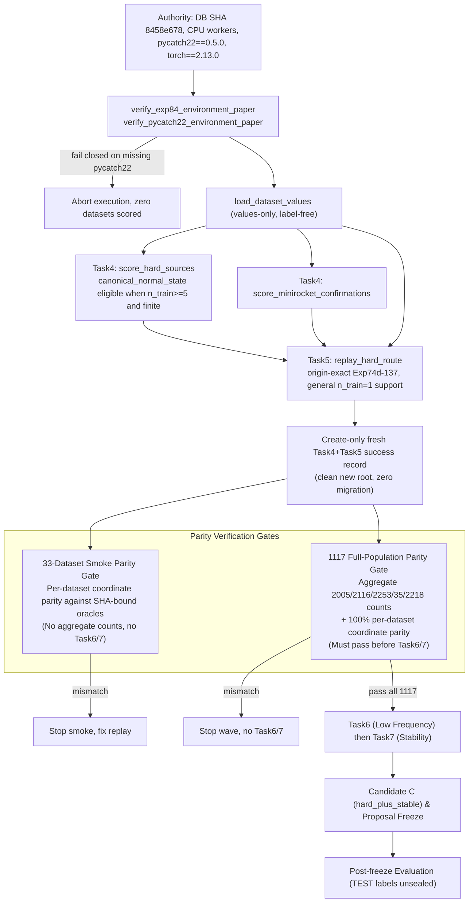
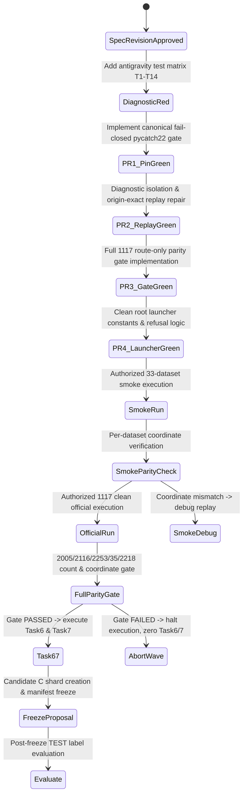

# Paper r4 Full-Population Hard-Route Parity Recovery

| Field | Value |
| --- | --- |
| Title | Paper r4 Full-Population Hard-Route Parity Recovery |
| Author | Antigravity (dedicated paper-r4 operational worktree) |
| Date | 2026-08-14 |
| Status | Approved |
| Path | `docs/superpowers/specs/2026-08-14-paper-r4-full-route-parity-recovery-antigravity-design.md` |
| Workspace | `/Users/mac/Documents/Time Series/.worktrees/grok-paper-r4-operational-antigravity` |
| Active experiment | Exp448 |
| This task | Design specification revision only |

This document specifies the approved route parity recovery design. It does not edit production code or tests, does not access TEST labels, does not run scoring, and does not create Dataset roots.

## Overview

The live official paper r4 Task4+Task5 run produced Hard-route stage counts **2074 / 2078 / 2231 / 28 / 2203**. The frozen authority that the paper proposal must reproduce is **2005 / 2116 / 2253 / 35 / 2218**. Those two sequences are different scientific objects. The live r4 numbers are the signature of a failed replay, not a new baseline.

Two independent mechanisms caused the mismatch:

1. **Mechanism 1 (Inexact Exp74d→137 Replay):** The paper `Exp74d → 89 → 90 → 93 → 133 → 134 → 135 → 137` replay is inexact against the frozen origin selectors. That alone moves Exp137 Hard from 2005 to 2074 (+69 delta).
2. **Mechanism 2 (`canonical_normal_state` Missing Package):** `canonical_normal_state` was unavailable across all 1,117 datasets. 935 of those abstentions were `dependency_unavailable:pycatch22` because the official r4 execution interpreter (`/Users/mac/Documents/Dataset/venvs/paper_r4_torch_antigravity_py314_v2/bin/python`) lacked the `pycatch22` package. Missing the fifth Exp234 source collapsed three-source expansion and moved Exp236 Hard from 2116 to 2078 (−38 delta).

In addition, the current paper codebase contains a defect candidate in `Phoneme_normal_39` handling: an artificial `n_train < 2` check that short-circuits to a typed empty route. In the historical SHA-bound Exp137 and Exp236 oracles, `Phoneme_normal_39` (`n_train=1`) produced Hard `{49}`. The historical oracle Hard `{49}` wins. The recovery requires diagnosing and reproducing the general origin `n_train=1` full-fit behavior without dataset-name branching or coordinate special-casing.

The repair strategy consists of:
- An explicit diagnostic RED phase isolating the exact Mechanism 1 primitive before making any selector edits.
- A process-level fail-closed `pycatch22==0.5.0` environment pin in `canonical_paper.py`.
- Diagnosis and reproduction of general origin `n_train=1` full-fit handling.
- Candidate C (`hard_plus_stable`, automatic Hard ∪ stable-26) unchanged as a rule.
- A 33-dataset operational smoke validating per-dataset coordinate parity against SHA-bound oracles (including `MelbournePedestrian_normal_10` and `Phoneme_normal_39`).
- A clean new official root with fresh Task4+5 records; all cache migration and record reuse from prior runs are eliminated and unauthorized.
- A strict values-only route parity gate validating exact 2005 / 2116 / 2253 / 35 / 2218 counts and per-dataset coordinate identity before Task6/Task7 scoring.

## Live Verified Authority

Parity oracles are SHA-bound, label-free prediction artifacts. They are compared strictly after a fresh route freeze by dedicated label-free adapters. They are never arguments to `replay_hard_route`, `score_hard_sources`, `score_minirocket_confirmations`, or `build_legacy_route_evidence`.

| Stage | File | SHA-256 | Extracted Field |
| --- | --- | --- | --- |
| Exp137 | `results/exp137/experiment_137_operational_triage_results.csv` (and byte-identical `input_hashes.exp137_results` in Exp236) | `942e2f5faac41364a0e91fd9dad7c3e45734cd765a080f31d9d149950826735d` | `hard_alert_indices` (space-delimited integers) |
| Exp236 | `outputs/exp236_detection_coverage_expansion/exp236_frozen_predictions.jsonl` | `a03ce4ea40f36cfa840f2d509c002a01f56fe99db795f60ad78d88bb767e6524` | `hard_indices` (JSON list of integers) |
| Exp291 | `/Users/mac/Documents/Dataset/exp291_final_operational_routing_freeze/exp291_frozen_operational_routing.jsonl` | `73dff56e26429158bd2672a898d87266aa38e73f0a50d15d4f7c7082e3a01848` | `automatic_hard_indices` and `automatic_normal_exact_indices` |
| Exp404 | `/Users/mac/Documents/Dataset/exp403_408_feature_ml_validation/exp404_hard_confidence.jsonl` | `437dc63754a29d0d65c0b30bfee54102abdd9fb56d45d2c5b1c5a511b0448e70` | `hard_indices` (2218 automatic Hard coordinates) |

Supporting frozen authority:
- Database `/Users/mac/Documents/Dataset/univariate_ts.db` SHA-256: `8458e6787031afba104a2c93b6b578dacf183f9b85c5252938ec8e092673ef3c`
- Population: 1,117 datasets, 195,900 TEST rows; excluded: `CornellWhaleChallenge`, `Wafer_normal_1`
- Target ablation alert counts: `FROZEN_CONFIG.ablation_alert_counts = (2218, 2248, 2244, 2222)`

### Frozen versus Confirmed r4 Counts

Stage order is fixed: Exp137 Hard → Exp236 Hard → Exp253 Hard → exact-normal removed → Automatic Hard.

| Stage | Frozen Authority | Confirmed Live r4 (Diagnostic) | Delta | Status in Oracle Artifacts |
| --- | ---: | ---: | ---: | --- |
| Exp137 Hard | 2005 | 2074 | +69 | Stored in Exp137 CSV `hard_alert_indices` |
| Exp236 Hard | 2116 | 2078 | −38 | Stored in Exp236 JSONL `hard_indices` |
| Exp253 Hard (pre-exact) | 2253 | 2231 | −22 | Reconstructed: `automatic_hard_indices ∪ automatic_normal_exact_indices` (2218 + 35) |
| Exact-normal removed | 35 | 28 | −7 | Stored in Exp291 JSONL `automatic_normal_exact_indices` |
| Automatic Hard (Exp291 = Exp404) | 2218 | 2203 | −15 | Stored in Exp291 `automatic_hard_indices` and Exp404 `hard_indices` |

Count algebra on fresh replay:
```text
2253 = 2218 + 35
2218 = 2116 + |MiniRocket promotions| - 35  (where |MiniRocket promotions| == 137)
2218 = 2253 - 35
FROZEN_CONFIG.ablation_alert_counts[0] == 2218
```

Confirmed live r4 counts (2074 / 2078 / 2231 / 28 / 2203) and the 935 / 182 abstention breakdown are diagnostic evidence of failure, not scientific targets. Success is exact coordinate parity against the four SHA-bound oracles across all 1,117 datasets.

## Confirmed Mechanisms and Diagnosis

### Mechanism 1 — Inexact Exp74d–93–137 Replay (Diagnostic RED Phase Required)

`paper/equipment_anomaly_detection/hard_route_paper.py` reconstructs the legacy route chain from copied primitives. The live r4 Exp137 count of 2074 (+69 over frozen authority 2005) proves the reconstruction diverged from origin selectors.

**Diagnostic RED Requirements:**
1. **No Guessed argsort Edits:** Implementers must not guess or speculate on sort orders, tie-breakers, or rank parameters without an isolated test case.
2. **Diagnostic Stage Isolation:** Compare intermediate outputs against origin reference ASTs stage-by-stage:
   - Exp74d: `_ranked_primary`, `_cap`, and large-dataset branch (`n_train >= 100 and n_test >= 100`).
   - Exp89: Four-source union, `exp84_fg` margin conditions (`train_exceed_rate <= 0.015`, `top1_threshold_margin >= 0.0`, `top1_top2_margin >= 0.0`).
   - Exp90: Zero-F1 repair conditions and `_exp90_top_score_index`.
   - Exp93: `_exp93_order`, weighted rank scoring (`EXP93_WEIGHTS_PAPER`), and candidate replacement conditions (`n_train > 10 and len(exp90) <= 1`).
   - Exp133–137: Confirmation blocks (Block-A, Block-B @ 0.015/0.01, Block-C @ 0.01) and review candidate selection (`replay_exp134`).
   - Legacy Evidence: `build_legacy_route_evidence` transductive length alignment and median calculations.
3. **Concrete Diagnostic Fixture:** Construct a dedicated diagnostic test fixture reproducing the exact point of divergence between paper replay and frozen origin selectors.
4. **Isolate and Lock Before Fix:** Observe and record the exact failing assertion in RED before writing the production repair.

### Mechanism 2 — `canonical_normal_state` Unavailable on 935 Datasets

In the live r4 run, `canonical_normal_state` was ineligible on all 1,117 datasets:
- **935 datasets** were finite, `n_train >= 5`, but failed with `dependency_unavailable:pycatch22` because the runtime venv lacked `pycatch22`.
- **182 datasets** were legitimate ordinary abstentions: 162 with `n_train < 5` (`unsupported_n_train_lt_5`) and 20 with nonfinite raw TRAIN rows (`nonfinite_input`).

`score_hard_sources` caught `DependencyUnavailablePaper` and quietly marked the source ineligible, collapsing the 5th source in `EXP234_SOURCES_PAPER` and reducing Exp236 Hard expansion from 2116 to 2078.

**Repair:**
- Single home for the pin: `paper/equipment_anomaly_detection/sources_paper/canonical_paper.py`.
- Define `PINNED_PYCATCH22_VERSION_PAPER = "0.5.0"` and `verify_pycatch22_environment_paper() -> dict[str, str]`.
- Call `verify_pycatch22_environment_paper()` from `_collect_task4_task5` in `proposal_score_paper.py` next to `verify_exp84_environment_paper()`.
- **Fail Closed:** Missing `pycatch22` or version mismatch aborts the wave immediately before scoring any dataset.
- In worker scoring, an import error on an eligible dataset must raise a failure, not be swallowed into `eligible=False`. The 182 ordinary abstentions remain unchanged.

### Phoneme_normal_39 and General `n_train=1` Origin Full-Fit Behavior

Historical SHA-bound Exp137 and Exp236 oracles record `Phoneme_normal_39` (`n_train=1`, `n_test=50`) with Hard `{49}`. The current paper replay short-circuits `len(train_rows) < 2` to an empty route.

**Resolution:**
1. **Historical Oracle Wins:** `Phoneme_normal_39` must produce Hard `{49}` matching Exp137 (`hard_alert_indices=49`) and Exp236 (`hard_indices:[49]`).
2. **Defect Candidate:** The `n_train < 2` empty route check in `replay_hard_route` and `build_legacy_route_evidence` is a defect candidate in paper replay, not an invariant.
3. **No Special-Casing:** No dataset name branches (`if dataset == "Phoneme_normal_39"`) or hard-coded coordinate injections are permitted.
4. **Origin `n_train=1` Reproduction:** Diagnose and reproduce the general origin full-fit behavior for `n_train=1` datasets:
   - In full-fit legacy sources (e.g. Exp40 ROCKET local-gap, Exp55/56 imaging, Exp84), single-train instances evaluate queries against the single reference row ($k=1$ or origin-exact single-row metric).
   - In Task4 cross-fitting, `score_hard_sources` continues to legitimately abstain when `n_train < 5` (`unsupported_n_train_lt_5`). Exp234 expansion on `n_train=1` yields no new sources, preserving the Exp137 Hard lane `{49}` through Exp236, Exp253, and Automatic Hard.

### MelbournePedestrian_normal_10 and Parity on Every Smoke Member

`MelbournePedestrian_normal_10` represents the TEST-only nonfinite repair boundary (TRAIN is finite, TEST row 1 has NaNs).
- `build_legacy_route_evidence` applies linear-edge-nearest repair to working copies.
- `MelbournePedestrian_normal_10` and every member of the 33-dataset smoke set must match the SHA-bound values-only Exp137, Exp236, Exp291, and Exp404 route authority exactly.
- Any coordinate mismatch on any smoke member blocks promotion to the full 1,117 official run.

### Candidate C Remains Unchanged

Candidate C (`hard_plus_stable`) is the frozen proposed policy: Automatic Hard $\cup$ stable-26 from the 30-candidate stability partition.
- Parameters remain frozen: `GLOBAL_CANDIDATE_BUDGET_PAPER = 30`, `_MAXIMUM_VIEWS_PAPER = 16`, survival threshold 14/16 ($0.875$).
- Target ablation count formula: $2218 \text{ (Automatic Hard)} + 26 \text{ (stable)} = 2244$.
- Candidate C is not retuned or modified. Restoring Automatic Hard to 2218 naturally restores Candidate C.

## Goals and Non-Goals

### Goals
1. Execute an explicit diagnostic RED phase to isolate the exact Mechanism 1 primitive before any production selector edit.
2. Implement a fail-closed `pycatch22==0.5.0` environment pin in `canonical_paper.py` called before dataset scoring.
3. Diagnose and reproduce general origin `n_train=1` full-fit behavior, restoring historical Hard `{49}` on `Phoneme_normal_39` without name branching.
4. Preserve Candidate C rule, constants, and 2244 target formula without modification.
5. Exclude historical prediction coordinates from runtime scoring functions.
6. Enforce per-dataset coordinate parity on the 33-dataset smoke against SHA-bound oracles.
7. Enforce aggregate count (2005/2116/2253/35/2218) and 100% per-dataset coordinate parity on the full 1,117 dataset route verifier before Task6/Task7 scoring.
8. Execute official scoring on clean, new smoke and official roots with fresh Task4+5 records (zero cache reuse).
9. Preserve the stderr progress-logging contract.
10. Maintain zero TEST-label access until post-freeze evaluation.
11. Follow strict TDD: observe and record every RED failure before making the GREEN production edit.
12. Maintain CPU execution for worker pools, adhering to MLX/MPS assessment.

### Non-Goals
- Editing production code or tests within this design specification task.
- Opening TEST labels, executing official scoring, or creating Dataset directories in this task.
- Injecting or hardcoding historical coordinates into runtime replay functions.
- Altering frozen count targets to match the failed live r4 numbers (2074/2078/2231/28/2203).
- Adding dataset-name special cases (`Phoneme_normal_39`, `MelbournePedestrian_normal_10`, or the 935 pycatch22-affected datasets).
- Migrating or reusing success records from the failed `/Users/mac/Documents/Dataset/paper_proposal_full_r4_antigravity_20260813` root.
- Rewriting third-party feature extractors (aeon MiniRocket, pycatch22) for MLX/MPS.

## Proposed Architecture and System Design

### Architecture

Scientific scoring resides in `paper/equipment_anomaly_detection/`. Operational orchestration resides in `scratch/manage_paper_r4_proposal_antigravity.py`. All new test classes are placed in `experiments/exp448_exp447_text_label_boundary_repair_antigravity/tests/` to preserve AGENTS.md naming conventions and `ConfigLineageTests` invariants.



### Data Flow

1. **Environment Verification:** The parent process invokes `verify_exp84_environment_paper()` and `verify_pycatch22_environment_paper()` before processing any dataset. The check verifies `importlib.metadata.version("pycatch22") == "0.5.0"` and validates `from pycatch22 import catch22_all`. Any failure raises `DependencyUnavailablePaper` and halts execution.
2. **Values-Only Loading:** `load_dataset_values` loads raw time series values without label columns. `_label_firewall()` prevents loading `label_access_paper`.
3. **Task4 Scoring:** Six sources are scored on raw values. On eligible datasets ($n_{\text{train}} \ge 5$, finite), `canonical_normal_state` produces finite OOF and TEST scores. The 182 ordinary abstentions remain `unsupported_n_train_lt_5` or `nonfinite_input`.
4. **Task5 Replay:** Full-fit legacy evidence is computed via `build_legacy_route_evidence(values)`. General $n_{\text{train}}=1$ handling executes single-instance full-fit scoring without raising. Origin-exact selectors replay Exp74d through Exp137. MiniRocket promotions and the byte-exact normal guard produce `HardRouteResult`.
5. **Fresh Publication:** Success records are written create-only to the clean new root. Stale or prior-root records are ignored.
6. **33-Dataset Smoke Parity:** For the 33 smoke datasets, per-dataset route coordinates are compared against the SHA-bound Exp137, Exp236, Exp291, and Exp404 oracles using dedicated label-free adapters.
7. **1,117 Route-Only Parity Gate:** After all 1,117 datasets complete Task4+Task5, the official verifier checks:
   - Population counts: Exp137 Hard = 2005, Exp236 Hard = 2116, Exp253 Hard = 2253, exact-normal removed = 35, Automatic Hard = 2218.
   - Coordinate parity: 100% per-dataset coordinate equality against the 4 SHA-bound oracles.
   - Failure raises an exception and blocks Task6 and Task7.
8. **Task6, Task7, and Candidate C:** Only after passing the parity gate, `compose_proposal_score` executes `score_low_frequency`, `classify_stability`, and `build_policies` (Candidate C `hard_plus_stable`).
9. **Post-Freeze Evaluation:** TEST labels are unsealed only in the evaluator after proposal artifacts are frozen.

### Ordered Stage-Gate Table

| Stage | Name | Input / Scope | Execution Details | Gate Condition | Failure Action |
| :---: | :--- | :--- | :--- | :--- | :--- |
| **0** | **Environment Gate** | Scoring runtime process | `verify_exp84_environment_paper()`, `verify_pycatch22_environment_paper()` | `pycatch22==0.5.0`, `torch==2.13.0` present and loadable | Abort process immediately. Nonzero exit. Zero datasets scored. |
| **1** | **Diagnostic RED & Exact Repair** | Test suite & Replay code | Diagnostic fixture comparing replay stages to origin AST; reproduce origin $n_{\text{train}}=1$ full-fit | Concrete failing test observed in RED, then GREEN after minimal primitive fix | Stop. Do not proceed to smoke run until test suite is GREEN. |
| **2** | **33-Dataset Smoke Execution** | 33 smoke datasets (14 representative + 19 affected) | Fresh Task4+5 scoring in new smoke root (`paper_proposal_r4_full_route_parity_smoke_antigravity_20260814`) | 100% per-dataset coordinate equality against Exp137, Exp236, Exp291, Exp404 oracles | Stop. Refuse official run launch. Debug failing smoke dataset coordinates. |
| **3** | **Clean 1,117 Official Execution** | Full 1,117 dataset catalog | Fresh Task4+5 scoring in new clean official root (`paper_proposal_full_r4_parity_antigravity_20260814`) | Exactly 1,117 Task4+5 success records created; zero silent pycatch22 abstentions | Mark run incomplete (`ProposalScoreIncomplete`). Abort before Task6. |
| **4** | **1,117 Route-Only Parity Gate** | All 1,117 Task4+5 route outputs | Route-only verifier helper (`verify_hard_route_parity_paper`) compares routes to the 4 SHA-bound oracles | Counts == 2005 / 2116 / 2253 / 35 / 2218 **AND** 100% per-dataset coordinate identity | Raise exception. Halt pipeline. Do NOT invoke Task6 or Task7. |
| **5** | **Task6 & Task7 Execution** | 1,117 verified routes | `score_low_frequency` and `classify_stability` | Finite scores, valid stability classifications across 1,117 datasets | Fail wave. |
| **6** | **Candidate C Proposal Freeze** | Task4–7 outputs | `build_policies` and `write_and_freeze_proposal_score` | Candidate C count == 2244; create-only shards and manifest written | Fail wave. |
| **7** | **Post-Freeze Evaluation** | Frozen proposal manifest | Evaluator unseals TEST labels for final metrics | Provenance and score verification complete | Log evaluation results. |

### Dedicated Label-Free Oracle Adapters

To prevent evaluation leakage and avoid ad-hoc parsing, dedicated label-free adapter functions read the SHA-bound oracles:

```python
def load_exp137_oracle_lanes(csv_path: Path) -> dict[str, frozenset[int]]:
    """Read Exp137 CSV, extracting only dataset and hard_alert_indices (ignoring all metric/label columns)."""

def load_exp236_oracle_lanes(jsonl_path: Path) -> dict[str, frozenset[int]]:
    """Read Exp236 JSONL, extracting only dataset and hard_indices."""

def load_exp291_oracle_lanes(jsonl_path: Path) -> tuple[dict[str, frozenset[int]], dict[str, frozenset[int]], dict[str, frozenset[int]]]:
    """Read Exp291 JSONL, returning (automatic_hard, exact_normal_removed, reconstructed_pre_exact_exp253)."""

def load_exp404_oracle_lanes(jsonl_path: Path) -> dict[str, frozenset[int]]:
    """Read Exp404 JSONL, extracting dataset and hard_indices (2218 automatic Hard coordinates)."""
```

These adapters are isolated in verification tools and are forbidden from being imported by runtime scoring modules.

### Clean Root Policy (Zero Cache Migration)

All cache migration, record reuse, and fallback reading from prior run directories are completely eliminated:
- **Clean Execution Only:** Both the 33-dataset smoke and the full 1,117 official run execute against clean, newly created root directories.
- **Fresh Shards:** Every Task4+5 success record is computed afresh from raw values under the verified `pycatch22==0.5.0` environment.
- **Unauthorized Migration:** Any attempt to migrate or reuse records from `/Users/mac/Documents/Dataset/paper_proposal_full_r4_antigravity_20260813` or prior smoke directories is strictly unauthorized and rejected.
- **Destination Refusal:** The launcher script (`manage_paper_r4_proposal_antigravity.py`) refuses to accept prior run directories as destination roots.

## Error Handling and Failure Modes

| Failure Mode | Detection Point | Handling Policy | Pipeline Impact |
| :--- | :--- | :--- | :--- |
| `pycatch22` missing or wrong version | Stage 0 Parent Environment Gate | Raise `DependencyUnavailablePaper("dependency_unavailable:pycatch22==0.5.0")` | Immediate process abort. Nonzero exit. Zero datasets scored. |
| Eligible dataset throws import error in worker | Stage 3 Task4 Worker Execution | Fail dataset attempt, record exception in attempt log | Wave marked incomplete (`ProposalScoreIncomplete`). Pipeline stops. |
| `n_train < 5` dataset scored | Stage 3 Task4 Worker Execution | Record legitimate `unsupported_n_train_lt_5` abstention | Normal expected behavior for 162 catalog datasets. |
| Nonfinite raw TRAIN values | Stage 3 Task4 Worker Execution | Record legitimate `nonfinite_input` abstention | Normal expected behavior for 20 catalog datasets. |
| `Phoneme_normal_39` or $n_{\text{train}}=1$ raises | Stage 1 / Stage 3 Task5 Replay | Origin-exact $n_{\text{train}}=1$ full-fit handling executes cleanly | Regression if raised. Must produce Hard `{49}`. |
| Smoke dataset coordinate mismatch | Stage 2 Smoke Parity Gate | Compare per-dataset coordinates to Exp137/236/291/404 oracles | Halt smoke. Refuse official run authorization. |
| Aggregate counts $\ne$ 2005/2116/2253/35/2218 | Stage 4 1,117 Parity Gate | Check route counts across 1,117 datasets | Raise `ParityCountMismatch`. Block Task6 and Task7. |
| Single dataset coordinate mismatch in 1,117 | Stage 4 1,117 Parity Gate | Check per-dataset coordinate equality against 4 oracles | Raise `ParityCoordinateMismatch`. Block Task6 and Task7. |
| Old run root supplied as destination | Launcher CLI / `check` command | Path validation against forbidden prior roots | Command fails immediately. Refuse to write or resume. |
| TEST label module imported in Task4–7 | Runtime `_label_firewall()` | Dynamic inspection of `sys.modules` | Raise `RuntimeError("Label access firewall violation")`. |
| Progress callback exception | Stderr sink emission | Catch and swallow in `emit_progress_paper` | Science execution unaffected; stderr warning emitted. |

## Environment Pin Specification

`paper/equipment_anomaly_detection/sources_paper/canonical_paper.py` is the single home for the pin:

```python
PINNED_PYCATCH22_VERSION_PAPER = "0.5.0"

def verify_pycatch22_environment_paper() -> dict[str, str]:
    """Fail-closed Task4 environment gate. Missing or mismatched version aborts execution."""
    try:
        version = importlib.metadata.version("pycatch22")
    except importlib.metadata.PackageNotFoundError as exc:
        raise DependencyUnavailablePaper("dependency_unavailable:pycatch22==0.5.0") from exc
    if version != PINNED_PYCATCH22_VERSION_PAPER:
        raise DependencyUnavailablePaper(
            f"dependency_unavailable:pycatch22=={PINNED_PYCATCH22_VERSION_PAPER} (found {version})"
        )
    try:
        from pycatch22 import catch22_all
    except ImportError as exc:
        raise DependencyUnavailablePaper("dependency_unavailable:pycatch22==0.5.0") from exc
    return {"pycatch22": version}
```

The parent orchestrator (`_collect_task4_task5` in `proposal_score_paper.py`) calls `verify_pycatch22_environment_paper()` alongside `verify_exp84_environment_paper()` before spawning workers.

## Exact RED then GREEN Implementation Workflow

No production file is modified until the corresponding test has failed with the expected reason and the failure has been documented.

1. **Step 1 — Create Antigravity Test Suite:** Add `experiments/exp448_exp447_text_label_boundary_repair_antigravity/tests/test_paper_r4_full_route_parity_recovery_antigravity.py` containing methods T1 through T14.
2. **Step 2 — Execute Initial Test Suite (Observe RED):** Run the test suite on the current codebase:
   - Observe RED on T1 and T2 (missing `PINNED_PYCATCH22_VERSION_PAPER` / gate function).
   - Observe RED on T3 (current code catches and silently abstains on missing pycatch22).
   - Observe RED on T5 (`Phoneme_normal_39` returns typed empty instead of historical Hard `{49}`).
   - Observe RED on T6 (Mechanism 1 diagnostic fixture reproducing legacy replay divergence).
   - Observe RED on T7 (33-dataset smoke parity failure).
   - Observe RED on T8 (current compose does not gate Task6/7 on 1,117 route parity).
   - Observe RED on T10 (new root create-only verification).
   - Verify regression locks T4, T9, T12, T13, and T14 are GREEN.
3. **Step 3 — Implement Fail-Closed pycatch22 Pin (PR 1):**
   - Add `PINNED_PYCATCH22_VERSION_PAPER` and `verify_pycatch22_environment_paper()` in `canonical_paper.py`.
   - Call gate in `proposal_score_paper._collect_task4_task5`.
   - Update `hard_sources_paper.score_hard_sources` so workers fail on import error rather than silently abstaining.
   - Run T1, T2, T3 $\rightarrow$ GREEN.
4. **Step 4 — Diagnostic RED and Replay Repair (PR 2):**
   - Execute diagnostic isolation of Mechanism 1 primitives.
   - Implement general $n_{\text{train}}=1$ full-fit handling in `legacy_route_sources_paper.py` and `hard_route_paper.py`.
   - Fix identified Mechanism 1 selector divergence in `hard_route_paper.py`.
   - Run T5, T6, T7 $\rightarrow$ GREEN.
5. **Step 5 — Full 1,117 Route-Only Parity Gate (PR 3):**
   - Implement route-only parity verifier helper (`verify_hard_route_parity_paper`) and label-free oracle adapters.
   - Insert route-only parity gate into `compose_proposal_score` before `score_low_frequency`.
   - Run T8 $\rightarrow$ GREEN.
6. **Step 6 — Clean Root Launcher and Destination Refusal (PR 4):**
   - Update launcher constants for new clean smoke and official roots.
   - Implement strict destination path refusal for prior run roots.
   - Run T10, T11 $\rightarrow$ GREEN.
7. **Step 7 — Regression Suite Verification:**
   - Execute existing paper test suite (`test_hard_route_paper.py`, `test_hard_sources_paper.py`, `test_artifacts_runner_paper.py`, `test_progress_logging_paper.py`).
   - All tests must pass GREEN.

## Representative Divergence Set, Smoke Set, and Full Gate

### Representative Set (14 Datasets)
Catalog-sorted, values-only:
```text
ACSF1_normal_0 .. ACSF1_normal_9 (10 datasets)
ChlorineConcentration_normal_3
MelbournePedestrian_normal_10
Phoneme_normal_39
PigAirwayPressure_normal_1
```
This set covers origin artifact lanes, weak-family large TRAIN, TEST-only nonfinite repair, $n_{\text{train}}=1$, and $n_{\text{train}}=4$ with length 2000.

### 33-Dataset Operational Smoke Set
Catalog-sorted union of the 14 representative datasets and `EXPECTED_AFFECTED_DATASETS_ANTIGRAVITY` (19 nonfinite-repair datasets):
- **14 Representative:** ACSF1 (0..9), ChlorineConcentration_normal_3, MelbournePedestrian_normal_10, Phoneme_normal_39, PigAirwayPressure_normal_1.
- **19 Affected:** DodgerLoopDay (1, 2, 4, 5, 6, 7), DodgerLoopGame (1, 2), DodgerLoopWeekend (1, 2), MelbournePedestrian (1..9).
- Total: Exactly 33 unique datasets ($14 + 19 = 33$, since MelbournePedestrian_normal_10 is in the representative set but not in the 19 affected list).

**Smoke Gate Contract:** Per-dataset coordinate parity against SHA-bound Exp137, Exp236, Exp291, and Exp404 oracles for each of the 33 datasets. No aggregate full-population count assertions; no Task6 or Task7 execution.

### Full 1,117 Population Gate
All 1,117 catalog datasets. Executed after Task4+5 and before Task6/7:

| Stage | Oracle Identifier | Frozen Aggregate Count | Verification Condition |
| --- | --- | ---: | --- |
| Exp137 Hard | Exp137 CSV `942e2f5f...` | 2005 | Exact count + 100% per-dataset coordinate match |
| Exp236 Hard | Exp236 JSONL `a03ce4ea...` | 2116 | Exact count + 100% per-dataset coordinate match |
| Exp253 Hard (pre-exact) | Exp291 JSONL `73dff56e...` reconstructed | 2253 | Exact count + 100% per-dataset coordinate match |
| Exact-normal removed | Exp291 JSONL `73dff56e...` | 35 | Exact count + 100% per-dataset coordinate match |
| Automatic Hard | Exp291 JSONL and Exp404 `437dc637...` | 2218 | Exact count + 100% per-dataset coordinate match |

## Clean Smoke and Clean Official Roots

The paths below are the authorized identities for the repaired run:

| Role | Path | Policy |
| --- | --- | --- |
| Repaired Smoke Scientific | `/Users/mac/Documents/Dataset/paper_proposal_r4_full_route_parity_smoke_antigravity_20260814` | 33-dataset smoke. Clean create-only directory. |
| Repaired Smoke Ops | `/Users/mac/Documents/Dataset/paper_proposal_r4_full_route_parity_smoke_antigravity_20260814_ops_antigravity` | Launcher flock, progress log, event journal. |
| Repaired Official Scientific | `/Users/mac/Documents/Dataset/paper_proposal_full_r4_parity_antigravity_20260814` | Full 1,117 official run. Clean create-only directory. |
| Repaired Official Ops | `/Users/mac/Documents/Dataset/paper_proposal_full_r4_parity_antigravity_20260814_ops_antigravity` | Official ops namespace. |

**Forbidden Destination Roots (Refused by Launcher):**
- `/Users/mac/Documents/Dataset/paper_proposal_full_r4_antigravity_20260813`
- `/Users/mac/Documents/Dataset/paper_proposal_full_r4_antigravity_20260813_ops_antigravity`
- `/Users/mac/Documents/Dataset/paper_proposal_full_r4_v2_antigravity_20260814_ops_antigravity`
- All prior 20260813 / 20260814 v1–v3 smoke and smoke-ops roots
- `/Users/mac/Documents/Dataset/paper_proposal_full_r3_antigravity_20260813`

The launcher `check` subcommand may inspect prior paths as immutable historical evidence, but `smoke` and `launch` strictly forbid writing to or resuming them.

## API and Interface Changes

All new function parameters are keyword-only. Production files retain `*_paper.py` naming; new test files use `*_antigravity.py`.

| Module | Symbol / Function | Nature of Change |
| --- | --- | --- |
| `sources_paper/canonical_paper.py` | `PINNED_PYCATCH22_VERSION_PAPER = "0.5.0"` | New constant defining pinned pycatch22 version. |
| `sources_paper/canonical_paper.py` | `verify_pycatch22_environment_paper() -> dict[str, str]` | New fail-closed environment verification gate. |
| `proposal_score_paper.py` | `_collect_task4_task5` | Calls `verify_pycatch22_environment_paper()` before dataset iteration. |
| `sources_paper/hard_sources_paper.py` | `score_hard_sources` | Workers fail on unexpected import failure on eligible datasets; 182 ordinary abstentions preserved. |
| `sources_paper/legacy_route_sources_paper.py` | `build_legacy_route_evidence` | General $n_{\text{train}}=1$ full-fit support without raising; no dataset-name branching. |
| `hard_route_paper.py` | `replay_hard_route` | Remove artificial $n_{\text{train}}<2$ short-circuit to empty; execute origin-exact selectors. Signature remains `(values, sources, mini)`. |
| `hard_route_paper.py` | `replay_exp74d_89_90_93`, `replay_exp133_134_135_137` | Replay origin-exact selectors matching frozen Exp137/236 oracles. |
| `proposal_score_paper.py` | `verify_hard_route_parity_paper` | New helper verifying 2005/2116/2253/35/2218 counts and per-dataset coordinate identity. |
| `proposal_score_paper.py` | `compose_proposal_score` | Gated on `verify_hard_route_parity_paper` before invoking Task6 and Task7. |
| `scratch/manage_paper_r4_proposal_antigravity.py` | Launcher Constants | Updated to new clean smoke and official paths; reject prior roots as destinations. |

## Data Model and Provenance

No schema modifications are made to proposal shards, journals, or `paper-task8-proposal-manifest.v1`.

- **Success Shard Contents:** On eligible datasets, `canonical_normal_state` records finite float64 OOF and TEST score arrays, with `eligible=True` and `eligibility_reason="eligible"`. Empty score arrays with `dependency_unavailable:pycatch22` are strictly absent.
- **Environment Authority:** The official run provenance metadata records:
  - Reviewed clean commit SHA
  - Python interpreter path and version (3.14.6)
  - Pinned package versions: `pycatch22==0.5.0`, `torch==2.13.0`, `aeon==1.5.0`, `numpy==2.3.5`, `scikit-learn==1.8.0`
  - Database SHA-256 (`8458e678...`)
  - The 4 oracle SHA-256 hashes
  - Worker concurrency configuration (`dataset_workers = max(1, logical - 1)`, inner threads = 1)
  - Explicit confirmation that prior root bytes were not reused

## Exact Test Matrix

All new tests are located in `experiments/exp448_exp447_text_label_boundary_repair_antigravity/tests/test_paper_r4_full_route_parity_recovery_antigravity.py` under class `FullRouteParityRecoveryAntigravityTests`.

| ID | Test Method | Initial State | GREEN Pass Condition | Description & Purpose |
| :---: | :--- | :---: | :--- | :--- |
| **T1** | `test_pycatch22_pin_fails_closed_when_missing_or_wrong_version` | RED | `verify_pycatch22_environment_paper()` raises `DependencyUnavailablePaper` when package is missing or version $\ne 0.5.0$. | Validates fail-closed behavior before any dataset is scored. |
| **T2** | `test_pycatch22_0_5_0_is_the_only_accepted_version` | RED | Constant is `"0.5.0"` and returns `{"pycatch22": "0.5.0"}` on capable interpreter. | Confirms single home in `canonical_paper.py` and exact pinned version. |
| **T3** | `test_eligible_dataset_does_not_abstain_canonical_for_pycatch22` | RED | Eligible dataset fixture scores finite `canonical_normal_state` arrays; no `dependency_unavailable:pycatch22` abstention. | Proves the 935 silent abstention bug is eliminated. |
| **T4** | `test_replay_signature_still_rejects_historical_coordinates` | GREEN (Lock) | `replay_hard_route` and `build_legacy_route_evidence` accept only raw data and computed sources; no oracle parameters. | Regression lock: historical coordinates are never runtime inputs. |
| **T5** | `test_phoneme_normal_39_reproduces_historical_hard_49_without_name_branch` | RED | `Phoneme_normal_39` fixture produces Hard `{49}` via general $n_{\text{train}}=1$ full-fit; AST contains no dataset name check. | Validates historical Hard `{49}` recovery and elimination of artificial empty route. |
| **T6** | `test_mechanism1_diagnostic_isolation_reproduces_and_fixes_divergence` | RED | Diagnostic test isolates exact Mechanism 1 primitive divergence and verifies GREEN under repaired selector. | Enforces diagnostic RED phase isolating first exact primitive before fix. |
| **T7** | `test_smoke_33_datasets_match_sha_bound_oracles` | RED | All 33 smoke datasets (including Melbourne_10 and Phoneme_39) match Exp137, Exp236, Exp291, Exp404 coordinates. | Validates per-dataset coordinate parity on operational smoke set. |
| **T8** | `test_full_1117_route_only_parity_gate_blocks_task6_and_task7` | RED | Parity verifier confirms 2005/2116/2253/35/2218 and SHA identity; `compose_proposal_score` halts before Task6 on mismatch. | Validates pre-Task6/7 gate and separate verification contract. |
| **T9** | `test_candidate_c_rule_and_target_algebra_unchanged` | GREEN (Lock) | `hard_plus_stable` is Hard $\cup$ stable-26; budget 30, view cap 16, survival 14/16; count formula $2218 + 26 = 2244$. | Regression lock: Candidate C rule is strictly unchanged. |
| **T10** | `test_clean_root_execution_and_rejection_of_live_r4_reuse` | RED | Official runner creates fresh records in clean root; rejects reading or migrating records from live r4 root. | Validates zero cache reuse and clean root execution lifecycle. |
| **T11** | `test_new_smoke_and_official_root_paths_are_distinct_and_refuse_old_destinations` | RED | Launcher constants point to new clean paths; `check`/`smoke`/`launch` reject old r4 paths as destinations. | Confirms destination path refusal for prior failed roots. |
| **T12** | `test_progress_logging_remains_optional_and_label_free` | GREEN (Lock) | Default `progress=None` produces bit-identical results; stderr sink emits label-free events. | Regression lock: progress logging is result-neutral. |
| **T13** | `test_zero_test_label_access_until_evaluation` | GREEN (Lock) | `_label_firewall` active during Task4–7; `TEST_VALUES_SQL` contains no label columns. | Regression lock: strict firewall against TEST label access. |
| **T14** | `test_frozen_counts_2218_remain_authoritative_target` | GREEN (Lock) | `FROZEN_CONFIG.ablation_alert_counts[0] == 2218`; live r4 count 2203 is nowhere defined as a target. | Regression lock: frozen targets are immutable. |

## Success Criteria

The recovery is complete and successful only when all of the following conditions are met:

1. **Environment Verification:** The runtime environment enforces `pycatch22==0.5.0` and `torch==2.13.0`; missing either package halts execution before dataset scoring.
2. **Canonical Eligibility Restored:** `canonical_normal_state` is eligible on all datasets outside the 182 ordinary abstentions. The 935 `dependency_unavailable:pycatch22` abstentions are completely eliminated.
3. **Phoneme Historical Hard Restored:** `Phoneme_normal_39` produces Hard `{49}` through general $n_{\text{train}}=1$ full-fit handling without dataset-name branching.
4. **Smoke Parity (33 Datasets):** All 33 smoke datasets (including `MelbournePedestrian_normal_10` and `Phoneme_normal_39`) achieve exact per-dataset coordinate equality against the SHA-bound Exp137, Exp236, Exp291, and Exp404 oracles.
5. **Full Population Aggregate Counts:** The fresh 1,117 replay produces aggregate counts of exactly **2005 / 2116 / 2253 / 35 / 2218**.
6. **Full Population Coordinate Parity:** 100% of the 1,117 datasets match the SHA-bound Exp137, Exp236, Exp291, and Exp404 prediction coordinates.
7. **Candidate C Invariant:** Candidate C rule is unchanged; its expected ablation count evaluates to 2244 ($2218 + 26$).
8. **Runtime Isolation of Coordinates:** Historical prediction coordinates are strictly oracles and are never passed as inputs to runtime scoring functions.
9. **Gated Composition:** `compose_proposal_score` does not execute Task6 or Task7 until the 1,117 route-only parity gate passes.
10. **Clean Execution Lifecycle:** Scoring executes in clean, newly created root directories. Zero records are migrated or reused from `/Users/mac/Documents/Dataset/paper_proposal_full_r4_antigravity_20260813`.
11. **Zero Label Leakage:** No TEST label is loaded or accessed prior to post-freeze evaluation.
12. **TDD Compliance:** Every new test was observed and recorded in RED before the corresponding production code was modified to achieve GREEN.

## Provenance and Root Lifecycle



## Acceleration Assessment

This work repairs an algorithm replay and establishes an environment pin. It is evaluated under the workspace PyTorch / MLX / MPS policy and `acceleration_paper.py`.

| Assessment Item | Conclusion | Technical Rationale |
| --- | :--- | :--- |
| **Tensor-Eligible?** | **No** | Route selectors are discrete rank/set/cap operations. `pycatch22.catch22_all` is a frozen third-party C/Python CPU extractor. |
| **Backend Availability?** | **CPU Only** | Capable oracle environment provides `pycatch22==0.5.0` on CPU. MLX is absent. |
| **Transfer / Overhead?** | **Unfavorable** | Rewriting feature extractors for GPU would incur high transfer latency across 1,117 small series with no throughput benefit. |
| **Numerical Parity?** | **Strictly Required** | Bit-exact parity against the SHA-bound oracles is mandatory. Non-canonical GPU approximations are forbidden. |
| **Canonical CPU Fallback?** | **Retained as Canonical** | `acceleration_paper.py` designates `hard_sources` and `hard_route` as CPU-canonical. |
| **Worker Concurrency** | **CPU Pool** | Concurrency uses `max(1, logical_cpu_count - 1)` worker processes with single inner threads. |

## Rejected Alternatives

### 1. Import Historical Coordinates as Runtime Inputs
**Rejected:** The paper proposal must be raw-computable from values alone. Lineage rules forbid `input_kind == "prediction_coordinates"`. Hard-coding historical coordinates would turn the paper into a static file copy, concealing the replay defects.

### 2. Retarget Counts to Live r4 Numbers (2203)
**Rejected:** 2203 is the corrupted count resulting from missing `pycatch22` and inexact replay selectors. Accepting 2203 would publish an unverified detector and permanently lose parity with Exp291 and Exp404. `FROZEN_CONFIG.ablation_alert_counts[0]` remains 2218.

### 3. Special-Case Dataset Names
**Rejected:** Adding branches like `if dataset == "Phoneme_normal_39"` or maintaining explicit lists of the 935 pycatch22-affected datasets is unscientific. The system must reproduce general origin behaviors across all datasets uniformly.

### 4. Cache Migration / In-Place Record Reuse
**Rejected:** Attempting to migrate or selectively reuse Task4+5 success records from `/Users/mac/Documents/Dataset/paper_proposal_full_r4_antigravity_20260813` introduces complex state management and risks propagating corrupted bytes. Execution on a clean new root ensures 100% provenance integrity.

## Security and Label Boundary

| Threat Vector | Severity | Enforced Mitigation |
| --- | :--- | :--- |
| TEST labels influence replay selector fixes | Critical | Replay and parity gates are strictly values-only. `_label_firewall` blocks label loading. T13. |
| Oracle coordinates leak into runtime replay | Critical | `replay_hard_route` signature has no oracle parameters. Lineage locks enforce raw inputs. T4. |
| Silent environment drift | High | Fail-closed gate validates `pycatch22==0.5.0` at process launch. T1–T3. |
| Contaminated records from live r4 run | High | Clean root policy. Launcher rejects prior roots as destinations. T10–T11. |
| Diagnostic logs expose TEST labels | Medium | Progress sinks and parity reports log only dataset names, counts, and timing. Zero label SQL. |

## Observability and Progress Logging

The progress logging framework from `docs/superpowers/specs/2026-08-14-paper-r4-complete-progress-logging-antigravity-design.md` is preserved:
- Stderr sink installed via `make_stderr_progress_sink_paper()`.
- Default `progress=None` ensures bit-identical test execution.
- Wave startup logs: `environment pycatch22=0.5.0 torch=2.13.0`.
- Parity gate logs: `route_parity 2005/2116/2253/35/2218 exact=true` or detailed mismatch summaries on failure.
- No score arrays, label values, or p-value tensors are emitted in logs.

## Rollout and Implementation PR Plan

Each PR is independently reviewable and includes regenerated codemap files (`docs/codemap/codemap_exp448_antigravity.*` and `paper/equipment_anomaly_detection/codemap_paper.*`).

### PR 1 — Fail-Closed pycatch22 Environment Pin
- **Title:** Fail closed unless pycatch22 0.5.0 is present
- **Files:** `canonical_paper.py`, `proposal_score_paper.py`, `hard_sources_paper.py`, test file (T1–T3), codemaps.
- **Scope:** Add `verify_pycatch22_environment_paper()`, invoke in `_collect_task4_task5`, prevent workers from swallowing import errors. Observe RED then GREEN.

### PR 2 — Diagnostic Isolation and Origin-Exact Replay Repair
- **Title:** Diagnostic isolation and origin-exact Exp74d–137 replay repair
- **Files:** `hard_route_paper.py`, `legacy_route_sources_paper.py`, test file (T5–T7), codemaps.
- **Scope:** Isolate Mechanism 1 primitive in diagnostic fixture. Implement general $n_{\text{train}}=1$ full-fit handling. Repair selector divergence. Observe RED then GREEN on T5, T6, and T7.

### PR 3 — Route-Only Parity Gate Before Task6/Task7
- **Title:** Route-only parity verification gate before Task6/Task7
- **Files:** `proposal_score_paper.py`, test file (T8, T9, T13, T14), codemaps.
- **Scope:** Add label-free oracle adapters and `verify_hard_route_parity_paper`. Gate `compose_proposal_score` before `score_low_frequency`. Observe RED then GREEN.

### PR 4 — Clean Root Operational Launcher and Smoke Setup
- **Title:** Clean root operational launcher and smoke configuration
- **Files:** `scratch/manage_paper_r4_proposal_antigravity.py`, test file (T10–T12), codemaps.
- **Scope:** Update launcher paths to new clean smoke and official roots. Add destination path refusal for prior roots. Observe RED then GREEN.

## Key Decisions

1. **Frozen 2005/2116/2253/35/2218 Target:** Live r4 counts (2074/2078/2231/28/2203) are diagnostic failure signatures. Target counts are immutable.
2. **Diagnostic RED for Mechanism 1:** Replay selector repairs must be preceded by explicit diagnostic isolation; no guessed argsort changes.
3. **Fail-Closed Environment Pin:** Missing `pycatch22` or version mismatch aborts the wave before dataset scoring.
4. **Historical Oracle Wins for Phoneme:** `Phoneme_normal_39` produces Hard `{49}` via general $n_{\text{train}}=1$ full-fit support; $n_{\text{train}}<2$ empty route is a defect candidate.
5. **No Special-Casing:** No dataset name branches or hard-coded coordinate injections.
6. **Split Parity Contracts:** 33-dataset smoke enforces per-dataset coordinate parity (no aggregate count check, no Task6/7). Full 1,117 run enforces aggregate counts and 100% coordinate parity before Task6/7.
7. **Clean Root Lifecycle:** Clean new roots only; zero cache reuse or record migration from prior runs.
8. **Candidate C Unchanged:** Rule, budget (30), view cap (16), survival (14/16), and expected count formula ($2218 + 26 = 2244$) are strictly preserved.
9. **CPU Concurrency Canonical:** Retain CPU ProcessPool execution; MLX/MPS acceleration rejected.
10. **Strict TDD:** Every new test is observed in RED before production code changes.

## References

- `paper/equipment_anomaly_detection/hard_route_paper.py`
- `paper/equipment_anomaly_detection/sources_paper/hard_sources_paper.py`
- `paper/equipment_anomaly_detection/sources_paper/canonical_paper.py`
- `paper/equipment_anomaly_detection/sources_paper/legacy_route_sources_paper.py`
- `paper/equipment_anomaly_detection/proposal_score_paper.py`
- `paper/equipment_anomaly_detection/acceleration_paper.py`
- `paper/equipment_anomaly_detection/tests_paper/test_hard_route_paper.py`
- `docs/superpowers/specs/2026-08-13-paper-r4-operational-launch-antigravity-design.md`
- `docs/superpowers/specs/2026-08-14-paper-r4-complete-progress-logging-antigravity-design.md`
- `outputs/exp236_detection_coverage_expansion/exp236_prediction_manifest.json`
- `results/exp137/README.md`

## Self-Review

- **TODO/TBD/Placeholders:** Verified zero instances of TODO, TBD, FIXME, XXX, or unassigned design choices. All paths, constants, formulas, and functions are concrete.
- **Contradictions:** Fully resolved. `Phoneme_normal_39` produces Hard `{49}` matching Exp137/Exp236 via general $n_{\text{train}}=1$ handling, removing the previous contradiction between typed empty and exact 2005/SHA identity. Smoke 33 uses per-dataset coordinate parity without aggregate count checks; 1,117 verifier enforces aggregate counts before Task6/7. Cache migration is eliminated.
- **Ambiguity:** Exact oracle file paths, SHA-256 hashes, extracted fields, count algebras ($2218 + 35 = 2253$, $2116 + 137 - 35 = 2218$), and test matrices are explicitly specified.
- **Scope Integrity:** Strictly confined to specification revision. No production code or tests were edited, no Dataset directories created, no TEST labels accessed, and no network used.
