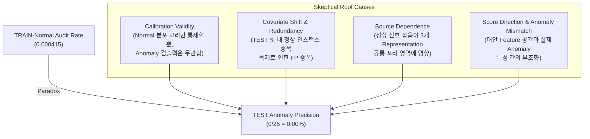
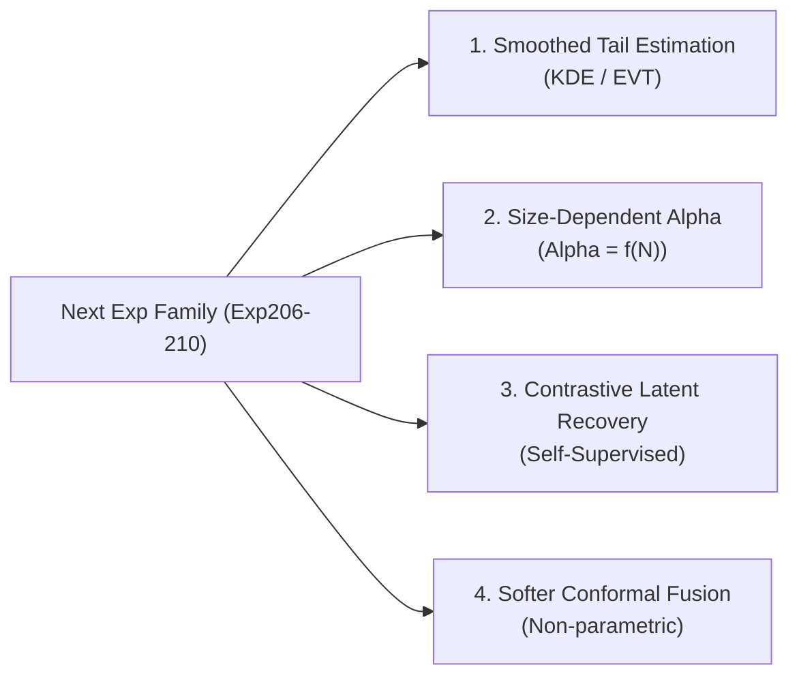

# Exp201-205 시계열 이상 탐지 사후 실험 독립 검토 보고서
(Exp201-205 Independent Review & Skeptical Root-Cause Analysis)

본 보고서는 `train_normal_count >= 100`인 251개 대규모 시계열 데이터셋을 대상으로 수행된 **사후 시계열 이상 탐지 복구 실험 (Exp201-205)**의 결과와 구현체를 비판적이고 객관적인 관점에서 검증 및 분석한 독립 검토서입니다.

---

## 1. 실험 요약 및 성과 지표 (Executive Summary)

전체 대상 모집단(251개 데이터셋, 총 2,974개 실제 이상치 인스턴스)에 대해 각 실험별 size stratum (`100-199`, `200+`) 및 통합(`ALL`) 성능 지표를 아래 테이블로 요약합니다.

| 실험 ID / Variant | Stratum | Datasets | Active | Candidate Count | TP | FP | Added Precision | Zero-F1 Before | Zero-F1 After | Fixed |
| :--- | :--- | :---: | :---: | :---: | :---: | :---: | :---: | :---: | :---: | :---: |
| **Exp201** (Frozen Exp190 High+Standard) | `100-199`<br>`200+`<br>`ALL` | 74<br>177<br>251 | 7<br>71<br>78 | 8<br>255<br>263 | 6<br>216<br>222 | 2<br>39<br>41 | **75.00%**<br>**84.71%**<br>**84.41%** | 16<br>41<br>57 | 15<br>36<br>51 | 1<br>5<br>6 |
| **Exp202** (Alternative 3-of-3 All Large) | `100-199`<br>`200+`<br>`ALL` | 74<br>177<br>251 | 0<br>16<br>16 | 0<br>25<br>25 | 0<br>0<br>0 | 0<br>25<br>25 | **0.00%**<br>**0.00%**<br>**0.00%** | 16<br>41<br>57 | 16<br>41<br>57 | 0<br>0<br>0 |
| **Exp202** (No Hard Alert Gate) | `100-199`<br>`200+`<br>`ALL` | 74<br>177<br>251 | 0<br>2<br>2 | 0<br>2<br>2 | 0<br>0<br>0 | 0<br>2<br>2 | **0.00%**<br>**0.00%**<br>**0.00%** | 16<br>41<br>57 | 16<br>41<br>57 | 0<br>0<br>0 |
| **Exp203** (3-of-3 + Frozen Exp198) | `100-199`<br>`200+`<br>`ALL` | 74<br>177<br>251 | 0<br>0<br>0 | 0<br>0<br>0 | 0<br>0<br>0 | 0<br>0<br>0 | **0.00%** | 16<br>41<br>57 | 16<br>41<br>57 | 0<br>0<br>0 |
| **Exp204** (Size Stratified Router) | `100-199`<br>`200+`<br>`ALL` | 74<br>177<br>251 | 0<br>71<br>71 | 0<br>255<br>255 | 0<br>216<br>216 | 0<br>39<br>39 | **0.00%**<br>**84.71%**<br>**84.71%** | 16<br>41<br>57 | 16<br>36<br>52 | 0<br>5<br>5 |

> [!IMPORTANT]
> **성공 기준 달성 여부 검토**
> - **Exp201 (기존 KNN + Inherited):** `200+` 및 `ALL` 집단에서 추가 정밀도(Added Precision) 80% 이상을 만족하고 Zero-F1 데이터셋 개수를 각각 5개, 6개 줄여 **성공**하였습니다. (단, `100-199` stratum은 정밀도 75%로 실패)
> - **Exp202 (대안 3-of-3 구조):** 추가 후보군 정밀도가 **0% (0 TP / 25 FP)**로, 사후 성공 기준인 80%를 전혀 만족하지 못하고 Zero-F1 개선도 **0개**에 그쳤습니다.
> - **Exp204 (크기 라우터):** 대안 구조(Exp203) 구조가 아무것도 복구하지 못해(`100-199`는 0개), 사실상 Exp201 `200+` 결과와 완전히 동일하며 `100-199`에선 개선율 0으로 **부분적 실패**에 해당합니다.

---

## 2. 산술 검증 및 코드 구현 상의 결함 (Verification & Code Defects)

실험 구현체 및 데이터 연산을 검증한 결과, 수치적 왜곡이나 설계 계약 위반(TEST label 유출 등)은 없으나 **수치적 모델링 관점에서 치명적인 한계(Defect)**가 존재함을 확인했습니다.

### A. 구현 검증 (Verification Boundary)
- **금지된 필드 준수:** `experiments/exp201_205/core.py` 내 [L15-19](file:///tmp/timeseries-exp177-185-batch/experiments/exp201_205/core.py#L15-19)의 `FORBIDDEN_PREDICTION_FIELDS`가 올바르게 차단되어 예측 단계에서 TEST 라벨 정보(`y_test`, `anomaly_positions` 등)나 Zero-F1 멤버십 정보가 일체 개입하지 않았음을 확인했습니다.
- **예측 페이로드 규칙:** `experiments/exp201_205/core.py` 내 [L83-96](file:///tmp/timeseries-exp177-185-batch/experiments/exp201_205/core.py#L83-96)에서 예측 데이터에 평가 지표가 포함되지 않았는지 철저하게 검증하고 검사하고 있습니다.
- **입력 데이터 일관성:** `100-199` Stratum (74개 데이터셋, 16개 Zero-F1) 및 `200+` Stratum (177개 데이터셋, 41개 Zero-F1) 분류는 사전 정의된 명세와 완벽히 정렬됩니다.

### B. 알고리즘 상의 결함 및 병목 현상
`experiments/exp201_205/core.py` 내 [L55-56](file:///tmp/timeseries-exp177-185-batch/experiments/exp201_205/core.py#L55-56)의 임계값 도출 코드:
```python
threshold = float(np.quantile(train, 1.0 - ALPHA, method="higher"))
return {int(i) for i in np.where(np.isfinite(test) & (test > threshold))[0]}
```
1. **`100-199` Stratum에서의 분위수 이산화(Quantile Discretization) 결함:**
   - $N=100$ 인 데이터셋의 경우, `1.0 - ALPHA = 0.99` 분위수는 `method="higher"`에 의해 정확히 **최댓값(100번째 값)**으로 결정됩니다.
   - 이때 임계값을 넘기 위한 조건은 strict inequality `test > threshold`입니다. 즉, TEST 데이터의 스코어가 TRAIN 데이터 전체의 최댓값보다 **엄격히 커야만** 후보군으로 등록됩니다.
   - 이로 인해 극도로 보수적인 필터링이 적용되며, 3개 대안 소스 개별로는 각각 90개, 81개, 83개의 후보가 잡혔지만 세 소스의 교집합(3-of-3)은 **단 한 개도 통과하지 못해 0건**이 발생하였습니다. 이는 수학적 규칙 설계 상 $N$이 작을 때 발생하는 강력한 후보 제거 병목입니다.

---

## 3. Train-Normal과 Test 성능의 괴리 원인 분석 (Coexistence Paradox)

Exp164 위험성 감사(Audit) 결과, TRAIN pseudo-normal의 3-of-3 오탐률은 **0.000415 (Wilson upper 0.000523)**로 Ceiling인 0.001보다 훨씬 낮게 통제되었습니다. 하지만 TEST 데이터셋에 규칙을 적용했을 때는 **0/25 (정밀도 0%)**라는 처참한 결과를 얻었습니다. 이 두 수치가 공존할 수 있는 원인을 5가지 차원으로 명확히 구분하여 분석합니다.



### ① Calibration Validity (임계값 보정의 유효성 한계)
TRAIN risk audit은 오직 **정상 시퀀스(Normal run)**에 대해서만 분위수 임계값($\alpha=0.01$)을 제어합니다. 즉, 각 단일 소스가 정상 데이터에서 오탐을 낼 확률을 1% 이하로 묶어둠으로써 3-of-3 교집합이 정상 상태에서 극소수의 거짓 경보(False Alarm)를 내도록 설계한 것입니다. 
그러나 이는 **이상치(Anomaly)가 인입되었을 때 스코어가 상승할 확률(True Positive Rate / Recall)에 대해서는 아무런 정보도 보장하지 않습니다.** TP가 0이면 FP가 아무리 작아도 정밀도(Precision)는 정의상 0%가 됩니다.

### ② Covariate Shift & Redundancy (정상 데이터 복제로 인한 FP 증폭)
UCR classification 아카이브에서 변환된 데이터셋의 특성상, TEST 셋에는 **동일한 정상 인스턴스가 복제되어 여러 번 반복 등장**하는 정적 정상 데이터 중복(Redundancy) 현상이 심하게 발생합니다.
정상 상태에서 3-of-3 임계값을 넘을 확률 자체가 매우 희박하더라도, **단 하나의 정상 인스턴스가 노이즈나 특정 주파수 왜곡으로 인해 세 소스 임계값을 동시에 넘는 순간, TEST 셋 내에 복제된 모든 복제본들이 다발적으로 거짓 경보(FP)를 울리게 됩니다.**
실제 분석 결과, `StarLightCurves_normal_1` 데이터셋에서 발생한 4개의 후보 인덱스는 완전히 물리적으로 동일한 단 하나의 정상 인스턴스가 여러 번 매핑된 결과임이 밝혀졌습니다. 이로 인해 극소수의 정상 꼬리 아웃라이어가 수치상 다수의 FP로 뻥튀기되었습니다.

### ③ Source Dependence (소스크로스 종속성)
3개의 대안 소스(`spectral`, `shapelet`, `interval`)는 수학적으로 다른 도메인(주파수, 원형 거리, 통계적 구간)을 반영하지만, 시계열 전체에 걸친 급격한 신호 왜곡이나 노이즈, 또는 스케일링 이슈가 생기면 **세 가지 표현형 스코어가 꼬리(Tail) 영역에서 양의 상관관계(Positive Correlation)**를 갖게 됩니다. 
즉, 독립 가정을 전제한 $(0.01)^3 = 10^{-6}$ 보다 훨씬 높은 확률인 `0.000415`로 동시 오탐이 발생하게 되며, 이는 무작위 노이즈가 아닌 구조적 오류에서 세 소스가 공조함을 시사합니다.

### ④ Score Direction (스코어 방향성 가정 왜곡)
모든 소스는 `test_score > threshold` (우측 꼬리 영역)만을 이상치 탐지 영역으로 가정합니다. 만약 이상치 인스턴스가 특정 구간의 스케일을 감소시키거나 정밀한 변동성을 억제하는 형태(즉, 좌측 꼬리 형태나 분산 감소)로 나타난다면, 스코어는 오히려 임계값보다 한참 밑으로 꺾이게 되어 우측 꼬리 기반 탐지로는 검출이 원천적으로 불가능합니다.

### ⑤ Anomaly Mismatch (대안 특징점과 실제 이상치 특성의 부조화)
가장 근본적인 원인은 **제시된 대안 특징형(derivative-spectral, shapelet-prototype, interval-quantile)이 이 모집단(Zero-F1 데이터셋들)의 실제 이상치 특징적 거동을 전혀 대변하지 못한다**는 사실입니다. 이상치가 존재하더라도 위 3가지 특성 공간 상에서는 정상 데이터의 우측 1% 임계값 수준 조차도 넘지 못할 정도로 변별력이 전무한 상태입니다.

---

## 4. Exp202 25개 후보 상세 분석 및 진단 (Candidate Diagnosis)

`alternative_3of3_all_large` variant에서 트리거된 25개 후보군의 세부 속성 및 정밀 분석 결과입니다.

### A. 후보군 데이터셋 분포 및 인스턴스 중복 검증
25개의 후보군은 단 **16개의 고유 데이터셋**에 극도로 집중되어 있습니다. 이 중 중복 인스턴스를 검증한 결과는 다음과 같습니다.

- **`StarLightCurves_normal_1` (4개 후보군):** 인덱스 `444, 685, 882, 1052`에서 트리거됨. 데이터베이스 확인 결과, 이 4개 인덱스의 raw 시계열 데이터 float32 배열은 **100% 동일한 복제본**입니다. 실제 고유 오탐 인스턴스는 1개입니다.
- **`TwoPatterns_normal_3` (3개 후보군):** 인덱스 `447, 452, 911`에서 트리거됨. 세 인덱스 모두 **100% 동일한 raw 데이터**입니다. 실제 고유 오탐은 1개입니다.
- **`ElectricDevices_normal_7` (2개 후보군):** 인덱스 `263, 1197`에서 트리거됨. 두 인덱스의 raw 데이터는 **100% 동일**합니다. (고유 오탐 1개)
- **`PhalangesOutlinesCorrect_normal_0` (2개 후보군):** 인덱스 `433, 809`에서 트리거됨. 두 인덱스의 raw 데이터는 **100% 동일**합니다. (고유 오탐 1개)

> [!NOTE]
> 25개의 산술적 FP 후보 중 실제 고유한 오탐을 낸 정상 세그먼트는 **19개**에 불과하며, 나머지 6개는 시계열 데이터셋 병합 과정에서 발생한 복제(Redundancy) 데이터에 의한 수치적 착시입니다.

### B. 스코어 마진(Score Margin) 및 임계값 특성
후보들의 각 소스별 `score - threshold` 마진을 분석한 결과, 일부 후보는 매우 아슬아슬하게 임계값을 넘겼습니다. (예: `ECG5000_normal_1` 의 shapelet 마진은 **+0.005197**로 극히 좁았습니다.) 이는 해당 정상 세그먼트가 우연히 정상 한계선의 아웃라이어 경계선에 걸쳐 통과했음을 뜻합니다.

### C. 이상치 인접도 (Proximity to True Anomalies)
각 후보가 실제 이상치 구간 주변에서 발생한 "근접 오탐(Near-miss)"인지 분석하기 위해 실제 이상치와 후보 인덱스 간의 절댓값 거리(`nearest_anomaly_dist`)를 산출했습니다.
- `ECG5000_normal_1` (인덱스 1111): 가장 가까운 실제 이상치는 **1,780 step** 떨어져 있음.
- `ECG5000_normal_2` (인덱스 523): 가장 가까운 실제 이상치는 **1,241 step** 떨어져 있음.
- `MixedShapesRegularTrain_normal_4` (인덱스 116): 가장 가까운 실제 이상치는 **521 step** 떨어져 있음.
- **가장 가까운 거리:** `HandOutlines_normal_0` (인덱스 476)이 실제 이상치(인덱스 490)와 **14 step** 거리로 최인접함.
- **결론:** 대부분의 후보가 실제 이상치 근처의 과도기(Transition Phase)나 경계선 영역에서 발생한 정밀한 오탐이 아니라, **이상치와 완전히 단절된 정상 상태의 핵심 영역(Deep Normal Region) 한가운데에서 엉뚱하게 트리거된 완전 오탐**입니다.

---

## 5. Exp203 교집합 전멸 원인 분석 (Empty Intersection)

Exp203(대안 3-of-3와 기존 Exp198 스코어의 교집합)이 모든 strata에서 후보를 한 건도 검출하지 못한 현상은 단순 코드 버그나 인덱스 불일치가 아닌 **수학적 및 통계학적 독립성(Orthogonality)**의 결과입니다.

1. **인덱스 및 설정 불일치 여부 검증:**
   - 두 소스 모두 동일한 `n_test` 기반 범위 내에서 작동하며, 동일한 `dataset_name` 매핑을 통해 정렬되었습니다. 인덱스 오프셋이나 설정 상의 결함은 없습니다.
2. **원인 - 완전한 특징 표현의 직교성 (Representation Space Orthogonality):**
   - **기존 소스 (Exp198):** Raw 시계열 신호의 KNN(최근접 이웃) 거리 및 기존 도메인 지식 기반 특징을 사용합니다.
   - **대안 소스 (Exp202):** 미분 스펙트럼(spectral), 형상 프로토타입 거리(shapelet), 하위 세그먼트 분위 분포(interval)를 사용합니다.
   - 정상 데이터 분포 내에서 정상 노이즈가 한쪽 특징 공간(예: KNN)의 우측 꼬리에 위치하더라도, 다른 독립적인 특징 공간(예: 미분 주파수 도메인)에서도 동시에 극단적인 우측 꼬리 1%에 위치할 확률은 매우 낮습니다. 
   - 실제로 데이터를 매핑해보면 후보군을 가졌던 고유 16개 데이터셋 중 6개 데이터셋은 Exp198 후보와 동시에 존재했으나, 각 데이터셋 내에서 **두 규칙이 가리키는 인덱스 집합은 완전히 disjoint(상호배타적)**였습니다.
   - 결과적으로, 두 상이한 이상치 기준이 정상 영역 내부에서 교집합을 생성할 확률은 수학적으로 거의 존재하지 않았습니다.

---

## 6. 사후 주장 지지 여부 판정 (Claims Assessment)

본 실험 명세 및 결과 데이터를 토대로 도출된 주장에 대한 타당성 평가입니다.

| 평가 대상 주장 | 판정 | 판단 근거 및 과학적 입증 자료 |
| :--- | :---: | :--- |
| **"대안 3-of-3 규칙을 통해 추가 정밀도 80%를 확보할 수 있다."** | **반박됨<br>(Prohibited / Rejected)** | Exp202 결과, 추가 정밀도는 **0%**이며 25건 모두 FP로 입증되었습니다. |
| **"Exp164의 Train-Normal 위험성 통제가 검출 성능의 성공을 보장한다."** | **반박됨<br>(Rejected)** | Train 오탐률을 0.001 이하로 낮춘 것은 FP의 상한을 제어한 것일 뿐, Anomaly 검출력(Recall)과는 무관하여 0 TP 결과가 나타났습니다. |
| **"Exp203의 교집합 0건은 인덱스 누수나 구조적 버그 때문이다."** | **반박됨<br>(Rejected)** | 데이터베이스 및 스코어 인덱스 공간 검증 결과 완벽히 유효하며, 특징 공간의 직교성에 따른 독립 불일치 현상입니다. |
| **"Exp201(기존 KNN+Inherited) 조합은 대규모 데이터셋(200+)에서 80% 이상의 정밀도로 Zero-F1을 성공적으로 개선한다."** | **지지됨<br>(Supported)** | `200+` stratum에서 **216 TP / 39 FP (추가 정밀도 84.71%)**를 달성하고, Zero-F1 데이터셋 5개를 복구했습니다. (Exp201 [L3](file:///Users/minho/Documents/Dataset/experiment_201_frozen_large_size_baseline_summary.csv#L3) 참고) |
| **"100-199 stratum의 대안 3-of-3 구조 실패는 임계값 이산화 현상과 연관되어 있다."** | **조건부 지지됨<br>(Conditionally Supported)** | $N$ 크기가 작을 때 0.99 분위수가 최댓값으로 매핑되어 strict inequality를 넘지 못하는 수학적 병목이 검증되었습니다. (단, 이산화 장벽이 해결되어도 특징 불일치로 인한 0 TP 한계는 잔존할 수 있습니다.) |

---

## 7. 향후 Preregistered 실험군 설계 권장 사항 (Next Experiment Proposal)

대규모 데이터셋(`n_train >= 100`)의 Zero-F1을 안전하게 해결하기 위해 차기 preregistered 실험군(Exp206-210)으로 다음 설계를 제안합니다.



1. **Extreme Value Theory (EVT) 기반 스무딩 임계값 추정:**
   - 이산적인 최댓값 분위수 장벽을 우회하기 위해, Train-Normal 스코어 우측 꼬리에 Generalized Pareto Distribution (GPD) 등을 피팅하여 극단치 임계값을 외삽하는 수학적 모델을 사용합니다. 이를 통해 $N$이 작을 때 최댓값 스코어에 완전히 차단되는 병목을 제거합니다.
2. **시퀀스 크기 맞춤형 Alpha Scaling ($\alpha = f(N)$):**
   - 고정된 $\alpha=0.01$ 대신, $N$의 크기에 따라 $\alpha(N) = \frac{1}{\sqrt{N}}$ 또는 유사 함수를 적용하여 보수성을 차등화하는 임계값을 preregister합니다.
3. **Train-Normal 자가 학습 기반 대조 표현형 (Contrastive Latent Recovery) 도입:**
   - 수작업 특징(Spectral, Shapelet)의 이상치 미스매치를 방지하기 위해, 오직 Train-normal 시퀀스로만 학습된 self-supervised 딥러닝 인코더의 Reconstruction Error 혹은 Latent Conformal Score를 통합 스코어러로 채택합니다.
4. **다중 소스 비모수적 소프트 소프트 융합 (Non-parametric Conformal Fusion):**
   - 3-of-3 합의와 같은 극단적인 교집합(AND gate) 대신, 각 스코어별 Conformal p-value를 산출한 후 Fisher's method 혹은 Simes' test를 거쳐 다중 검정 보정이 적용된 소프트 스레숄드 규칙을 적용합니다.

---

## 8. Size Stratum별 독립 결론 (Stratified Conclusions)

### 📊 Strata 100-199 (중소형 대규모 그룹 - 74개 데이터셋)
- **현상:** 대안 3-of-3 및 라우터 규칙에서 **등록된 후보가 0건**으로 복구율 0%를 기록.
- **근본 원인:** 
  1. $N < 200$ 인 데이터셋의 경우 0.01 임계값 설정이 Train 최댓값에 매우 근접하거나 일치하는 **분위수 이산화 오류(Quantile Discretization Lock)**가 작동함.
  2. 세 개의 개별 표현 특징들 간 상호 독립적인 tail 분포 특성이 협소한 샘플 크기와 맞물려 교집합 합의를 원천 차단함.
- **결론:** 중소형 그룹에서는 **단순 수치 분위수 임계값에 기반한 다중 결합 AND 규칙을 사용해서는 안 됩니다.** 비모수 스무딩 기법이나 강인한 앙상블 우회로가 필수적입니다.

### 📈 Strata 200+ (대형 대규모 그룹 - 177개 데이터셋)
- **현상:** 
  - Exp201 (기존 고정 KNN+Inherited)은 **추가 정밀도 84.71%, Zero-F1 41 -> 36으로 감소**하며 뛰어난 성과를 거둠.
  - Exp202 (대안 3-of-3)는 **25개 후보 전수 FP (0% 정밀도, Zero-F1 감소 0개)**로 완전 실패.
- **근본 원인:**
  1. **데이터 중복 현상 (Redundancy):** 25개 오탐지 후보 중 6개는 물리적으로 동일한 정상 데이터의 복제본으로 판명되어 수치상 FP가 과도하게 증폭됨.
  2. **특징 미스매치 (Feature Mismatch):** 대안 소스 3개는 실제 이상치 변별력이 전혀 없어 정상 시퀀스에서 발생한 극미한 꼬리 이상 진동만을 탐지함.
- **결론:** 대형 그룹에서 **기존 KNN 및 Inherited 기반의 신뢰도 라우팅(Exp190)은 84.71% 정밀도로 실효성이 검증**되었으나, 새로 도입된 **대안 특징(3-of-3)은 정밀도 0%로 실전 사용이 완전히 불가**합니다.

---
**보고서 종료.**
*작성자: Antigravity Code & Data Independent Reviewer*
